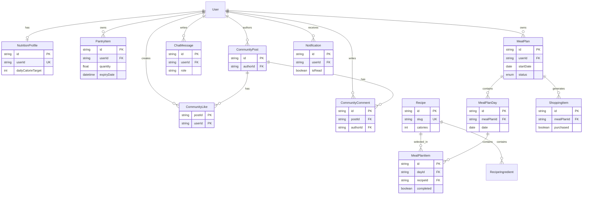

# REPORT NOURI — LƯỢT 1: KHẢO SÁT NỀN TẢNG HỆ THỐNG

Phạm vi: khảo sát code, cấu hình, Prisma schema/migration, route/page và tích hợp AI hiện có trong project. Báo cáo phản ánh trạng thái thể hiện bởi source code; không suy luận về chức năng chưa có bằng chứng.

## 1. TỔNG QUAN HỆ THỐNG

### 1.1 Bài toán hệ thống đang giải quyết

Nouri là ứng dụng quản lý thực phẩm trong gia đình và lập kế hoạch bữa ăn/dinh dưỡng cá nhân hóa. Code thể hiện các mục tiêu chính:

- Quản lý thực phẩm trong kho, số lượng, nơi bảo quản và hạn sử dụng; tạo cảnh báo sắp hết hạn/hết hàng. Bằng chứng: `backend/src/modules/pantry/pantry.service.ts` (`listPantryItems`, `createPantryItem`, `updatePantryItem`, `deletePantryItem`), `backend/src/modules/notifications/notifications.service.ts` (`syncPantryNotifications`), `frontend/src/pages/PantryPage.tsx` (`getStatus`, `expiryCopy`).
- Quản lý hồ sơ dinh dưỡng, mục tiêu, chế độ ăn, dị ứng, thực phẩm không thích và khẩu vị; tính chỉ tiêu calorie/macro. Bằng chứng: `backend/src/modules/profile/profile.service.ts` (`updateProfile`), `backend/src/services/nutrition.service.ts` (`calculateNutritionTargets`), `frontend/src/pages/ProfilePage.tsx` (`ProfilePage`).
- Tra cứu công thức và nguyên liệu của công thức. Bằng chứng: `backend/src/modules/recipes/recipes.service.ts` (`listRecipes`, `getRecipe`), `frontend/src/pages/RecipesPage.tsx` (`RecipesPage`).
- Tạo thực đơn 7 ngày, tổng hợp nguyên liệu còn thiếu thành danh sách mua sắm và theo dõi trạng thái hoàn thành. Bằng chứng: `backend/src/modules/meal-plans/meal-plans.service.ts` (`generateWeeklyPlan`, `updateMealCompletion`, `updateShoppingPurchased`), `frontend/src/pages/MealPlansPage.tsx` (`MealPlansPage`).
- Hỏi đáp dinh dưỡng theo hồ sơ và kho thực phẩm của người dùng. Bằng chứng: `backend/src/modules/ai/chat.service.ts` (`sendChatMessage`), `backend/src/modules/ai/openai.service.ts` (`answerNutritionQuestion`), `frontend/src/pages/AiAssistantPage.tsx` (`AiAssistantPage`).
- Dashboard tổng hợp dinh dưỡng, kho, thực đơn hôm nay và công thức gợi ý. Bằng chứng: `backend/src/modules/dashboard/dashboard.service.ts` (`getDashboard`), `frontend/src/pages/DashboardPage.tsx` (`DashboardPage`).
- Cộng đồng bài viết, lượt thích và bình luận; thông báo tương tác. Bằng chứng: `backend/src/modules/community/community.service.ts`, `backend/src/modules/notifications/notifications.service.ts`, `frontend/src/pages/CommunityPage.tsx`.

README cũng mô tả mục tiêu giảm lãng phí thực phẩm, cân bằng dinh dưỡng và cá nhân hóa khẩu vị (`README.md`).

### 1.2 Các module chính hiện có

| Module | Mô tả một dòng | Bằng chứng |
|---|---|---|
| Auth | Đăng ký, đăng nhập, phát hành JWT và kết thúc phiên ở frontend | `backend/src/modules/auth/`, `frontend/src/features/auth/`, `frontend/src/contexts/AuthContext.tsx` |
| Profile | Hồ sơ cá nhân và chỉ tiêu dinh dưỡng | `backend/src/modules/profile/`, `frontend/src/features/profile/` |
| Pantry | CRUD thực phẩm trong kho và dữ liệu hạn sử dụng | `backend/src/modules/pantry/`, `frontend/src/features/pantry/` |
| Recipes | Danh sách/lọc và chi tiết công thức | `backend/src/modules/recipes/`, `frontend/src/features/recipes/` |
| Meal Plans | Tạo, xem, kích hoạt, hoàn thành thực đơn; danh sách mua sắm nằm trong module này | `backend/src/modules/meal-plans/`, `frontend/src/features/meal-plans/` |
| AI | Lập thực đơn bằng OpenAI hoặc thuật toán dự phòng; chat dinh dưỡng | `backend/src/modules/ai/`, `backend/src/modules/meal-plans/meal-plans.service.ts` |
| Dashboard | Tổng hợp dữ liệu cho màn hình tổng quan | `backend/src/modules/dashboard/`, `frontend/src/features/dashboard/` |
| Community | Feed bài viết, like, comment | `backend/src/modules/community/`, `frontend/src/features/community/` |
| Notifications | Sinh, đọc và đánh dấu thông báo | `backend/src/modules/notifications/`, `frontend/src/features/notifications/`, `frontend/src/components/notifications/` |

Không thấy module backend độc lập tên `shopping`; danh sách mua sắm được tạo và cập nhật trong `backend/src/modules/meal-plans/meal-plans.service.ts` (`generateWeeklyPlan`, `updateShoppingPurchased`).

### 1.3 Kiến trúc tổng thể và luồng dữ liệu

Đây là kiến trúc frontend/backend tách riêng, với backend dạng modular monolith; chưa thấy dấu hiệu microservice. Bằng chứng cấu hình workspace: `package.json`, `frontend/package.json`, `backend/package.json`.

```text
React SPA (Vite)
  -> Axios REST client (/api)
  -> Express backend
  -> middleware: CORS, Helmet, JSON, JWT auth, Zod validation, error handler
  -> module route -> controller -> service
  -> Prisma Client
  -> PostgreSQL

Meal plan / AI chat:
  Frontend -> backend AI/meal-plan service
  backend lấy profile + pantry + recipes
  -> OpenAI Responses API nếu có OPENAI_API_KEY
  -> fallback rule-based cho meal plan hoặc fallback text cho chat
  -> lưu MealPlan/ChatMessage vào PostgreSQL
```

Bằng chứng frontend khởi tạo SPA/router/query/auth: `frontend/src/main.tsx` (`createRoot`), `frontend/src/App.tsx` (`App`, `ProtectedRoute`), `frontend/src/api/client.ts` (`api`), `frontend/src/contexts/AuthContext.tsx` (`AuthProvider`). Bằng chứng backend đăng ký route và middleware: `backend/src/app.ts` (`app`, các `app.use`). Bằng chứng Docker production route frontend `/api` tới backend: `frontend/nginx.conf`, `docker-compose.yml`.

Luồng xác thực: frontend lưu token/user trong `localStorage`, Axios gắn `Authorization: Bearer ...`, backend giải JWT và đưa `userId` vào request. Bằng chứng: `frontend/src/features/auth/auth.storage.ts`, `frontend/src/api/client.ts`, `backend/src/middleware/auth.ts` (`requireAuth`).

### 1.4 Công nghệ

| Tầng | Công nghệ/phiên bản thể hiện trong project | Bằng chứng |
|---|---|---|
| Frontend | React `^19.0.0`, React DOM `^19.0.0`, TypeScript `~5.7.2`, Vite `^6.1.0` | `frontend/package.json` |
| Frontend routing/data | React Router DOM `^7.2.0`, TanStack React Query `^5.66.9`, Axios `^1.8.1` | `frontend/package.json`, `frontend/src/App.tsx`, `frontend/src/api/` |
| UI/interaction | GSAP `^3.15.0`, `@gsap/react ^2.1.2`, Lucide React `^0.475.0`, Recharts `^2.15.1`, date-fns `^4.1.0` | `frontend/package.json`, các page trong `frontend/src/pages/` |
| Backend runtime | Node.js `22-alpine` trong Docker, Express `^5.1.0`, TypeScript `^5.8.2` | `backend/Dockerfile`, `backend/package.json` |
| Backend middleware/security | CORS `^2.8.5`, Helmet `^8.1.0`, dotenv `^16.4.7`, bcryptjs `^3.0.2`, jsonwebtoken `^9.0.2`, Zod `^3.24.2` | `backend/package.json`, `backend/src/app.ts`, `backend/src/middleware/` |
| Database/ORM | PostgreSQL `16-alpine`, Prisma/Prisma Client `^6.5.0` | `docker-compose.yml`, `backend/package.json`, `backend/prisma/schema.prisma` |
| AI SDK | OpenAI SDK `^5.0.0`, Responses API và structured output bằng Zod | `backend/package.json`, `backend/src/modules/ai/openai.service.ts` |

### 1.5 Dịch vụ bên ngoài

- PostgreSQL chạy bằng service Docker và được Prisma truy cập qua `DATABASE_URL`. Bằng chứng: `docker-compose.yml`, `backend/prisma/schema.prisma` (`datasource db`), `backend/src/lib/prisma.ts`.
- OpenAI Responses API là tích hợp AI tùy chọn; frontend không gọi trực tiếp OpenAI. Bằng chứng: `backend/src/modules/ai/openai.service.ts` (`new OpenAI`, `responses.parse`, `responses.create`), `frontend/src/features/ai/ai.api.ts`, `docs/ARCHITECTURE.md`.
- Google Fonts được import từ URL ngoài trong CSS. Bằng chứng: `frontend/src/styles.css` (`@import url(...)`). Đây là tài nguyên giao diện, không phải dịch vụ nghiệp vụ.
- Không tìm thấy code tích hợp email/SMTP, upload ảnh/cloud storage, OAuth hoặc payment. Các asset hiện có nằm trong `frontend/public/assets/` và được tham chiếu trực tiếp từ frontend; không thấy endpoint upload.

### 1.6 Tên biến môi trường

Chỉ liệt kê tên, không liệt kê giá trị:

| Biến | Nơi khai báo/đọc | Trạng thái theo code |
|---|---|---|
| `VITE_API_URL` | `frontend/.env.example`, `frontend/src/api/client.ts` | Tùy chọn; mặc định về `/api` nếu không có |
| `NODE_ENV` | `backend/.env.example`, `backend/src/config/env.ts` | Có giá trị mặc định theo schema |
| `PORT` | `backend/.env.example`, `backend/src/config/env.ts`, `backend/src/server.ts` | Có giá trị mặc định |
| `FRONTEND_URL` | `backend/.env.example`, `backend/src/config/env.ts`, `backend/src/app.ts` | Có giá trị mặc định; dùng cho CORS |
| `DATABASE_URL` | `backend/.env.example`, `backend/src/config/env.ts`, `backend/prisma/schema.prisma` | Bắt buộc theo schema môi trường |
| `JWT_SECRET` | `backend/.env.example`, `backend/src/config/env.ts`, `backend/src/modules/auth/auth.service.ts`, `backend/src/middleware/auth.ts` | Bắt buộc; schema yêu cầu độ dài tối thiểu |
| `OPENAI_API_KEY` | `backend/.env.example`, `backend/src/config/env.ts`, `backend/src/modules/ai/openai.service.ts` | Tùy chọn; thiếu thì AI chat trả fallback và meal plan dùng fallback |
| `OPENAI_MODEL` | `backend/.env.example`, `backend/src/config/env.ts`, `backend/src/modules/ai/openai.service.ts` | Có giá trị mặc định |

### 1.7 Cấu trúc thư mục chính

```text
.
├── frontend/
│   ├── src/
│   │   ├── api/
│   │   ├── components/
│   │   ├── contexts/
│   │   ├── features/
│   │   ├── layouts/
│   │   ├── pages/
│   │   └── types/
│   └── public/assets/
├── backend/
│   ├── prisma/
│   │   ├── migrations/
│   │   ├── schema.prisma
│   │   └── seed.ts
│   └── src/
│       ├── config/
│       ├── lib/
│       ├── middleware/
│       ├── modules/
│       ├── services/
│       ├── types/
│       └── utils/
├── docs/
├── output/
├── scripts/
├── docker-compose.yml
├── package.json
└── README.md
```

Bằng chứng cấu trúc: danh sách file/thư mục hiện có trong project; các thư mục `node_modules/`, `.git/`, `.agents/`, `.codex/` không phải module nghiệp vụ của Nouri.

## 2. ACTOR

| Actor | Mô tả | Bằng chứng |
|---|---|---|
| Guest | Người chưa đăng nhập; xem landing/login và thực hiện đăng ký/đăng nhập | `frontend/src/App.tsx` (`LandingPage`, `LoginPage`, `ProtectedRoute`), `backend/src/modules/auth/auth.routes.ts` (`/register`, `/login` không gắn `requireAuth`) |
| Authenticated User | Người dùng đã có JWT; sử dụng hồ sơ, kho, thực đơn, công thức, dashboard, cộng đồng, AI và thông báo | `backend/src/middleware/auth.ts` (`requireAuth`), `backend/src/modules/*/*.routes.ts` (các router có `router.use(requireAuth)`), `frontend/src/layouts/AppLayout.tsx` (`user`, `logout`) |
| OpenAI/AI service | Dịch vụ ngoài tùy chọn dùng để sinh kế hoạch và trả lời chat; backend là nơi gọi dịch vụ | `backend/src/modules/ai/openai.service.ts` (`createOpenAIService`, `requestMealPlan`, `requestNutritionAnswer`), `backend/src/modules/meal-plans/meal-plans.service.ts` (`generatePlanWithAI`) |

Không có bằng chứng về actor `Admin` hoặc phân quyền theo role: `User` trong `backend/prisma/schema.prisma` không có trường role và các route protected chỉ dùng `requireAuth`, không có middleware role. Đây là điểm `UNCLEAR` nếu đồ án dự kiến có quản trị viên.

## 3. ROUTE / PAGE (FRONTEND)

Tổng số route frontend được khai báo trong `frontend/src/App.tsx`: **9 route** (gồm index, login và 7 route protected). `ProtectedRoute` kiểm tra token frontend; backend vẫn kiểm tra JWT tại API.

| Path | Component/File | Mô tả | Yêu cầu đăng nhập? | Role | Dữ liệu (Thật/Mock/Không rõ) |
|---|---|---|---|---|---|
| `/` | `frontend/src/pages/LandingPage.tsx` — `LandingPage` | Landing/marketing, giới thiệu tính năng, carousel công thức và CTA | Không | Guest | **Mock/static**: `features`, `recipes`, `communityHighlights`, `aboutValues` là hằng số trong file; không gọi API |
| `/login` | `frontend/src/pages/LoginPage.tsx` — `LoginPage` | Form chuyển đổi đăng nhập/đăng ký | Không | Guest | **Thật**: gọi `auth.login`/`auth.register` từ `frontend/src/contexts/AuthContext.tsx` -> `frontend/src/features/auth/auth.api.ts` |
| `/dashboard` | `frontend/src/pages/DashboardPage.tsx` — `DashboardPage` | Tổng quan kho, hạn sử dụng, calorie, bữa hôm nay, công thức gợi ý | Có | User | **Thật + fallback/local**: GET dashboard qua `dashboardQueries`; công thức fallback trong `frontend/src/features/dashboard/dashboard.logic.ts` (`dashboardFallbackRecipes`), lượng nước chỉ là state local trong page |
| `/pantry` | `frontend/src/pages/PantryPage.tsx` — `PantryPage` | Xem/lọc/thêm/sửa/xóa thực phẩm, hiển thị trạng thái hạn dùng | Có | User | **Thật**: CRUD qua `frontend/src/features/pantry/pantry.api.ts`; lọc, phân trang và trạng thái là xử lý local |
| `/meal-plans` | `frontend/src/pages/MealPlansPage.tsx` — `MealPlansPage` | Xem thực đơn, sinh thực đơn, kích hoạt, hoàn thành bữa và đánh dấu mua | Có | User | **Thật**: dùng `frontend/src/features/meal-plans/meal-plans.api.ts`; backend có AI/fallback |
| `/recipes` | `frontend/src/pages/RecipesPage.tsx` — `RecipesPage` | Tìm/lọc/sắp xếp/phân trang công thức | Có | User | **Thật + local**: danh sách từ `recipeQueries.list`; trạng thái favorite chỉ là `useState` trong page, không có API/model tương ứng |
| `/community` | `frontend/src/pages/CommunityPage.tsx` — `CommunityPage` | Feed bài viết, đăng bài, like, comment | Có | User | **Thật + local/static**: feed/post/like/comment gọi API; saved/follow và danh sách chủ đề/thành viên nổi bật có state/hằng số local |
| `/assistant` | `frontend/src/pages/AiAssistantPage.tsx` — `AiAssistantPage` | Chat AI và hiển thị context hồ sơ/kho/thực đơn | Có | User | **Thật + fallback**: history/chat/dashboard/profile từ API; lịch sử mẫu dùng khi history rỗng trong `frontend/src/features/ai/ai.logic.ts` (`assistantFallbackHistory`) |
| `/profile` | `frontend/src/pages/ProfilePage.tsx` — `ProfilePage` | Xem/sửa hồ sơ và chỉ tiêu dinh dưỡng | Có | User | **Thật**: GET/PUT profile qua `frontend/src/features/profile/profile.api.ts` |

Không có route frontend riêng cho `/recipes/:id` hoặc `/meal-plans/:id`; các hàm API/query detail có tồn tại nhưng chưa thấy page runtime gọi chúng. Bằng chứng: `frontend/src/features/recipes/recipes.api.ts` (`getRecipe`), `frontend/src/features/recipes/recipes.queries.ts` (`detail`), `frontend/src/features/meal-plans/meal-plans.api.ts` (`getMealPlan`), `frontend/src/features/meal-plans/meal-plans.queries.ts` (`detail`), và không có route tương ứng trong `frontend/src/App.tsx`.

## 4. API ENDPOINT (BACKEND)

Base path được đăng ký trong `backend/src/app.ts` là `/api`. Tổng số endpoint HTTP được khai báo: **29**, gồm health, auth, community, notifications, profile, pantry, recipes, meal-plans, AI và dashboard.

| METHOD | URL | Chức năng | Controller/Handler | Service | Yêu cầu auth? | Role | FE có gọi không? |
|---|---|---|---|---|---|---|---|
| GET | `/api/health` | Kiểm tra trạng thái API | inline handler trong `backend/src/app.ts` | Không có | Không | Guest | Không thấy gọi trong `frontend/src` |
| POST | `/api/auth/register` | Tạo tài khoản và profile rỗng | `registerController` — `backend/src/modules/auth/auth.controller.ts` | `register` — `auth.service.ts` | Không | Guest | Có: `frontend/src/features/auth/auth.api.ts` (`register`) |
| POST | `/api/auth/login` | Đăng nhập, trả JWT và user | `loginController` | `login` — `auth.service.ts` | Không | Guest | Có: `auth.api.ts` (`login`) |
| GET | `/api/community` | Lấy feed bài viết | `listCommunityPostsController` | `listCommunityPosts` — `community.service.ts` | Có | User | Có: `frontend/src/features/community/community.api.ts` (`listCommunityPosts`) |
| POST | `/api/community` | Đăng bài viết | `createCommunityPostController` | `createCommunityPost` | Có | User | Có: `publishCommunityPost` |
| POST | `/api/community/:postId/like` | Bật/tắt like bài viết | `toggleCommunityLikeController` | `toggleCommunityLike` | Có | User | Có: `toggleCommunityLike` |
| POST | `/api/community/:postId/comments` | Thêm bình luận | `addCommunityCommentController` | `addCommunityComment` | Có | User | Có: `addCommunityComment` |
| GET | `/api/notifications` | Liệt kê thông báo, lọc all/unread và limit | `listNotificationsController` | `listNotifications` | Có | User | Có: `listNotifications`, `NotificationCenter.tsx` |
| GET | `/api/notifications/unread-count` | Đếm thông báo chưa đọc | `unreadNotificationCountController` | `getUnreadNotificationCount` | Có | User | Có: `getUnreadNotificationCount` |
| PATCH | `/api/notifications/read-all` | Đánh dấu tất cả đã đọc | `markAllNotificationsReadController` | `markAllNotificationsRead` | Có | User | Có: `markAllNotificationsRead` |
| PATCH | `/api/notifications/:id/read` | Đánh dấu một thông báo đã đọc | `markNotificationReadController` | `markNotificationRead` | Có | User | Có: `markNotificationRead` |
| GET | `/api/profile` | Lấy profile và thông tin user | `getProfileController` | `getProfile` — `profile.service.ts` | Có | User | Có: `getProfile` |
| PUT | `/api/profile` | Cập nhật profile và tính lại target | `updateProfileController` | `updateProfile` | Có | User | Có: `updateProfile` |
| GET | `/api/pantry` | Liệt kê thực phẩm của user | `listPantryController` | `listPantryItems` — `pantry.service.ts` | Có | User | Có: `listPantryItems` |
| POST | `/api/pantry` | Thêm thực phẩm | `createPantryController` | `createPantryItem` | Có | User | Có: `createPantryItem` |
| PUT | `/api/pantry/:id` | Sửa thực phẩm | `updatePantryController` | `updatePantryItem` | Có | User | Có: `updatePantryItem` |
| DELETE | `/api/pantry/:id` | Xóa thực phẩm | `deletePantryController` | `deletePantryItem` | Có | User | Có: `deletePantryItem` |
| GET | `/api/recipes` | Tìm/lọc công thức theo `search`, `cuisine` | `listRecipesController` — `recipes.controller.ts` | `listRecipes` — `recipes.service.ts` | Có | User | Có: `listRecipes` |
| GET | `/api/recipes/:id` | Lấy chi tiết công thức | `getRecipeController` | `getRecipe` | Có | User | Chưa thấy component runtime gọi; chỉ có `getRecipe`/query detail trong `frontend/src/features/recipes/` và test |
| GET | `/api/meal-plans` | Liệt kê thực đơn của user | `listMealPlansController` — `meal-plans.controller.ts` | `listMealPlans` — `meal-plans.service.ts` | Có | User | Có: `listMealPlans` |
| GET | `/api/meal-plans/:id` | Lấy chi tiết thực đơn | `getMealPlanController` | `getMealPlan` | Có | User | Chưa thấy component runtime gọi; chỉ có API/query detail và test |
| POST | `/api/meal-plans/generate` | Sinh thực đơn 7 ngày và shopping items | `generateMealPlanController` | `generateWeeklyPlan` | Có | User | Có: `generateMealPlan` |
| PATCH | `/api/meal-plans/:id/status` | Đổi trạng thái DRAFT/ACTIVE/COMPLETED | `updateMealPlanStatusController` | `updateMealPlanStatus` | Có | User | Có: `updateMealPlanStatus` |
| PATCH | `/api/meal-plans/items/:id` | Đánh dấu bữa ăn hoàn thành | `updateMealCompletionController` | `updateMealCompletion` | Có | User | Có: `updateMealCompletion` |
| PATCH | `/api/meal-plans/shopping/:id` | Đánh dấu nguyên liệu đã mua | `updateShoppingPurchasedController` | `updateShoppingPurchased` | Có | User | Có: `updateShoppingPurchased` |
| DELETE | `/api/meal-plans/:id` | Xóa thực đơn | `deleteMealPlanController` | `deleteMealPlan` | Có | User | Có trong `meal-plans.api.ts` (`deleteMealPlan`), chưa thấy nút gọi rõ trong đoạn runtime page đã khảo sát |
| GET | `/api/ai/history` | Lấy tối đa 50 tin nhắn chat | `listChatHistoryController` — `ai.controller.ts` | `listChatHistory` — `chat.service.ts` | Có | User | Có: `getChatHistory` |
| POST | `/api/ai/chat` | Gửi câu hỏi dinh dưỡng và lưu cặp user/assistant | `sendChatMessageController` | `sendChatMessage` -> `answerNutritionQuestion` -> OpenAI/fallback | Có | User | Có: `sendChatMessage` |
| GET | `/api/dashboard` | Lấy dữ liệu tổng quan | `getDashboardController` — `dashboard.controller.ts` | `getDashboard` — `dashboard.service.ts` | Có | User | Có: `dashboard.api.ts` và `ai.api.ts` (`getAssistantDashboard`) |

Các route có `validate(...)` dùng schema Zod tương ứng trong `backend/src/modules/*/*.schema.ts`. Không có middleware role riêng trong code.

## 5. DATABASE

### 5.1 Danh sách model/table và trường chính

Schema nguồn: `backend/prisma/schema.prisma`; migration hiện có trong `backend/prisma/migrations/` gồm init, community, notifications và storage location.

| Model/table | Trường chính và kiểu dữ liệu quan trọng |
|---|---|
| `User` | `id String` PK, `email String` unique, `passwordHash String`, `name String`, `createdAt/updatedAt DateTime` |
| `NutritionProfile` | `id String` PK, `userId String` unique, `age Int?`, `gender Gender?`, `heightCm/weightKg/targetWeightKg Float?`, `activityLevel ActivityLevel`, `goal HealthGoal`, `dietType DietType`, `allergies/dislikedFoods/preferredCuisines String[]`, `mealsPerDay Int`, `dailyCalorieTarget/proteinTargetG/carbTargetG/fatTargetG Int?` |
| `PantryItem` | `id`, `userId`, `name/category String`, `quantity/minimumStock Float`, `unit FoodUnit`, `storageLocation StorageLocation`, `expiryDate DateTime?`, `purchasedAt DateTime`, `note String?`, timestamps |
| `Recipe` | `id`, `slug String` unique, `name/description String`, `instructions String[]`, `prepMinutes/cookMinutes/servings/calories Int`, `proteinG/carbsG/fatG/fiberG Float`, `dietTags DietType[]`, `cuisine String`, `imageUrl String?`, timestamps |
| `RecipeIngredient` | `id`, `recipeId`, `name String`, `quantity Float`, `unit FoodUnit`, `optional Boolean` |
| `MealPlan` | `id`, `userId`, `name String`, `startDate/endDate DateTime`, `status PlanStatus`, `calorieTarget Int`, `aiGenerated Boolean`, `summary String?`, timestamps |
| `MealPlanDay` | `id`, `mealPlanId`, `date DateTime`, `note String?`; unique theo `mealPlanId + date` |
| `MealPlanItem` | `id`, `dayId`, `recipeId`, `mealType MealType`, `servings Float`, `completed Boolean`, `calories Int` |
| `ShoppingItem` | `id`, `mealPlanId`, `name String`, `quantity Float`, `unit FoodUnit`, `purchased Boolean`, `category String?` |
| `ChatMessage` | `id`, `userId`, `role String`, `content String`, `createdAt DateTime` |
| `CommunityPost` | `id`, `authorId`, `content String`, `createdAt/updatedAt DateTime` |
| `CommunityLike` | khóa ghép `postId + userId`, hai FK, `createdAt DateTime` |
| `CommunityComment` | `id`, `postId`, `authorId`, `content String`, `createdAt/updatedAt DateTime` |
| `Notification` | `id`, `userId`, `type NotificationType`, `title/message String`, `isRead Boolean`, `relatedId/actionUrl String?`, `dedupeKey String?` unique, `createdAt DateTime` |

Các enum quan trọng được khai báo ngay trong `backend/prisma/schema.prisma`: `Gender`, `ActivityLevel`, `HealthGoal`, `DietType`, `FoodUnit`, `StorageLocation`, `MealType`, `PlanStatus`, `NotificationType`.

### 5.2 Mối quan hệ

- `User` — `NutritionProfile`: 1-1 qua `NutritionProfile.userId` unique.
- `User` — `PantryItem`, `MealPlan`, `ChatMessage`, `CommunityPost`, `CommunityLike`, `CommunityComment`, `Notification`: 1-n.
- `CommunityPost` — `CommunityLike`, `CommunityComment`: 1-n.
- `CommunityLike` là bảng liên kết giữa `User` và `CommunityPost`, tạo quan hệ n-n User/Post.
- `CommunityComment` liên kết n-1 tới `User` và n-1 tới `CommunityPost`.
- `Recipe` — `RecipeIngredient`: 1-n.
- `MealPlan` — `MealPlanDay`, `ShoppingItem`: 1-n.
- `MealPlanDay` — `MealPlanItem`: 1-n.
- `Recipe` — `MealPlanItem`: 1-n; vì vậy một recipe có thể xuất hiện ở nhiều meal plan item.
- `PantryItem` không có FK trực tiếp tới `ShoppingItem`; shopping items được tính từ nguyên liệu recipe và số lượng pantry trong `backend/src/modules/meal-plans/meal-plans.service.ts` (`generateWeeklyPlan`).

### 5.3 Mermaid ERD



### 5.4 Model có nhưng chưa được dùng

Không phát hiện model nào hoàn toàn không được dùng trong code hiện có. Tất cả 14 model đều xuất hiện trong schema/relation và có bằng chứng runtime hoặc seed:

- CRUD/query trực tiếp: `User`, `NutritionProfile`, `PantryItem`, `Recipe`, `MealPlan`, `MealPlanDay`, `MealPlanItem`, `ShoppingItem`, `ChatMessage`, `CommunityPost`, `CommunityLike`, `CommunityComment`, `Notification` trong các service dưới `backend/src/modules/`.
- `RecipeIngredient` được tạo/ cập nhật qua nested relation trong `backend/prisma/seed.ts` và được đọc qua `include: { ingredients: true }` trong `backend/src/modules/recipes/recipes.service.ts` và `backend/src/modules/meal-plans/meal-plans.service.ts`; không có repository call độc lập `prisma.recipeIngredient.*`.

Tài liệu `docs/ARCHITECTURE.md` có liệt kê Shopping như một miền chức năng, nhưng source code hiện thực nó như quan hệ/model `ShoppingItem` trong module Meal Plans, không phải model/module backend độc lập.

## UNCLEAR CẦN XÁC NHẬN

1. **Admin/role:** chưa có model/field role hoặc middleware phân quyền; mọi API protected chỉ dùng `requireAuth`. Bằng chứng: `backend/prisma/schema.prisma` (`User`), `backend/src/middleware/auth.ts` (`requireAuth`), các file `backend/src/modules/*/*.routes.ts`. Cần xác nhận đồ án có yêu cầu actor Admin hay không.
2. **Trang chi tiết:** backend có `GET /api/recipes/:id` và `GET /api/meal-plans/:id`, frontend có API/query helper tương ứng, nhưng chưa có route page hoặc component runtime gọi detail. Bằng chứng: `backend/src/modules/recipes/recipes.routes.ts`, `backend/src/modules/meal-plans/meal-plans.routes.ts`, `frontend/src/features/recipes/recipes.queries.ts`, `frontend/src/features/meal-plans/meal-plans.queries.ts`, `frontend/src/App.tsx`. Cần xác nhận đây là API dự phòng/chưa hoàn thiện hay sẽ đưa vào Use Case.
3. **Dữ liệu landing/fallback:** landing dùng dữ liệu hardcode; dashboard/assistant có fallback khi API rỗng hoặc AI chưa cấu hình. Bằng chứng: `frontend/src/pages/LandingPage.tsx` (`features`, `recipes`), `frontend/src/features/dashboard/dashboard.logic.ts` (`dashboardFallbackRecipes`), `frontend/src/features/ai/ai.logic.ts` (`assistantFallbackHistory`), `backend/src/modules/meal-plans/meal-plans.service.ts` (`fallbackPlan`), `backend/src/modules/ai/openai.service.ts` (`missingAIChatResponse`). Cần xác nhận dữ liệu này là mock/demo hay dữ liệu nghiệp vụ chính thức.
4. **Tính bền vững của một số thao tác UI:** favorite recipe, saved post, follow member và lượng nước được giữ bằng state local, chưa thấy API/model lưu trữ tương ứng. Bằng chứng: `frontend/src/pages/RecipesPage.tsx` (`favorites`), `frontend/src/pages/CommunityPage.tsx` (`savedPosts`, `followedMembers`), `frontend/src/pages/DashboardPage.tsx` (`waterGlasses`). Cần xác nhận các thao tác này có nằm trong phạm vi Use Case chính thức hay chỉ là UI demo.
5. **Tích hợp ngoài:** không thấy email, upload/cloud storage, OAuth hoặc payment trong source; asset được đọc từ `frontend/public/assets/`. Nếu đồ án có mô tả các dịch vụ này ngoài code hiện tại thì cần cung cấp/ xác nhận nguồn bổ sung. Bằng chứng khảo sát: `frontend/src/`, `backend/src/`, `docker-compose.yml`, `frontend/package.json`, `backend/package.json`.
6. **Trạng thái triển khai thực tế:** báo cáo chỉ kết luận theo source/config; không xác nhận database, OpenAI key hoặc dịch vụ Docker đang chạy tại thời điểm khảo sát. Cấu hình liên quan: `backend/src/config/env.ts`, `docker-compose.yml`, `backend/Dockerfile`.

<!-- HẾT LƯỢT 1 — Lượt 2 sẽ viết tiếp từ mục 6 -->

# LƯỢT 2 — PHÂN TÍCH CHỨC NĂNG, ĐỐI CHIẾU VÀ USE CASE

## 6. DANH SÁCH CHỨC NĂNG THEO MODULE

Phân loại trong phần này dùng đúng định nghĩa của yêu cầu lượt 2. `DONE` chỉ dùng cho luồng đã có FE gọi API, BE xử lý và có đọc/ghi database. Các bảng gồm 9 module nghiệp vụ backend/frontend và một lớp `Landing/Marketing` chỉ có ở frontend.

### 6.1 Landing / Marketing (frontend-only)

| Chức năng | Actor | Trạng thái | Frontend (file/component) | API endpoint | Backend (controller/service) | Database | Dữ liệu | Ghi chú |
|---|---|---|---|---|---|---|---|---|
| Hiển thị landing, nội dung giới thiệu và carousel công thức | Guest | UI ONLY | `frontend/src/pages/LandingPage.tsx` (`LandingPage`; các hằng `features`, `recipes`, `communityHighlights`, `aboutValues`) | Không có | Không có | Không có | Mock/static trong source | Bookmark công thức landing không có `onClick`; nội dung không lấy từ Recipe API |

### 6.2 Authentication

| Chức năng | Actor | Trạng thái | Frontend (file/component) | API endpoint | Backend (controller/service) | Database | Dữ liệu | Ghi chú |
|---|---|---|---|---|---|---|---|
| Đăng ký tài khoản | Guest | DONE | `frontend/src/pages/LoginPage.tsx` (`LoginPage`), `frontend/src/contexts/AuthContext.tsx` (`register`), `frontend/src/features/auth/auth.api.ts` | `POST /api/auth/register` | `backend/src/modules/auth/auth.controller.ts` (`registerController`) -> `backend/src/modules/auth/auth.service.ts` (`register`) | Tạo `User` và `NutritionProfile` rỗng | Thật | Có validate Zod, hash password bằng bcrypt và trả JWT |
| Đăng nhập | Guest | DONE | `LoginPage.tsx` (`submit`), `AuthContext.tsx` (`login`), `auth.api.ts` | `POST /api/auth/login` | `auth.controller.ts` (`loginController`) -> `auth.service.ts` (`login`) | Đọc `User` | Thật | So sánh password hash, phát hành JWT |
| Đăng xuất | Authenticated User | PARTIAL | `frontend/src/layouts/AppLayout.tsx` (`logout`), `frontend/src/contexts/AuthContext.tsx` (`logout`), `frontend/src/features/auth/auth.session.ts` (`endAuthSession`) | Không có endpoint logout | Không có server-side logout | Không ghi DB; xóa local session/query cache | LocalStorage/session local | JWT không bị revoke ở backend; chỉ bị xóa khỏi trình duyệt |

### 6.3 Profile

| Chức năng | Actor | Trạng thái | Frontend (file/component) | API endpoint | Backend (controller/service) | Database | Dữ liệu | Ghi chú |
|---|---|---|---|---|---|---|---|---|
| Xem hồ sơ và chỉ tiêu dinh dưỡng | Authenticated User | DONE | `frontend/src/pages/ProfilePage.tsx` (`ProfilePage`), `frontend/src/features/profile/profile.queries.ts` (`profileQueries.detail`) | `GET /api/profile` | `backend/src/modules/profile/profile.controller.ts` (`getProfileController`) -> `profile.service.ts` (`getProfile`) | Đọc `User`, `NutritionProfile` | Thật | Lọc theo `userId` lấy từ JWT |
| Cập nhật hồ sơ, mục tiêu và khẩu vị | Authenticated User | DONE | `ProfilePage.tsx` (`submit`, `save`), `frontend/src/features/profile/profile.api.ts` (`updateProfile`) | `PUT /api/profile` | `profile.controller.ts` (`updateProfileController`) -> `profile.service.ts` (`updateProfile`) | Ghi `User`, upsert `NutritionProfile` | Thật | `calculateNutritionTargets` được gọi trong transaction; có validate Zod |

### 6.4 Pantry / Kho thực phẩm

| Chức năng | Actor | Trạng thái | Frontend (file/component) | API endpoint | Backend (controller/service) | Database | Dữ liệu | Ghi chú |
|---|---|---|---|---|---|---|---|---|
| Xem, tìm, lọc và sắp xếp kho | Authenticated User | DONE | `frontend/src/pages/PantryPage.tsx` (`PantryPage`, `filtered`, `getStatus`), `frontend/src/features/pantry/pantry.queries.ts` | `GET /api/pantry` | `backend/src/modules/pantry/pantry.controller.ts` (`listPantryController`) -> `pantry.service.ts` (`listPantryItems`) | Đọc `PantryItem` | Thật; bộ lọc trạng thái xử lý local | Trang lấy dữ liệu từ DB rồi lọc/phân trang ở frontend |
| Thêm thực phẩm | Authenticated User | DONE | `PantryPage.tsx` (`openAddForm`, `submit`), `frontend/src/features/pantry/pantry.queries.ts` (`pantryMutations.create`) | `POST /api/pantry` | `pantry.controller.ts` (`createPantryController`) -> `pantry.service.ts` (`createPantryItem`) | Tạo `PantryItem`; đồng bộ `Notification` | Thật | Validate tên, số lượng, unit, storage location và ngày |
| Sửa thực phẩm | Authenticated User | DONE | `PantryPage.tsx` (`openEditForm`, `updateItem`) | `PUT /api/pantry/:id` | `pantry.controller.ts` (`updatePantryController`) -> `pantry.service.ts` (`updatePantryItem`) | Cập nhật `PantryItem`; xóa/tạo lại cảnh báo liên quan | Thật | Có kiểm tra `id + userId` |
| Xóa thực phẩm | Authenticated User | DONE | `PantryPage.tsx` (`confirmRemove`, `removeItem`) | `DELETE /api/pantry/:id` | `pantry.controller.ts` (`deletePantryController`) -> `pantry.service.ts` (`deletePantryItem`) | Xóa `PantryItem` và `Notification` liên quan | Thật | Có kiểm tra `id + userId` trước khi xóa |
| Sinh cảnh báo hạn dùng/tồn kho thấp | Authenticated User / hệ thống | DONE | `frontend/src/components/notifications/NotificationCenter.tsx` (`countQuery`, `notificationsQuery`) | `GET /api/notifications`, `GET /api/notifications/unread-count`; đồng bộ phụ khi pantry CRUD | `backend/src/modules/notifications/notifications.service.ts` (`syncPantryNotifications`, `buildPantryNotificationCandidates`) | Đọc `PantryItem`, ghi `Notification` | Thật | Cảnh báo được đồng bộ khi đọc notification hoặc sau create/update pantry; không có job nền riêng được thể hiện |

### 6.5 Recipes / Công thức

| Chức năng | Actor | Trạng thái | Frontend (file/component) | API endpoint | Backend (controller/service) | Database | Dữ liệu | Ghi chú |
|---|---|---|---|---|---|---|---|---|
| Xem, tìm, lọc, sắp xếp và phân trang công thức | Authenticated User | DONE | `frontend/src/pages/RecipesPage.tsx` (`RecipesPage`, `filterAndSortRecipes`), `frontend/src/features/recipes/recipes.api.ts` (`listRecipes`) | `GET /api/recipes` | `backend/src/modules/recipes/recipes.controller.ts` (`listRecipesController`) -> `recipes.service.ts` (`listRecipes`) | Đọc `Recipe`, `RecipeIngredient` | Thật; ảnh hiển thị chọn từ asset local | FE lấy danh sách thật, sau đó lọc/sắp xếp thêm ở local |
| Xem chi tiết công thức | Authenticated User | BACKEND ONLY | Có `getRecipe` và `recipeQueries.detail` trong `frontend/src/features/recipes/`, nhưng không có page runtime gọi | `GET /api/recipes/:id` | `backend/src/modules/recipes/recipes.controller.ts` (`getRecipeController`) -> `recipes.service.ts` (`getRecipe`) | Đọc `Recipe`, `RecipeIngredient` | Thật ở BE | FE helper chủ yếu được kiểm tra trong `recipes.test.ts`; chưa có route `/recipes/:id` |
| Thêm/xóa công thức yêu thích | Authenticated User | UI ONLY | `frontend/src/pages/RecipesPage.tsx` (`favorites`, `toggleFavorite`) | Không có | Không có | Không có model/API | State local | Trạng thái mất khi reload; không phải chức năng persisted |

### 6.6 Meal Plans / Kế hoạch ăn uống

| Chức năng | Actor | Trạng thái | Frontend (file/component) | API endpoint | Backend (controller/service) | Database | Dữ liệu | Ghi chú |
|---|---|---|---|---|---|---|---|---|
| Liệt kê và chọn thực đơn đã lưu | Authenticated User | DONE | `frontend/src/pages/MealPlansPage.tsx` (`useQuery`, `selectMealPlan`), `frontend/src/features/meal-plans/meal-plans.api.ts` (`listMealPlans`) | `GET /api/meal-plans` | `backend/src/modules/meal-plans/meal-plans.controller.ts` (`listMealPlansController`) -> `meal-plans.service.ts` (`listMealPlans`) | Đọc `MealPlan`, `MealPlanDay`, `MealPlanItem`, `ShoppingItem`, `Recipe` | Thật | Chọn plan hiện có bằng state local nhưng dữ liệu plan lấy từ DB |
| Xem chi tiết thực đơn qua API | Authenticated User | BACKEND ONLY | `getMealPlan`/`mealPlanQueries.detail` có trong `frontend/src/features/meal-plans/`, chưa được component runtime gọi | `GET /api/meal-plans/:id` | `meal-plans.controller.ts` (`getMealPlanController`) -> `meal-plans.service.ts` (`getMealPlan`) | Đọc quan hệ meal plan đầy đủ | Thật ở BE | Chưa có route/page detail riêng |
| Tạo thực đơn 7 ngày | Authenticated User | DONE | `frontend/src/pages/MealPlansPage.tsx` (`generate`), `frontend/src/features/meal-plans/meal-plans.api.ts` (`generateMealPlan`) | `POST /api/meal-plans/generate` | `meal-plans.controller.ts` (`generateMealPlanController`) -> `meal-plans.service.ts` (`generateWeeklyPlan`) | Ghi `MealPlan`, `MealPlanDay`, `MealPlanItem`, `ShoppingItem` | Thật; có AI hoặc fallback rule-based | Luồng luôn tạo dữ liệu DB; nhánh OpenAI được đánh giá riêng ở module AI |
| Kích hoạt/đổi trạng thái thực đơn | Authenticated User | DONE | `MealPlansPage.tsx` (`activate`), `meal-plans.queries.ts` (`updateStatus`) | `PATCH /api/meal-plans/:id/status` | `meal-plans.controller.ts` (`updateMealPlanStatusController`) -> `meal-plans.service.ts` (`updateMealPlanStatus`) | Cập nhật `MealPlan.status` | Thật | UI hiện thể hiện rõ thao tác DRAFT -> ACTIVE |
| Đánh dấu bữa ăn đã hoàn thành | Authenticated User | DONE | `MealPlansPage.tsx` (`toggleMeal`), `meal-plans.api.ts` (`updateMealCompletion`) | `PATCH /api/meal-plans/items/:id` | `meal-plans.controller.ts` (`updateMealCompletionController`) -> `meal-plans.service.ts` (`updateMealCompletion`) | Cập nhật `MealPlanItem.completed` | Thật | BE ràng buộc item thuộc meal plan của user |
| Đánh dấu nguyên liệu đã mua | Authenticated User | DONE | `MealPlansPage.tsx` (`toggleShop`), `meal-plans.api.ts` (`updateShoppingPurchased`) | `PATCH /api/meal-plans/shopping/:id` | `meal-plans.controller.ts` (`updateShoppingPurchasedController`) -> `meal-plans.service.ts` (`updateShoppingPurchased`) | Cập nhật `ShoppingItem.purchased` | Thật | BE ràng buộc item thuộc meal plan của user |
| Xóa thực đơn | Authenticated User | BACKEND ONLY | `deleteMealPlan` và mutation có trong `frontend/src/features/meal-plans/`, nhưng không thấy nút/handler runtime trong `MealPlansPage.tsx` | `DELETE /api/meal-plans/:id` | `meal-plans.controller.ts` (`deleteMealPlanController`) -> `meal-plans.service.ts` (`deleteMealPlan`) | Xóa `MealPlan` cascade các day/item/shopping | Thật ở BE | API và mutation tồn tại nhưng FE chưa kích hoạt |
| Thêm món thủ công vào thực đơn đang chọn | Authenticated User | NOT IMPLEMENTED | `MealPlansPage.tsx` có Link `Thêm món`, `Chọn món`, `Thêm món vào thực đơn` trỏ tới `/recipes` | Không có endpoint attach recipe vào plan | Không có controller/service cho thao tác này | Không có luồng ghi tương ứng | Không rõ/mock UI | Có điều hướng sang Recipes nhưng không có code chọn recipe và gắn vào MealPlan |

### 6.7 AI

| Chức năng | Actor | Trạng thái | Frontend (file/component) | API endpoint | Backend (controller/service) | Database | Dữ liệu | Ghi chú |
|---|---|---|---|---|---|---|---|---|
| Xem lịch sử chat | Authenticated User | DONE | `frontend/src/pages/AiAssistantPage.tsx` (`useQuery(aiQueries.history)`), `frontend/src/features/ai/ai.api.ts` (`getChatHistory`) | `GET /api/ai/history` | `backend/src/modules/ai/ai.controller.ts` (`listChatHistoryController`) -> `chat.service.ts` (`listChatHistory`) | Đọc `ChatMessage` tối đa 50 bản ghi | Thật | UI chỉ hiển thị lịch sử user/assistant đã lưu |
| Gửi câu hỏi cho trợ lý dinh dưỡng | Authenticated User, OpenAI service nếu có | PARTIAL | `frontend/src/pages/AiAssistantPage.tsx` (`submit`, `chat`), `frontend/src/features/ai/ai.api.ts` (`sendChatMessage`) | `POST /api/ai/chat` | `ai.controller.ts` (`sendChatMessageController`) -> `chat.service.ts` (`sendChatMessage`) -> `ai.service.ts` -> `openai.service.ts` | Ghi cặp `ChatMessage` user/assistant khi xử lý thành công | Thật + fallback | Khi không có client OpenAI, backend trả `missingAIChatResponse`; đây không phải câu trả lời AI thật |
| Sinh phần thực đơn bằng OpenAI structured output | Authenticated User, OpenAI service nếu có | PARTIAL | Được kích hoạt gián tiếp bởi nút `Tạo thực đơn AI` trong `frontend/src/pages/MealPlansPage.tsx`; không có FE gọi OpenAI trực tiếp | Gián tiếp qua `POST /api/meal-plans/generate` | `backend/src/modules/meal-plans/meal-plans.service.ts` (`generatePlanWithAI`) -> `backend/src/modules/ai/openai.service.ts` (`generatePlan`), dùng `responses.parse` và `generatedPlanSchema` | Kết quả cuối được ghi trong `MealPlan` và các bảng con | Thật khi có OpenAI; fallback khi thiếu key | Tích hợp API/model là thật nhưng phụ thuộc `OPENAI_API_KEY`; thiếu key thì dùng `fallbackPlan` |
| Đính kèm thực phẩm trong chat | Authenticated User | NOT IMPLEMENTED | `frontend/src/pages/AiAssistantPage.tsx` có button `Paperclip` nhưng không có `onClick` | Không có | Không có | Không có | UI only | Không có upload/file input hoặc payload attachment |
| Nhập câu hỏi bằng giọng nói | Authenticated User | NOT IMPLEMENTED | `AiAssistantPage.tsx` có button `Mic` nhưng không có `onClick` | Không có | Không có | Không có | UI only | Không thấy Web Speech API hoặc endpoint audio |

### 6.8 Dashboard

| Chức năng | Actor | Trạng thái | Frontend (file/component) | API endpoint | Backend (controller/service) | Database | Dữ liệu | Ghi chú |
|---|---|---|---|---|---|---|---|
| Xem dashboard tổng quan | Authenticated User | DONE | `frontend/src/pages/DashboardPage.tsx` (`DashboardPage`), `frontend/src/features/dashboard/dashboard.queries.ts` | `GET /api/dashboard` | `backend/src/modules/dashboard/dashboard.controller.ts` (`getDashboardController`) -> `dashboard.service.ts` (`getDashboard`) | Đọc `NutritionProfile`, `PantryItem`, `MealPlan`, `MealPlanItem`, `Recipe` | Thật; có fallback hiển thị khi thiếu một số dữ liệu | Dashboard AI assistant cũng tái sử dụng endpoint này qua `frontend/src/features/ai/ai.api.ts` (`getAssistantDashboard`) |
| Ghi nhận lượng nước | Authenticated User | UI ONLY | `frontend/src/pages/DashboardPage.tsx` (`waterGlasses`, `setWaterGlasses`) | Không có | Không có | Không có | State local | Không lưu DB và mất khi reload |

### 6.9 Community

| Chức năng | Actor | Trạng thái | Frontend (file/component) | API endpoint | Backend (controller/service) | Database | Dữ liệu | Ghi chú |
|---|---|---|---|---|---|---|---|---|
| Xem feed cộng đồng | Authenticated User | DONE | `frontend/src/pages/CommunityPage.tsx` (`feed`), `frontend/src/features/community/community.queries.ts` | `GET /api/community` | `backend/src/modules/community/community.controller.ts` (`listCommunityPostsController`) -> `community.service.ts` (`listCommunityPosts`) | Đọc `CommunityPost`, `CommunityLike`, `CommunityComment`, `User` | Thật | BE giới hạn feed 30 bài và tính `likedByMe`, count |
| Đăng bài viết text | Authenticated User | DONE | `CommunityPage.tsx` (`submitPost`, `publish`), `frontend/src/features/community/community.api.ts` (`publishCommunityPost`) | `POST /api/community` | `community.controller.ts` (`createCommunityPostController`) -> `community.service.ts` (`createCommunityPost`) | Tạo `CommunityPost` | Thật | Validate content 1–2000 ký tự |
| Like/unlike bài viết | Authenticated User | DONE | `CommunityPage.tsx` (`toggleLike`), `community.api.ts` (`toggleCommunityLike`) | `POST /api/community/:postId/like` | `community.controller.ts` (`toggleCommunityLikeController`) -> `community.service.ts` (`toggleCommunityLike`) | Tạo/xóa `CommunityLike`; có thể ghi `Notification` | Thật | Khóa ghép `postId + userId` ngăn like trùng |
| Thêm bình luận | Authenticated User | DONE | `CommunityPage.tsx` (`submitComment`, `addComment`), `community.api.ts` (`addCommunityComment`) | `POST /api/community/:postId/comments` | `community.controller.ts` (`addCommunityCommentController`) -> `community.service.ts` (`addCommunityComment`) | Tạo `CommunityComment`; có thể ghi `Notification` | Thật | Validate content 1–500 ký tự |
| Chia sẻ bài viết | Authenticated User | UI ONLY | `CommunityPage.tsx` (`shareCommunityPost`), `frontend/src/features/community/community.logic.ts` (`shareCommunityPost`) | Không có API chia sẻ | Không có | Không có | Browser Share API/clipboard | Chỉ chia sẻ text qua browser; không lưu trạng thái vào DB |
| Lưu bài viết | Authenticated User | UI ONLY | `CommunityPage.tsx` (`savedPosts`, `toggleSaved`) | Không có | Không có | Không có | State local | Không có SavedPost model/endpoint |
| Theo dõi thành viên | Authenticated User | UI ONLY | `CommunityPage.tsx` (`followedMembers`, `toggleFollow`) | Không có | Không có | Không có | State local | Không có Follow model/endpoint |
| Đính kèm ảnh, chia sẻ công thức hoặc tạo poll trong bài viết | Authenticated User | NOT IMPLEMENTED | `CommunityPage.tsx` có các button `Ảnh`, `Công thức`, `Thăm dò ý kiến` không có handler | Không có | Không có | Không có | UI only | Form submit hiện chỉ lấy text `content` |
| Hiển thị chủ đề/thành viên nổi bật | Authenticated User | UI ONLY | `frontend/src/features/community/community.logic.ts` (`suggestedTopics`, `featuredMembers`), `CommunityPage.tsx` | Không có endpoint tương ứng | Không có | Không có | Hằng số static | Nút `Xem tất cả` thành viên không có handler; không có API topic/member |

### 6.10 Notifications

| Chức năng | Actor | Trạng thái | Frontend (file/component) | API endpoint | Backend (controller/service) | Database | Dữ liệu | Ghi chú |
|---|---|---|---|---|---|---|---|
| Xem danh sách/lọc và số chưa đọc | Authenticated User | DONE | `frontend/src/components/notifications/NotificationCenter.tsx` (`countQuery`, `notificationsQuery`), `frontend/src/features/notifications/notifications.api.ts` | `GET /api/notifications`, `GET /api/notifications/unread-count` | `backend/src/modules/notifications/notifications.controller.ts` -> `notifications.service.ts` (`listNotifications`, `getUnreadNotificationCount`) | Đọc/đồng bộ `Notification` | Thật | FE có polling unread count và lọc all/unread |
| Đánh dấu một hoặc tất cả thông báo đã đọc | Authenticated User | DONE | `NotificationCenter.tsx` (`markRead`, `markAllRead`), `notifications.api.ts` | `PATCH /api/notifications/:id/read`, `PATCH /api/notifications/read-all` | `notifications.controller.ts` -> `notifications.service.ts` (`markNotificationRead`, `markAllNotificationsRead`) | Cập nhật `Notification.isRead` | Thật | BE kiểm tra notification thuộc user trước khi đánh dấu |
| Tạo thông báo từ pantry/community event | Hệ thống / Authenticated User bị tác động | DONE | Hiển thị bởi `NotificationCenter.tsx` | Không có endpoint tạo riêng từ FE; được kích hoạt khi đọc notification, pantry CRUD hoặc like/comment | `notifications.service.ts` (`syncPantryNotifications`), `community.service.ts` (`toggleCommunityLike`, `addCommunityComment`), `pantry.service.ts` | Ghi `Notification` | Thật | Chưa thấy scheduler nền; pantry sync chạy theo request |

## 7. ĐỐI CHIẾU FE ↔ BE

### 7.1 Endpoint có ở BE nhưng không có lời gọi runtime từ FE

| Endpoint | Bằng chứng BE | Tình trạng FE |
|---|---|---|
| `GET /api/health` | `backend/src/app.ts` (inline handler) | Không thấy `api.get("/health")` trong `frontend/src`; có thể chỉ dùng health check ngoài ứng dụng |
| `GET /api/recipes/:id` | `backend/src/modules/recipes/recipes.routes.ts`, `recipes.controller.ts`, `recipes.service.ts` | `getRecipe`/query detail chỉ được khai báo trong `frontend/src/features/recipes/` và được dùng trong test; không có component/page runtime |
| `GET /api/meal-plans/:id` | `backend/src/modules/meal-plans/meal-plans.routes.ts`, `meal-plans.controller.ts`, `meal-plans.service.ts` | `getMealPlan`/query detail chỉ được khai báo trong `frontend/src/features/meal-plans/` và được dùng trong test; không có page runtime |
| `DELETE /api/meal-plans/:id` | `meal-plans.routes.ts`, `meal-plans.controller.ts`, `meal-plans.service.ts` | `deleteMealPlan` và mutation có tồn tại nhưng không thấy `mealPlanMutations.remove()` được dùng trong `MealPlansPage.tsx` |

Không tính các request của file `*.test.ts` là lời gọi runtime của sản phẩm.

### 7.2 Lời gọi API ở FE không có endpoint tương ứng ở BE

Không phát hiện lời gọi runtime nào trong `frontend/src/features/*.api.ts` không có route tương ứng trong `backend/src/app.ts` và `backend/src/modules/*/*.routes.ts`.

Các path FE đã đối chiếu gồm auth, community, notifications, profile, pantry, recipes, meal-plans, AI và dashboard. Các API detail có route tương ứng ở BE; vấn đề của detail là chưa được component runtime gọi, không phải thiếu endpoint.

### 7.3 FE dùng mock/hardcode/local state trong khi BE đã có API

| Vị trí | FE hiện dùng | API/BE liên quan | Phân loại |
|---|---|---|---|
| Landing recipe cards | Hằng `recipes` trong `frontend/src/pages/LandingPage.tsx` | `GET /api/recipes` -> `backend/src/modules/recipes/recipes.service.ts` | UI ONLY; landing không dùng Recipe API |
| Dashboard recommendation fallback | `dashboardFallbackRecipes` trong `frontend/src/features/dashboard/dashboard.logic.ts` | `GET /api/dashboard` trả `recommendedRecipes` từ `dashboard.service.ts` | Fallback local; không thay thế dữ liệu nếu API có recipe |
| Assistant history rỗng | `assistantFallbackHistory` trong `frontend/src/features/ai/ai.logic.ts` | `GET /api/ai/history` -> `ChatMessage` | UI fallback; chỉ hiển thị mẫu khi history rỗng |
| Favorite recipe | `favorites` trong `frontend/src/pages/RecipesPage.tsx` | Không có endpoint/model favorite; Recipe API chỉ list/detail | UI ONLY, không có BE tương ứng |
| Save/follow community | `savedPosts`, `followedMembers` trong `CommunityPage.tsx` | Community BE chỉ có post/like/comment | UI ONLY, không có BE tương ứng |
| Lượng nước | `waterGlasses` trong `DashboardPage.tsx` | Dashboard BE không có hydration model/endpoint | UI ONLY, không persist |
| Chủ đề/thành viên nổi bật | `suggestedTopics`, `featuredMembers` trong `frontend/src/features/community/community.logic.ts` | Không có API topic/member | Static UI; không thể kết luận đây là dữ liệu demo hay dữ liệu sản phẩm dự kiến |

## 8. PHẦN AI

### 8.1 AI đã tích hợp thật chưa?

Có tích hợp API thật ở backend, nhưng là tích hợp tùy chọn theo môi trường:

- `backend/src/modules/ai/openai.service.ts` import `OpenAI`, tạo client khi `env.OPENAI_API_KEY` tồn tại và gọi `client.responses.parse(...)` cho sinh kế hoạch, `client.responses.create(...)` cho chat.
- Model truyền vào client là `env.OPENAI_MODEL`; tên biến được validate tại `backend/src/config/env.ts`.
- Frontend chỉ gọi backend qua `frontend/src/features/ai/ai.api.ts` và `frontend/src/features/meal-plans/meal-plans.api.ts`; không thấy frontend gọi OpenAI trực tiếp.
- Khi không có OpenAI client, `generatePlan` trả `null` để `backend/src/modules/meal-plans/meal-plans.service.ts` (`generateWeeklyPlan`) dùng `fallbackPlan`; chat trả `missingAIChatResponse` trong `backend/src/modules/ai/ai.prompts.ts`.

Kết luận trạng thái: **AI integration = PARTIAL**. Đường gọi OpenAI là thật, nhưng không bắt buộc và có fallback không phải AI thật. Luồng tạo meal plan và chat vẫn có thể lưu dữ liệu/response nhờ fallback.

### 8.2 API/model/thư viện và nơi gọi

| Nhiệm vụ | API/model/thư viện | File gọi | Kết quả |
|---|---|---|---|
| Sinh kế hoạch ăn | OpenAI Responses API `responses.parse`, structured output `zodTextFormat(generatedPlanSchema, "weekly_meal_plan")` | `backend/src/modules/ai/openai.service.ts` (`generatePlan`), được gọi qua `ai.service.ts` và `meal-plans.service.ts` | `GeneratedPlan` được validate bằng `backend/src/modules/ai/ai.schema.ts` rồi ghi MealPlan |
| Chat dinh dưỡng | OpenAI Responses API `responses.create`, đọc `response.output_text` | `backend/src/modules/ai/openai.service.ts` (`answerNutritionQuestion`), được gọi bởi `chat.service.ts` | Text answer được ghi vào `ChatMessage` cùng câu hỏi user |
| Fallback lập thực đơn | Thuật toán nội bộ, không gọi external API | `backend/src/modules/meal-plans/meal-plans.service.ts` (`fallbackPlan`) | Chọn recipe theo số nguyên liệu trùng pantry và calorie |
| Fallback chat | Chuỗi cố định | `backend/src/modules/ai/ai.prompts.ts` (`missingAIChatResponse`) | Được lưu như assistant message |

### 8.3 Dữ liệu đầu vào gửi cho AI

- Meal plan: `generateWeeklyPlan` đọc `User.profile`, các `PantryItem` có quantity > 0 và toàn bộ `Recipe` kèm ingredients. Service tính target bằng `calculateNutritionTargets`, loại recipe chứa dị ứng/thực phẩm không thích qua `isRecipeAllowed`, sau đó tạo `aiContext` gồm targets, mealsPerDay, dietType, allergies, dislikedFoods, preferredCuisines, pantry và recipes. Bằng chứng: `backend/src/modules/meal-plans/meal-plans.service.ts` (`generateWeeklyPlan`, `isRecipeAllowed`, `aiContext`).
- Chat: `sendChatMessage` đọc `NutritionProfile`, các pantry item còn quantity > 0, rồi truyền `{ profile, pantry }` cùng message người dùng vào `answerNutritionQuestion`. Bằng chứng: `backend/src/modules/ai/chat.service.ts` (`sendChatMessage`), `backend/src/modules/ai/ai.prompts.ts` (`nutritionChatUserPrompt`).
- Prompt hệ thống yêu cầu tiếng Việt, không chẩn đoán/điều trị bệnh và loại trừ dị ứng trong meal plan. Bằng chứng: `backend/src/modules/ai/ai.prompts.ts` (`mealPlanSystemPrompt`, `nutritionChatSystemPrompt`).

### 8.4 Phần mới là mock/UI

- Các quick action, prompt pill và suggestion trong `frontend/src/features/ai/ai.logic.ts` là text preset; chúng chỉ điền vào ô chat, sau đó nếu người dùng submit thì mới gọi API.
- `assistantFallbackHistory` là dữ liệu static chỉ dùng khi history thật rỗng.
- Button đính kèm (`Paperclip`), button giọng nói (`Mic`) và `Xem tất cả` lịch sử trong `frontend/src/pages/AiAssistantPage.tsx` chưa có handler/endpoint.
- Asset mascot và các nội dung mẹo/tính năng ở sidebar là nội dung giao diện static; không có nguồn AI/DB tương ứng trong code.

## 9. PHÂN QUYỀN & BẢO MẬT

### 9.1 Role

Chỉ có actor User đã xác thực và Guest được thể hiện. Không có `role` trong model `User`, enum role, `Admin` controller/service hay middleware role. Bằng chứng: `backend/prisma/schema.prisma` (`User`), `backend/src/middleware/auth.ts` (`requireAuth`), các route dưới `backend/src/modules/`.

`Admin` hiện **không có chức năng nào được chứng minh trong code**. Nếu đồ án yêu cầu Admin thì trạng thái là `UNCLEAR/NOT IMPLEMENTED` theo phạm vi hiện tại.

### 9.2 Xác thực và lưu token

- Đăng ký/đăng nhập dùng bcryptjs để hash/compare password và jsonwebtoken để ký JWT có thời hạn 7 ngày. Bằng chứng: `backend/src/modules/auth/auth.service.ts` (`issueToken`, `register`, `login`).
- Frontend lưu token/user trong `localStorage` với key nội bộ của `frontend/src/features/auth/auth.storage.ts`; không in giá trị token trong báo cáo.
- Axios interceptor gắn Bearer token và khi nhận 401 thì xóa local auth session/chuyển về `/login`. Bằng chứng: `frontend/src/api/client.ts`.
- Không có OAuth, cookie session hay server-side logout được thể hiện. Bằng chứng: `frontend/src/features/auth/`, `backend/src/modules/auth/`.

### 9.3 Route guard và middleware

- FE guard: `frontend/src/App.tsx` (`ProtectedRoute`) đọc token rồi redirect về `/login` nếu thiếu.
- BE guard: `backend/src/middleware/auth.ts` (`requireAuth`) đọc Authorization header, verify JWT bằng `JWT_SECRET`, gắn `userId` vào request hoặc trả 401.
- Các router protected gọi `router.use(requireAuth)` trong `backend/src/modules/community/community.routes.ts`, `notifications.routes.ts`, `profile.routes.ts`, `pantry.routes.ts`, `recipes.routes.ts`, `meal-plans.routes.ts`, `ai.routes.ts`, `dashboard.routes.ts`.
- Public backend: `GET /api/health`, `POST /api/auth/register`, `POST /api/auth/login`. Public frontend: `/`, `/login`; các page nghiệp vụ còn lại nằm dưới `ProtectedRoute`. Bằng chứng: `backend/src/app.ts`, `backend/src/modules/auth/auth.routes.ts`, `frontend/src/App.tsx`.

### 9.4 Kiểm tra quyền sở hữu dữ liệu

| Nhóm dữ liệu | Bằng chứng kiểm tra ownership | Kết luận code-level |
|---|---|---|
| Profile | `profile.service.ts` dùng `userId` từ controller; `user.findUnique({ where: { id: userId } })`, profile upsert theo `userId` | User không truyền tùy ý để đọc/sửa profile khác qua service |
| Pantry | `pantry.service.ts` dùng `where: { id, userId }` cho update/delete; list dùng `where: { userId }` | Có kiểm tra sở hữu |
| Meal plan/item/shopping | `meal-plans.service.ts` dùng `where: { id, userId }` hoặc nested `day.mealPlan.userId`/`mealPlan.userId` cho các update | Có kiểm tra sở hữu cho list/get/status/meal/shopping/delete |
| Chat | `chat.service.ts` query/create với `userId` từ JWT | Lịch sử và message gắn user |
| Notifications | `notifications.service.ts` list/count/update dùng `userId`; `markNotificationRead` tìm `id + userId` | Không đánh dấu notification của user khác |
| Community | Like dùng composite `postId_userId`; comment dùng actor `authorId`; post/target được tìm theo id trước khi ghi | Có kiểm tra resource tồn tại và gắn actor; không có thao tác sửa/xóa post của user khác trong API hiện có |
| Recipes | Recipe là dữ liệu dùng chung, list/detail không gắn userId | Đây là dữ liệu catalog chung, không phải dữ liệu sở hữu cá nhân |

Các test backend cũng kiểm tra việc bỏ qua `userId` do client tự gửi và dùng userId từ token, ví dụ `backend/src/modules/profile/profile.test.ts`, `backend/src/modules/pantry/pantry.test.ts`, `backend/src/modules/meal-plans/meal-plans.test.ts`.

### 9.5 Admin hiện làm được gì?

Không có Admin role, route hoặc service admin được tìm thấy. Không thể liệt kê chức năng Admin từ code hiện tại.

## 10. VIỆC CÒN DANG DỞ

### 10.1 TODO/FIXME/HACK

Không tìm thấy chuỗi `TODO`, `FIXME`, `HACK` hoặc `not implemented` trong `frontend/`, `backend/`, `docs/`, `README.md` khi rà soát source. Kết luận này chỉ nói về các marker văn bản; không đồng nghĩa mọi chức năng đã hoàn thiện.

### 10.2 Nút/form hoặc workflow chưa có logic đầy đủ

| Vị trí | Nội dung quan sát được | Phân loại |
|---|---|---|
| `frontend/src/pages/AiAssistantPage.tsx` | Button `Đính kèm thực phẩm`, `Giọng nói`, `Xem tất cả` lịch sử không có `onClick`/workflow tương ứng | NOT IMPLEMENTED |
| `frontend/src/pages/CommunityPage.tsx` | Button `Ảnh`, `Công thức`, `Thăm dò ý kiến`, menu `Tùy chọn bài viết`, `Xem tất cả` thành viên không có handler nghiệp vụ | NOT IMPLEMENTED |
| `frontend/src/pages/MealPlansPage.tsx` | `Thêm món`, `Chọn món`, `Thêm món vào thực đơn` chỉ Link sang `/recipes`; không có chọn recipe và attach vào MealPlan | NOT IMPLEMENTED |
| `frontend/src/pages/MealPlansPage.tsx` + `frontend/src/features/meal-plans/meal-plans.queries.ts` | Delete API/mutation tồn tại nhưng page không gọi mutation remove và không có nút xóa thấy trong runtime | BACKEND ONLY |
| `frontend/src/pages/DashboardPage.tsx` | Bookmark công thức có button nhưng không có `onClick` | UI ONLY/NOT IMPLEMENTED persistence |
| `frontend/src/pages/LandingPage.tsx` | Bookmark trong carousel có button nhưng không có handler | UI ONLY |

### 10.3 Các điểm nghi vấn khi đọc code

- `rememberLogin` được cập nhật bởi checkbox trong `frontend/src/pages/LoginPage.tsx` nhưng không được dùng trong `submit`, `AuthContext` hoặc `auth.session`; nghi vấn tính năng “Nhớ đăng nhập” chưa có hành vi khác với lưu localStorage mặc định. Không khẳng định đây là bug vì code không nêu yêu cầu mong muốn.
- `Notification` tạo action URL dạng `/pantry?item=...` trong `backend/src/modules/notifications/notifications.service.ts`, nhưng `frontend/src/pages/PantryPage.tsx` không đọc query `item`; nghi vấn click notification chưa tự mở/focus đúng pantry item. Cần kiểm tra hành vi UI thực tế.
- `frontend/src/features/meal-plans/meal-plans.logic.ts` dùng fallback target protein/carbs/fat/fiber khi profile/plan thiếu dữ liệu; `frontend/src/features/dashboard/dashboard.logic.ts` dùng calorie fallback. Đây có thể là chủ ý để hiển thị UI, nhưng chưa có tài liệu xác nhận.
- Logout chỉ xóa token ở browser trong `frontend/src/features/auth/auth.session.ts`; không có server revoke endpoint. Nếu yêu cầu thu hồi token ngay lập tức thì đây là thiếu sót, còn code hiện tại chưa chứng minh yêu cầu đó.

## 11. BẢNG TÓM TẮT TỔNG

Bảng dưới đây tóm tắt 41 chức năng đã phân loại chi tiết ở mục 6. `Landing/Marketing` là lớp UI-only; 9 module còn lại là các module nghiệp vụ chính đã được nhận diện ở lượt 1.

| Module | Function | Actor | Status | Frontend | Backend | Database |
|---|---|---|---|---|---|---|
| Landing/Marketing | Landing static + carousel | Guest | UI ONLY | `LandingPage.tsx` | Không có | Không có |
| Authentication | Register, login; logout | Guest/User | 2 DONE, 1 PARTIAL | `LoginPage.tsx`, `AuthContext.tsx`, `AppLayout.tsx` | `auth.routes.ts`, `auth.controller.ts`, `auth.service.ts` | `User`, `NutritionProfile`; logout không ghi DB |
| Profile | Xem; cập nhật và tính target | User | 2 DONE | `ProfilePage.tsx`, `profile.api.ts` | `profile.controller.ts`, `profile.service.ts`, `nutrition.service.ts` | `User`, `NutritionProfile` |
| Pantry | Xem/lọc, thêm, sửa, xóa, cảnh báo | User/system | 5 DONE | `PantryPage.tsx`, `pantry.api.ts`, `NotificationCenter.tsx` | `pantry.service.ts`, `notifications.service.ts` | `PantryItem`, `Notification` |
| Recipes | Browse; detail; favorite | User | 1 DONE, 1 BACKEND ONLY, 1 UI ONLY | `RecipesPage.tsx`, `recipes.api.ts` | `recipes.service.ts` | `Recipe`, `RecipeIngredient` |
| Meal Plans | List, detail, generate, status, complete meal, shopping, delete, manual add | User/AI | 5 DONE, 2 BACKEND ONLY, 1 NOT IMPLEMENTED | `MealPlansPage.tsx`, `meal-plans.api.ts` | `meal-plans.service.ts`, controllers/routes | `MealPlan`, `MealPlanDay`, `MealPlanItem`, `ShoppingItem` |
| AI | History; chat; OpenAI meal generation; attachment; voice | User/AI | 1 DONE, 2 PARTIAL, 2 NOT IMPLEMENTED | `AiAssistantPage.tsx`, `ai.api.ts` | `ai.controller.ts`, `chat.service.ts`, `openai.service.ts` | `ChatMessage`; meal plan path ghi các bảng meal plan |
| Dashboard | Xem tổng quan; ghi nước | User | 1 DONE, 1 UI ONLY | `DashboardPage.tsx`, `dashboard.api.ts` | `dashboard.service.ts` | Đọc nhiều model; hydration không có model |
| Community | Feed, post, like, comment, share, save, follow, attachments/poll, featured data | User | 4 DONE, 4 UI ONLY, 1 NOT IMPLEMENTED | `CommunityPage.tsx`, `community.api.ts`, `community.logic.ts` | `community.service.ts` | `CommunityPost`, `CommunityLike`, `CommunityComment`, `Notification` |
| Notifications | List/count, mark read, event sync | User/system | 3 DONE | `NotificationCenter.tsx`, `notifications.api.ts` | `notifications.service.ts` | `Notification`, đọc `PantryItem` |

### 11.1 Thống kê

| Trạng thái | Số lượng |
|---|---:|
| DONE | 24 |
| PARTIAL | 3 |
| BACKEND ONLY | 3 |
| UI ONLY | 7 |
| NOT IMPLEMENTED | 4 |
| **Tổng** | **41** |

Không có chức năng nào được xếp `UNCLEAR` trong bảng thống kê chính; các điểm không đủ dữ kiện được nêu riêng ở mục 10.3 và mục UNCLEAR cuối báo cáo.

## 12. USE CASE CANDIDATES

Các candidate dưới đây chỉ lấy từ luồng đã thấy trong source. Các chức năng NOT IMPLEMENTED như upload/poll/voice/attach recipe thủ công không được biến thành use case hoàn chỉnh; chúng được giữ ở mục 10. Không gán quan hệ UML `include/extend` khi code chỉ cho thấy gọi hàm nội bộ mà chưa có biên use case rõ ràng.

### UC01 — Đăng ký tài khoản

- Actor chính: Guest. Actor phụ: PostgreSQL/Prisma.
- Tiền điều kiện: chưa cần đăng nhập; form có name, email, password hợp lệ.
- Luồng chính: (1) Guest mở `/login` và chuyển sang register; (2) nhập thông tin; (3) FE gọi `POST /api/auth/register`; (4) BE kiểm tra email, hash password, tạo `User` và `NutritionProfile`; (5) trả JWT, FE lưu session và điều hướng `/dashboard`.
- Ngoại lệ: email đã tồn tại trả lỗi 409; dữ liệu không hợp lệ bị Zod reject.
- Include/extend: register gọi tạo profile rỗng bên trong `register`, nhưng chưa đủ bằng chứng để khẳng định là quan hệ UML riêng.
- Trạng thái: DONE.
- Bằng chứng: `frontend/src/pages/LoginPage.tsx` (`submit`), `frontend/src/contexts/AuthContext.tsx` (`register`), `backend/src/modules/auth/auth.routes.ts`, `auth.service.ts` (`register`), `backend/prisma/schema.prisma` (`User`, `NutritionProfile`).

### UC02 — Đăng nhập

- Actor chính: Guest. Actor phụ: PostgreSQL/Prisma.
- Tiền điều kiện: tài khoản tồn tại; password đạt validate.
- Luồng chính: (1) Guest nhập email/password; (2) FE gọi `POST /api/auth/login`; (3) BE tìm user và `bcrypt.compare`; (4) BE ký JWT; (5) FE lưu token/user và đi tới dashboard.
- Ngoại lệ: email/password sai trả 401; lỗi hiển thị bởi `getApiError`.
- Include/extend: Không thấy quan hệ UML rõ trong code.
- Trạng thái: DONE.
- Bằng chứng: `frontend/src/pages/LoginPage.tsx` (`submit`), `frontend/src/features/auth/auth.api.ts` (`login`), `backend/src/modules/auth/auth.service.ts` (`login`, `issueToken`).

### UC03 — Đăng xuất

- Actor chính: Authenticated User.
- Tiền điều kiện: frontend đang có local auth session.
- Luồng chính: (1) User nhấn logout trong `AppLayout`; (2) FE clear React Query cache và localStorage; (3) context xóa user; (4) điều hướng `/login`.
- Ngoại lệ: Không có server logout/revoke token trong code.
- Include/extend: Không thấy.
- Trạng thái: PARTIAL.
- Bằng chứng: `frontend/src/layouts/AppLayout.tsx`, `frontend/src/contexts/AuthContext.tsx` (`logout`), `frontend/src/features/auth/auth.session.ts` (`endAuthSession`).

### UC04 — Xem hồ sơ dinh dưỡng

- Actor chính: Authenticated User. Actor phụ: PostgreSQL/Prisma.
- Tiền điều kiện: JWT hợp lệ.
- Luồng chính: (1) User mở `/profile`; (2) FE gọi `GET /api/profile`; (3) BE lấy user theo `userId` JWT; (4) trả profile; (5) FE hiển thị thông tin cá nhân, BMI và target.
- Ngoại lệ: Loading/error state do `ProfilePage`/`LoadingState` xử lý.
- Include/extend: Không thấy.
- Trạng thái: DONE.
- Bằng chứng: `frontend/src/pages/ProfilePage.tsx`, `frontend/src/features/profile/profile.queries.ts`, `backend/src/modules/profile/profile.service.ts` (`getProfile`).

### UC05 — Cập nhật hồ sơ và tính lại chỉ tiêu

- Actor chính: Authenticated User. Actor phụ: Nutrition calculation service.
- Tiền điều kiện: User đã đăng nhập và mở form profile.
- Luồng chính: (1) User sửa thông tin cơ thể/mục tiêu/diet; (2) submit form; (3) FE gọi `PUT /api/profile`; (4) BE validate, gọi `calculateNutritionTargets`, transaction update user/upsert profile; (5) FE đồng bộ user và invalidate profile/dashboard.
- Ngoại lệ: Zod reject dữ liệu ngoài range; lỗi API hiển thị trong form.
- Include/extend: Code gọi `calculateNutritionTargets` trực tiếp trong `updateProfile`.
- Trạng thái: DONE.
- Bằng chứng: `frontend/src/pages/ProfilePage.tsx` (`save`, `submit`), `frontend/src/features/profile/profile.api.ts`, `backend/src/modules/profile/profile.service.ts` (`updateProfile`), `backend/src/services/nutrition.service.ts`.

### UC06 — Quản lý kho thực phẩm

- Actor chính: Authenticated User. Actor phụ: Notification service.
- Tiền điều kiện: JWT hợp lệ; dữ liệu form hợp lệ khi tạo/sửa.
- Luồng chính: (1) User mở `/pantry` và FE tải danh sách; (2) User thêm, sửa hoặc yêu cầu xóa item; (3) FE gọi POST/PUT/DELETE pantry endpoint; (4) BE kiểm tra `id + userId` và ghi `PantryItem`; (5) pantry service đồng bộ cảnh báo liên quan và FE refresh query.
- Ngoại lệ: item không thuộc user hoặc không tồn tại trả 404; validate trả lỗi; xóa yêu cầu confirm ở UI.
- Include/extend: Pantry create/update có call đồng bộ notification nội bộ.
- Trạng thái: DONE.
- Bằng chứng: `frontend/src/pages/PantryPage.tsx`, `frontend/src/features/pantry/pantry.api.ts`, `backend/src/modules/pantry/pantry.service.ts`, `backend/src/modules/pantry/pantry.routes.ts`.

### UC07 — Tra cứu và lọc công thức

- Actor chính: Authenticated User. Actor phụ: PostgreSQL/Prisma.
- Tiền điều kiện: JWT hợp lệ; có thể có dữ liệu recipe seed/catalog.
- Luồng chính: (1) User mở `/recipes`; (2) FE gọi `GET /api/recipes`; (3) BE đọc recipe và ingredients; (4) FE lọc theo search/category, sort và phân trang; (5) FE hiển thị card công thức.
- Ngoại lệ: danh sách rỗng hiển thị `EmptyState`; lỗi tải có loading/error state.
- Include/extend: Không thấy.
- Trạng thái: DONE.
- Bằng chứng: `frontend/src/pages/RecipesPage.tsx`, `frontend/src/features/recipes/recipes.api.ts`, `frontend/src/features/recipes/recipes.logic.ts`, `backend/src/modules/recipes/recipes.service.ts`.

### UC08 — Xem chi tiết công thức

- Actor chính: Authenticated User. Actor phụ: PostgreSQL/Prisma.
- Tiền điều kiện: recipe id hợp lệ và JWT hợp lệ.
- Luồng chính ở BE: (1) nhận id; (2) validate cuid; (3) tìm recipe kèm ingredients; (4) trả recipe hoặc 404.
- Ngoại lệ: recipe không tồn tại trả 404.
- Include/extend: Không thấy page để xác định luồng UI hoàn chỉnh.
- Trạng thái: BACKEND ONLY.
- Bằng chứng: `backend/src/modules/recipes/recipes.routes.ts`, `recipes.controller.ts` (`getRecipeController`), `recipes.service.ts` (`getRecipe`); FE helper tại `frontend/src/features/recipes/recipes.api.ts` (`getRecipe`).

### UC09 — Tạo thực đơn 7 ngày

- Actor chính: Authenticated User. Actor phụ: OpenAI service hoặc fallback planner, PostgreSQL/Prisma.
- Tiền điều kiện: JWT hợp lệ; `startDate` là date hợp lệ; hệ thống có recipe phù hợp.
- Luồng chính: (1) User chọn ngày và nhấn tạo thực đơn; (2) FE POST `/api/meal-plans/generate`; (3) BE đọc profile/pantry/recipes, tính target và loại món bị cấm; (4) dùng OpenAI nếu có client hoặc `fallbackPlan`; (5) ghi MealPlan, days/items và shopping items rồi trả plan.
- Ngoại lệ: không có recipe phù hợp trả 422; AI tạo output không hợp lệ trả lỗi; thiếu OpenAI key dùng fallback rule-based.
- Include/extend: Code có call nội bộ tới `generatePlanWithAI` và bước tạo shopping items; chưa khẳng định quan hệ UML riêng.
- Trạng thái: DONE cho luồng tạo plan; nhánh AI provider là PARTIAL.
- Bằng chứng: `frontend/src/pages/MealPlansPage.tsx` (`generate`), `frontend/src/features/meal-plans/meal-plans.api.ts`, `backend/src/modules/meal-plans/meal-plans.service.ts` (`generateWeeklyPlan`, `fallbackPlan`).

### UC10 — Xem và chọn thực đơn đã lưu

- Actor chính: Authenticated User. Actor phụ: PostgreSQL/Prisma.
- Tiền điều kiện: JWT hợp lệ; có thể chưa có plan.
- Luồng chính: (1) User mở `/meal-plans`; (2) FE GET danh sách; (3) FE chọn selected plan/day bằng state; (4) hiển thị meals, nutrition, completion và shopping; (5) User chuyển ngày/plan.
- Ngoại lệ: không có plan hiển thị empty state và CTA tạo plan.
- Include/extend: Không thấy.
- Trạng thái: DONE.
- Bằng chứng: `frontend/src/pages/MealPlansPage.tsx`, `frontend/src/features/meal-plans/meal-plans.queries.ts`, `backend/src/modules/meal-plans/meal-plans.service.ts` (`listMealPlans`), `frontend/src/features/meal-plans/meal-plans.logic.ts`.

### UC11 — Kích hoạt thực đơn

- Actor chính: Authenticated User.
- Tiền điều kiện: có plan trạng thái DRAFT thuộc user.
- Luồng chính: (1) UI hiển thị nút `Áp dụng` cho DRAFT; (2) User nhấn; (3) FE PATCH status ACTIVE; (4) BE update theo id + userId; (5) FE invalidate meal-plan/dashboard.
- Ngoại lệ: plan không tồn tại/không thuộc user trả 404.
- Include/extend: Không thấy.
- Trạng thái: DONE.
- Bằng chứng: `frontend/src/pages/MealPlansPage.tsx` (`activate`), `frontend/src/features/meal-plans/meal-plans.api.ts` (`updateMealPlanStatus`), `backend/src/modules/meal-plans/meal-plans.service.ts` (`updateMealPlanStatus`).

### UC12 — Đánh dấu bữa ăn hoàn thành

- Actor chính: Authenticated User.
- Tiền điều kiện: meal item thuộc plan của user.
- Luồng chính: (1) User nhấn biểu tượng hoàn thành; (2) FE PATCH item với `completed`; (3) BE update item theo nested owner condition; (4) trả item; (5) FE refresh plan/dashboard.
- Ngoại lệ: item không tồn tại hoặc không thuộc user trả 404.
- Include/extend: Không thấy.
- Trạng thái: DONE.
- Bằng chứng: `frontend/src/pages/MealPlansPage.tsx` (`toggleMeal`), `backend/src/modules/meal-plans/meal-plans.service.ts` (`updateMealCompletion`).

### UC13 — Theo dõi nguyên liệu đã mua

- Actor chính: Authenticated User.
- Tiền điều kiện: shopping item thuộc plan của user.
- Luồng chính: (1) User tick checkbox; (2) FE PATCH shopping item; (3) BE update `purchased` với owner condition; (4) trả item; (5) FE cập nhật tỷ lệ mua.
- Ngoại lệ: item không tồn tại/không thuộc user trả 404.
- Include/extend: Không thấy.
- Trạng thái: DONE.
- Bằng chứng: `frontend/src/pages/MealPlansPage.tsx` (`toggleShop`), `frontend/src/features/meal-plans/meal-plans.api.ts`, `backend/src/modules/meal-plans/meal-plans.service.ts` (`updateShoppingPurchased`).

### UC14 — Xem chi tiết thực đơn qua endpoint detail

- Actor chính: Authenticated User.
- Tiền điều kiện: plan id hợp lệ và thuộc user.
- Luồng chính ở BE: (1) nhận id; (2) tìm plan theo id + userId; (3) include days/items/recipe ingredients/shopping; (4) trả plan hoặc 404.
- Ngoại lệ: plan không thuộc user hoặc không tồn tại trả 404.
- Include/extend: Chưa có page runtime.
- Trạng thái: BACKEND ONLY.
- Bằng chứng: `backend/src/modules/meal-plans/meal-plans.routes.ts`, `meal-plans.controller.ts` (`getMealPlanController`), `meal-plans.service.ts` (`getMealPlan`); FE helper tại `frontend/src/features/meal-plans/meal-plans.api.ts` (`getMealPlan`).

### UC15 — Xóa thực đơn

- Actor chính: Authenticated User.
- Tiền điều kiện: plan id thuộc user.
- Luồng chính ở BE: (1) nhận DELETE; (2) deleteMany theo id + userId; (3) cascade các quan hệ theo schema; (4) trả 204.
- Ngoại lệ: không có bản ghi phù hợp trả 404.
- Include/extend: Chưa có UI gọi mutation.
- Trạng thái: BACKEND ONLY.
- Bằng chứng: `backend/src/modules/meal-plans/meal-plans.controller.ts` (`deleteMealPlanController`), `meal-plans.service.ts` (`deleteMealPlan`), `frontend/src/features/meal-plans/meal-plans.api.ts` (`deleteMealPlan`).

### UC16 — Xem lịch sử chat AI

- Actor chính: Authenticated User. Actor phụ: PostgreSQL/Prisma.
- Tiền điều kiện: JWT hợp lệ.
- Luồng chính: (1) User mở `/assistant`; (2) FE GET history; (3) BE query tối đa 50 ChatMessage theo userId; (4) FE hiển thị theo role; (5) nếu rỗng UI hiển thị fallback history.
- Ngoại lệ: fallback chỉ là hiển thị UI, không được ghi DB.
- Include/extend: Không thấy.
- Trạng thái: DONE cho history thật; fallback UI được ghi riêng là UI ONLY.
- Bằng chứng: `frontend/src/pages/AiAssistantPage.tsx`, `frontend/src/features/ai/ai.api.ts`, `backend/src/modules/ai/chat.service.ts` (`listChatHistory`), `backend/prisma/schema.prisma` (`ChatMessage`).

### UC17 — Hỏi trợ lý dinh dưỡng AI

- Actor chính: Authenticated User. Actor phụ: OpenAI service hoặc fallback service.
- Tiền điều kiện: JWT hợp lệ; message tối thiểu 2 ký tự và tối đa 1000 ký tự.
- Luồng chính: (1) User nhập câu hỏi hoặc chọn prompt; (2) FE POST `/api/ai/chat`; (3) BE đọc profile/pantry và gọi OpenAI adapter; (4) BE lưu message user và assistant; (5) FE invalidate history và hiển thị câu trả lời.
- Ngoại lệ: thiếu OpenAI client trả fallback text; lỗi external không lưu partial history theo test; validation reject message không hợp lệ.
- Include/extend: Có call nội bộ `sendChatMessage` -> `answerNutritionQuestion`; chưa gán quan hệ UML.
- Trạng thái: PARTIAL vì AI thật phụ thuộc cấu hình; persistence/backend path là thật.
- Bằng chứng: `frontend/src/pages/AiAssistantPage.tsx` (`submit`, `chat`), `backend/src/modules/ai/chat.service.ts` (`sendChatMessage`), `backend/src/modules/ai/openai.service.ts`, `backend/src/modules/ai/ai.test.ts`.

### UC18 — Xem dashboard tổng quan

- Actor chính: Authenticated User. Actor phụ: PostgreSQL/Prisma.
- Tiền điều kiện: JWT hợp lệ.
- Luồng chính: (1) User mở `/dashboard`; (2) FE GET dashboard; (3) BE đọc profile, pantry, active plan và recipes; (4) trả tổng hợp; (5) FE tính view model calorie/progress/insight và hiển thị.
- Ngoại lệ: thiếu active plan/profile thì FE dùng giá trị fallback để render; lỗi API đi qua query error behavior.
- Include/extend: Không thấy.
- Trạng thái: DONE; một số giá trị presentation có fallback local.
- Bằng chứng: `frontend/src/pages/DashboardPage.tsx`, `frontend/src/features/dashboard/dashboard.logic.ts`, `backend/src/modules/dashboard/dashboard.service.ts` (`getDashboard`).

### UC19 — Xem feed cộng đồng

- Actor chính: Authenticated User. Actor phụ: PostgreSQL/Prisma.
- Tiền điều kiện: JWT hợp lệ.
- Luồng chính: (1) User mở `/community`; (2) FE GET feed; (3) BE lấy posts, author, likes/comments/count; (4) map `likedByMe`; (5) FE render feed và cho phép focus post qua query `post`.
- Ngoại lệ: FE có nút retry khi query lỗi; feed giới hạn 30 post ở BE.
- Include/extend: Không thấy.
- Trạng thái: DONE.
- Bằng chứng: `frontend/src/pages/CommunityPage.tsx` (`feed`), `backend/src/modules/community/community.service.ts` (`listCommunityPosts`).

### UC20 — Đăng bài viết cộng đồng

- Actor chính: Authenticated User.
- Tiền điều kiện: content text sau trim không rỗng, tối đa 2000 ký tự.
- Luồng chính: (1) User nhập content; (2) submit; (3) FE POST `/api/community`; (4) BE tạo CommunityPost với authorId JWT; (5) FE prepend post vào cache và xóa draft.
- Ngoại lệ: validate reject content; lỗi API hiển thị form error.
- Include/extend: Không thấy.
- Trạng thái: DONE cho text post.
- Bằng chứng: `frontend/src/pages/CommunityPage.tsx` (`submitPost`, `publish`), `backend/src/modules/community/community.schema.ts`, `community.service.ts` (`createCommunityPost`).

### UC21 — Like/unlike bài viết

- Actor chính: Authenticated User. Actor phụ: Notification service.
- Tiền điều kiện: post tồn tại; user có JWT.
- Luồng chính: (1) User nhấn like; (2) FE POST `/community/:postId/like`; (3) BE kiểm tra post và existing like; (4) tạo/xóa CommunityLike và có thể tạo/xóa notification; (5) FE cập nhật liked/count trong cache.
- Ngoại lệ: post không tồn tại trả 404; like bài của chính mình không tạo notification cho chính author.
- Include/extend: Event notification là call có điều kiện trong `toggleCommunityLike`, chưa khẳng định UML extend.
- Trạng thái: DONE.
- Bằng chứng: `frontend/src/pages/CommunityPage.tsx` (`toggleLike`), `backend/src/modules/community/community.service.ts` (`toggleCommunityLike`), `backend/prisma/schema.prisma` (`CommunityLike`, `Notification`).

### UC22 — Bình luận bài viết

- Actor chính: Authenticated User. Actor phụ: Notification service.
- Tiền điều kiện: post tồn tại; content 1–500 ký tự.
- Luồng chính: (1) User nhập comment; (2) FE POST `/community/:postId/comments`; (3) BE tạo CommunityComment; (4) nếu comment vào bài của user khác thì tạo Notification; (5) FE append comment vào cache.
- Ngoại lệ: post không tồn tại 404; content không hợp lệ bị reject.
- Include/extend: Notification là call có điều kiện trong `addCommunityComment`.
- Trạng thái: DONE.
- Bằng chứng: `frontend/src/pages/CommunityPage.tsx` (`submitComment`, `addComment`), `backend/src/modules/community/community.service.ts` (`addCommunityComment`).

### UC23 — Xem và đánh dấu thông báo

- Actor chính: Authenticated User. Actor phụ: Notification sync service.
- Tiền điều kiện: JWT hợp lệ.
- Luồng chính: (1) FE lấy unread count; (2) User mở dropdown/drawer; (3) FE lấy list theo filter; (4) BE sync pantry candidates rồi đọc Notification; (5) User mark one/all read và FE invalidate cache.
- Ngoại lệ: notification không thuộc user trả 404; khi không có unread thì nút mark all bị disabled.
- Include/extend: `listNotifications` và `getUnreadNotificationCount` gọi `syncPantryNotifications` nội bộ.
- Trạng thái: DONE.
- Bằng chứng: `frontend/src/components/notifications/NotificationCenter.tsx`, `frontend/src/features/notifications/notifications.api.ts`, `backend/src/modules/notifications/notifications.service.ts`.

### UC24 — Yêu thích công thức trên UI

- Actor chính: Authenticated User.
- Tiền điều kiện: User đang ở Recipes page và có recipe card.
- Luồng chính: (1) User nhấn heart; (2) FE gọi `toggleFavorite`; (3) Set local thêm/xóa recipe id; (4) card đổi trạng thái active; (5) reload sẽ khởi tạo lại Set rỗng.
- Ngoại lệ: Không có persist/endpoint.
- Include/extend: Không thấy.
- Trạng thái: UI ONLY.
- Bằng chứng: `frontend/src/pages/RecipesPage.tsx` (`favorites`, `toggleFavorite`).

### UC25 — Lưu bài viết hoặc theo dõi thành viên trên UI

- Actor chính: Authenticated User.
- Tiền điều kiện: Community page có post/member static.
- Luồng chính: (1) User nhấn save/follow; (2) FE cập nhật `savedPosts` hoặc `followedMembers`; (3) đổi icon/label; (4) không gửi request; (5) reload mất trạng thái.
- Ngoại lệ: Không có model/API.
- Include/extend: Không thấy.
- Trạng thái: UI ONLY.
- Bằng chứng: `frontend/src/pages/CommunityPage.tsx` (`toggleSaved`, `toggleFollow`), `frontend/src/features/community/community.logic.ts` (`toggleCommunitySelection`).

### UC26 — Chia sẻ bài viết qua browser

- Actor chính: Authenticated User. Actor phụ: Browser Share API hoặc clipboard.
- Tiền điều kiện: browser cung cấp `navigator.share` hoặc clipboard phù hợp.
- Luồng chính: (1) User nhấn share; (2) FE gọi `shareCommunityPost`; (3) nếu có share API thì mở share, nếu không thì copy text; (4) không gọi BE; (5) không ghi DB.
- Ngoại lệ: User đóng share dialog thì helper bắt lỗi và không báo lỗi nghiệp vụ.
- Include/extend: Không thấy.
- Trạng thái: UI ONLY.
- Bằng chứng: `frontend/src/pages/CommunityPage.tsx`, `frontend/src/features/community/community.logic.ts` (`shareCommunityPost`).

### 12.1 Nhóm candidate theo actor

- **Guest:** UC01 Đăng ký, UC02 Đăng nhập.
- **Authenticated User:** UC03–UC08, UC10–UC26, bao gồm profile, pantry, recipes, meal plans, dashboard, community, notification và AI chat.
- **OpenAI/AI service:** actor phụ của UC09 và UC17; có thể không tham gia khi backend dùng fallback.
- **PostgreSQL/Prisma:** actor phụ/kho dữ liệu của các UC đọc/ghi DB; không phải actor nghiệp vụ độc lập trong UI.

### 12.2 Gợi ý chia sơ đồ Use Case

Sơ đồ tổng quát có thể đặt `Guest`, `Authenticated User` và `OpenAI/AI service` quanh hệ thống Nouri; nhóm use case chính gồm Authentication, Profile, Pantry/Notifications, Recipes, Meal Plans/Shopping, AI, Dashboard và Community.

Các sơ đồ phân rã nên tách theo module:

1. **Authentication + Security:** UC01–UC03, route guard và JWT.
2. **Profile + Nutrition:** UC04–UC05, tính target.
3. **Pantry + Notifications:** UC06, UC23; thể hiện notification sync là xử lý phụ trợ được gọi từ pantry/list notification.
4. **Recipes:** UC07–UC08 và đánh dấu UC24 là UI-only nếu muốn thể hiện phạm vi hiện trạng.
5. **Meal Plans + Shopping:** UC09–UC15; nối OpenAI/fallback là actor phụ của UC09.
6. **AI Assistant:** UC16–UC17; nối Profile/Pantry context và ChatMessage.
7. **Dashboard:** UC18; thể hiện dữ liệu tổng hợp từ Profile/Pantry/MealPlan/Recipe.
8. **Community:** UC19–UC22, UC25–UC26; tách phần persisted khỏi phần UI-only.

## 13. ĐÍNH CHÍNH LƯỢT 1

Sau khi đối chiếu sâu với component runtime, controller/service và test, **chưa phát hiện kết luận nào ở lượt 1 cần sửa trực tiếp**. Các điểm đã được làm rõ/bổ sung ở lượt 2:

- `GET /api/recipes/:id`, `GET /api/meal-plans/:id` và `DELETE /api/meal-plans/:id` có backend và FE helper/mutation, nhưng chưa có lời gọi runtime từ page; lượt 2 phân loại là `BACKEND ONLY`.
- AI là tích hợp OpenAI thật ở backend nhưng tùy chọn; fallback meal plan/chat là code chạy thật nhưng không phải AI thật. Lượt 2 phân loại AI integration là `PARTIAL`.
- Favorite, save, follow, hydration và một số nội dung Landing/community là UI-only/local/static; đã tách khỏi các chức năng DONE.
- Lượt 1 đã ghi `Shopping` không phải module backend độc lập; lượt 2 xác nhận shopping items được tạo/cập nhật trong module Meal Plans.

## UNCLEAR SAU KHI ĐỐI CHIẾU LƯỢT 2

1. Có cần bổ sung actor Admin, role và sơ đồ phân quyền ngoài code hiện tại không? Bằng chứng không có role/admin trong `backend/prisma/schema.prisma`, `backend/src/modules/`.
2. Các chức năng favorite recipe, save/follow community, hydration, attachment, voice, poll và attach recipe vào meal plan có phải phạm vi chính thức của đồ án không, hay chỉ là UI placeholder? Bằng chứng: `frontend/src/pages/RecipesPage.tsx`, `DashboardPage.tsx`, `CommunityPage.tsx`, `AiAssistantPage.tsx`, `MealPlansPage.tsx`.
3. Có yêu cầu scheduler/background job cho pantry notification không? Code hiện chỉ sync theo request trong `backend/src/modules/notifications/notifications.service.ts`.
4. `rememberLogin` có cần thay đổi hành vi lưu phiên hay chỉ là checkbox giao diện? Bằng chứng: `frontend/src/pages/LoginPage.tsx` cập nhật state nhưng không dùng state đó khi đăng nhập.
5. Các API detail và delete meal plan có cần đưa vào page/use case chính thức không? Bằng chứng: `backend/src/modules/recipes/`, `backend/src/modules/meal-plans/`, các helper trong `frontend/src/features/` nhưng thiếu runtime caller.

<!-- HẾT LƯỢT 2 — Hoàn tất khảo sát Use Case dựa trên code hiện tại -->
