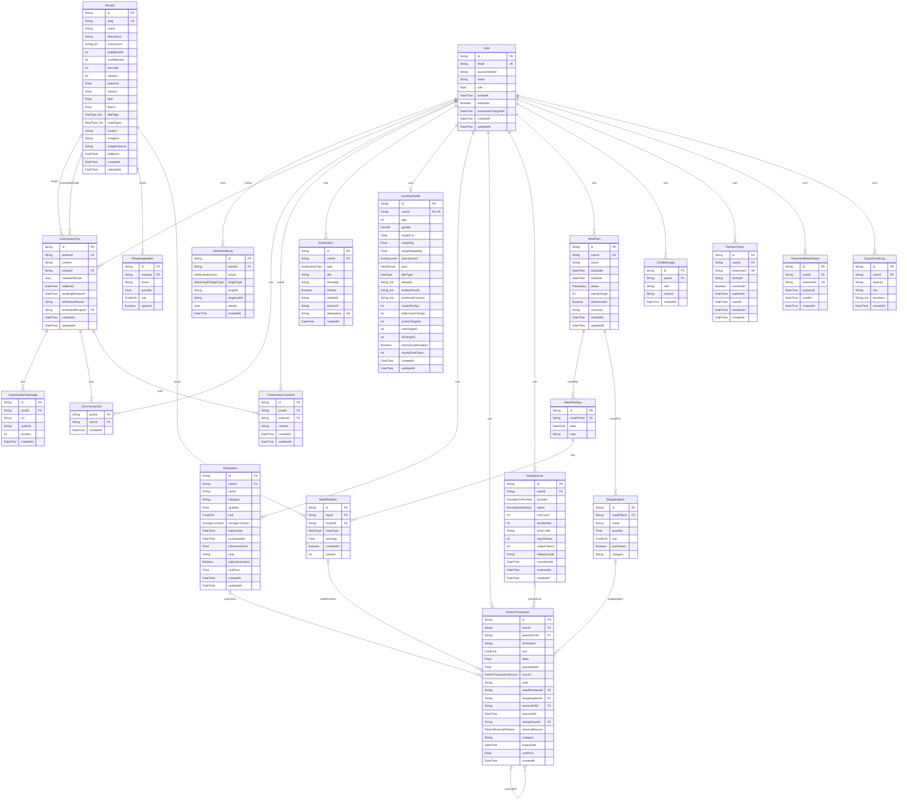

# Sơ đồ dữ liệu (ERD)

Sinh tự động từ `backend/prisma/schema.prisma` bằng `node scripts/docs/gen-erd.mjs` (2026-11-12).
21 bảng, 16 kiểu enum, 29 quan hệ khóa ngoại. CSDL: PostgreSQL qua Prisma; mọi thay đổi schema có migration
riêng trong `backend/prisma/migrations/`.

Ký hiệu: `||--o{` một – nhiều, `||--o|` một – một (khóa ngoại duy nhất), `|o--o{` khóa ngoại có thể rỗng. Nhãn trên đường là tên quan hệ
ở phía bảng con. Cột kiểu danh sách ghi `_list` trong sơ đồ (mermaid không nhận `[]`).

## Sơ đồ

## Tóm tắt các bảng

| Bảng | Ý nghĩa | Khóa chính | Khóa ngoại (xóa khi cha bị xóa) / duy nhất | Được tham chiếu bởi |
|---|---|---|---|---|
| User | Tài khoản: email (duy nhất), mật khẩu băm bcrypt, vai trò USER/ADMIN, khóa tài khoản (lockedAt), tài khoản mẫu (isSample). | id | duy nhất: email | AdminAuditLog.actorId, CommunityPost.authorId, CommunityLike.userId, CommunityComment.authorId, Notification.userId, NutritionProfile.userId, PantryItem.userId, PantryTransaction.userId, ReceiptScan.userId, MealPlan.userId, ChatMessage.userId, RefreshToken.userId, PasswordResetToken.userId, ExpiryEmailLog.userId |
| AdminAuditLog | Nhật ký thao tác Admin, ghi trong cùng transaction với thao tác. Không lưu mật khẩu, token, nội dung bài/bình luận. | id | actorId → User (xóa: Restrict) | — |
| CommunityPost | Bài viết cộng đồng: chữ, ảnh, gắn món có sẵn hoặc công thức tự viết (JSON); Admin ẩn; AI đánh dấu chờ duyệt. | id | authorId → User (xóa: Cascade); recipeId → Recipe (xóa: Restrict); promotedRecipeId → Recipe (xóa: SetNull) | CommunityPostImage.postId, CommunityLike.postId, CommunityComment.postId |
| CommunityPostImage | Ảnh trong bài viết (tối đa 4, lưu trên Cloudinary thư mục nouri/posts, đã xóa EXIF/GPS trước khi tải lên). | id | postId → CommunityPost (xóa: Cascade) | — |
| CommunityLike | Lượt thích bài viết; mỗi người thích một bài một lần. |  | postId → CommunityPost (xóa: Cascade); userId → User (xóa: Cascade) | — |
| CommunityComment | Bình luận bài viết. | id | postId → CommunityPost (xóa: Cascade); authorId → User (xóa: Cascade) | — |
| Notification | Thông báo trong ứng dụng (kho sắp hết hạn/đã hết hạn/dưới mức tối thiểu, lượt thích, bình luận); dedupeKey chống trùng. | id | userId → User (xóa: Cascade); duy nhất: dedupeKey | — |
| NutritionProfile | Hồ sơ dinh dưỡng 1–1 với User: chỉ số cơ thể, mục tiêu, chế độ ăn, dị ứng, món không thích, chỉ tiêu tính sẵn, cài đặt nhắc hạn email. | id | userId → User (xóa: Cascade); duy nhất: userId | — |
| PantryItem | Thực phẩm trong kho của người dùng: số lượng, đơn vị, hạn, nơi bảo quản, mức tối thiểu, đơn giá (tùy chọn). | id | userId → User (xóa: Cascade) | PantryTransaction.pantryItemId |
| PantryTransaction | Lịch sử xuất/nhập kho. Ghi cùng transaction với thay đổi kho. Chụp lại tên và đơn vị lúc ghi để lịch sử còn đọc được sau khi thực phẩm bị sửa/xóa (pantryItemId về null khi xóa). delta: + nhập, − xuất, theo `unit`; quantityAfter: số lượng sau thay đổi. Dòng hoàn lại (bỏ "đã ăn"/"đã mua") trỏ về dòng gốc qua reversalOfId; dòng gốc có reversedAt. | id | userId → User (xóa: Cascade); pantryItemId → PantryItem (xóa: SetNull); mealPlanItemId → MealPlanItem (xóa: SetNull); shoppingItemId → ShoppingItem (xóa: SetNull); reversalOfId → PantryTransaction (xóa: SetNull); receiptScanId → ReceiptScan (xóa: SetNull) | PantryTransaction.reversalOfId |
| ReceiptScan | Một lần quét hóa đơn (GĐ3c). Không lưu ảnh, không lưu văn bản đọc được; dòng nháp chỉ giữ trong bộ nhớ server. Dùng để đếm số lần quét mỗi ngày (kể cả lần lỗi) và gom các dòng lịch sử kho của một lần lưu để hoàn tác cả lô. | id | userId → User (xóa: Cascade) | PantryTransaction.receiptScanId |
| Recipe | Công thức trong thư viện (seed 33 món, Admin thêm/sửa): dinh dưỡng một khẩu phần, nhãn chế độ ăn, bữa phù hợp; hiddenAt = ngừng dùng. | id | duy nhất: slug | CommunityPost.recipeId, CommunityPost.promotedRecipeId, RecipeIngredient.recipeId, MealPlanItem.recipeId |
| RecipeIngredient | Nguyên liệu của công thức (tên, số lượng, đơn vị, tùy chọn). | id | recipeId → Recipe (xóa: Cascade) | — |
| MealPlan | Thực đơn 7 ngày (OpenAI hoặc thuật toán chấm điểm), trạng thái DRAFT/ACTIVE/COMPLETED. | id | userId → User (xóa: Cascade) | MealPlanDay.mealPlanId, ShoppingItem.mealPlanId |
| MealPlanDay | Một ngày của thực đơn (duy nhất theo thực đơn + ngày). | id | mealPlanId → MealPlan (xóa: Cascade); duy nhất: (mealPlanId, date) | MealPlanItem.dayId |
| MealPlanItem | Một bữa: món, loại bữa, khẩu phần, calo đã lưu, đã ăn hay chưa. | id | dayId → MealPlanDay (xóa: Cascade); recipeId → Recipe (xóa: —) | PantryTransaction.mealPlanItemId |
| ShoppingItem | Dòng đi chợ của thực đơn; "Đã mua" → nhập kho. | id | mealPlanId → MealPlan (xóa: Cascade) | PantryTransaction.shoppingItemId |
| ChatMessage | Tin nhắn Hỏi Nouri (người dùng / trợ lý). | id | userId → User (xóa: Cascade) | — |
| RefreshToken | Refresh token (GĐ4): chỉ lưu SHA-256 của token (token gốc nằm trong cookie httpOnly). Mỗi lần làm mới, token cũ được đánh dấu usedAt và phát token mới cùng familyId (xoay vòng). Dùng lại token đã xoay → thu hồi cả chuỗi (familyId). | id | userId → User (xóa: Cascade); duy nhất: tokenHash | — |
| PasswordResetToken | Quên mật khẩu (giai-doan-email): token ngẫu nhiên 32 byte gửi qua email, DB chỉ lưu SHA-256; hết hạn 30 phút, dùng một lần (usedAt). Yêu cầu mới xóa các token cũ của người đó. | id | userId → User (xóa: Cascade); duy nhất: tokenHash | — |
| ExpiryEmailLog | Email nhắc đồ sắp hết hạn đã gửi. Dòng được tạo TRƯỚC khi gửi và làm khóa: unique (userId, dayKey, slot) → chạy lịch nhiều lần hay nhiều tiến trình cũng chỉ một email/ngày ("daily"); "test-1..3" là các lần "Gửi thử ngay". itemKeys: "pantryItemId:yyyy-MM-dd" (id + hạn) của món đã nhắc, để không nhắc lại cùng món trừ khi hạn còn 1 ngày. | id | userId → User (xóa: Cascade); duy nhất: (userId, dayKey, slot) | — |

## Kiểu enum

| Enum | Giá trị |
|---|---|
| Gender | MALE, FEMALE, OTHER |
| ActivityLevel | SEDENTARY, LIGHT, MODERATE, ACTIVE, VERY_ACTIVE |
| HealthGoal | LOSE_WEIGHT, MAINTAIN, GAIN_WEIGHT, BUILD_MUSCLE |
| DietType | BALANCED, VEGETARIAN, VEGAN, LOW_CARB, HIGH_PROTEIN |
| FoodUnit | G, KG, ML, L, ITEM, PACKAGE |
| StorageLocation | REFRIGERATOR, FREEZER, DRY_STORAGE |
| PantryTransactionSource | CONSUMPTION, PURCHASE, MANUAL_ADD, MANUAL_EDIT, MANUAL_DELETE, RECEIPT_SCAN |
| PantryRemovalReason | USED_UP, DISCARDED, MISTAKE |
| MealType | BREAKFAST, LUNCH, DINNER, SNACK |
| PlanStatus | DRAFT, ACTIVE, COMPLETED |
| NotificationType | PANTRY_EXPIRING, PANTRY_EXPIRED, PANTRY_LOW_STOCK, MEAL_REMINDER, MEAL_PLAN_CREATED, MEAL_PREP_REMINDER, COMMUNITY_LIKE, COMMUNITY_COMMENT, COMMUNITY_REPLY, COMMUNITY_FOLLOW, AI_RECIPE_SUGGESTION, AI_EXPIRY_SUGGESTION, AI_NUTRITION_SUGGESTION |
| Role | USER, ADMIN |
| AdminAuditAction | RECIPE_CREATE, RECIPE_UPDATE, RECIPE_HIDE, RECIPE_SHOW, RECIPE_DELETE, RECIPE_IMAGE_REPLACE, USER_LOCK, USER_UNLOCK, POST_DELETE, COMMENT_DELETE, POST_HIDE, POST_SHOW, POST_PROMOTE, POST_APPROVE |
| AdminAuditTargetType | RECIPE, USER, COMMUNITY_POST, COMMUNITY_COMMENT |
| ReceiptOcrProvider | TESSERACT, OPENAI, MOCK |
| ReceiptScanStatus | PROCESSING, READY, COMMITTED, REVERSED, FAILED |

## Cột của từng bảng

### User

Tài khoản: email (duy nhất), mật khẩu băm bcrypt, vai trò USER/ADMIN, khóa tài khoản (lockedAt), tài khoản mẫu (isSample).

| Cột | Kiểu | Bắt buộc | Khóa | Ghi chú |
|---|---|---|---|---|
| id | String | có | PK | — |
| email | String | có | UK | — |
| passwordHash | String | có | — | — |
| name | String | có | — | — |
| role | Role (enum) | có | — | — |
| lockedAt | DateTime | không | — | Khác null: tài khoản đang bị khóa (không đăng nhập, không gọi API được); lưu thời điểm khóa. |
| isSample | Boolean | có | — | Tài khoản mẫu minh họa (seed, "Người dùng mẫu N", mauN@nouri.vn): có tương tác thật để thuật toán gợi ý cộng tác chạy khi demo; không tính vào thống kê Admin, danh sách người dùng Admin gắn nhãn "Tài khoản mẫu". |
| passwordChangedAt | DateTime | không | — | Lần đổi mật khẩu gần nhất (GĐ4): access token phát trước thời điểm này bị từ chối. |
| createdAt | DateTime | có | — | — |
| updatedAt | DateTime | có | — | — |

### AdminAuditLog

Nhật ký thao tác Admin, ghi trong cùng transaction với thao tác. Không lưu mật khẩu, token, nội dung bài/bình luận.

| Cột | Kiểu | Bắt buộc | Khóa | Ghi chú |
|---|---|---|---|---|
| id | String | có | PK | — |
| actorId | String | có | FK | Restrict: tài khoản Admin đã có nhật ký không bị xóa mất dấu vết (hiện chưa có chức năng xóa tài khoản). |
| action | AdminAuditAction (enum) | có | — | — |
| targetType | AdminAuditTargetType (enum) | có | — | — |
| targetId | String | có | — | Không có FK: đối tượng (món, bài, bình luận) có thể đã bị xóa nhưng nhật ký vẫn phải còn. |
| targetLabel | String | không | — | Tên món hoặc email người dùng/tác giả tại thời điểm thao tác. |
| details | Json | không | — | Chi tiết theo từng loại thao tác (danh sách trường cố định, xem admin-audit.service.ts). |
| createdAt | DateTime | có | — | — |

Chỉ mục / ràng buộc: `@@index([createdAt])`, `@@index([actorId, createdAt])`, `@@index([targetType, targetId, createdAt])`.

### CommunityPost

Bài viết cộng đồng: chữ, ảnh, gắn món có sẵn hoặc công thức tự viết (JSON); Admin ẩn; AI đánh dấu chờ duyệt.

| Cột | Kiểu | Bắt buộc | Khóa | Ghi chú |
|---|---|---|---|---|
| id | String | có | PK | — |
| authorId | String | có | FK | — |
| content | String | có | — | — |
| recipeId | String | không | FK | Công thức có sẵn được gắn kèm (tùy chọn). Restrict: công thức đã được bài viết gắn thì không xóa hẳn được (GĐ3: chỉ ẩn). |
| memberRecipe | Json | không | — | Công thức tự viết của thành viên (JSON: tên, khẩu phần, phút, nguyên liệu {tên, số lượng, đơn vị} nhập tự do, các bước). Không phải Recipe: không vào thực đơn, gợi ý, kho. Không đồng thời với recipeId. Kiểm tra bằng Zod (community-member-recipe.ts). |
| hiddenAt | DateTime | không | — | Khác null: Admin ẩn bài (không hiện ở bảng tin của người khác; tác giả vẫn thấy kèm ghi chú). |
| pendingReviewAt | DateTime | không | — | AI kiểm duyệt (Moderation API + kiểm tra "có liên quan ăn uống"): nghi vấn → khác null, bài chờ Admin duyệt, chỉ tác giả thấy. AI không bao giờ tự xóa bài; không có key/API lỗi thì đăng như thường. aiReviewReason: lý do AI (giữ lại sau khi duyệt). |
| aiReviewReason | String | không | — | — |
| promotedRecipeId | String | không | FK | Admin "Chuyển thành công thức": món mới tạo từ công thức tự viết. SetNull: xóa món thì bài chỉ mất liên kết. |
| createdAt | DateTime | có | — | — |
| updatedAt | DateTime | có | — | — |

Chỉ mục / ràng buộc: `@@index([createdAt])`, `@@index([authorId, createdAt])`, `@@index([recipeId])`, `@@index([promotedRecipeId])`.

### CommunityPostImage

Ảnh trong bài viết (tối đa 4, lưu trên Cloudinary thư mục nouri/posts, đã xóa EXIF/GPS trước khi tải lên).

| Cột | Kiểu | Bắt buộc | Khóa | Ghi chú |
|---|---|---|---|---|
| id | String | có | PK | — |
| postId | String | có | FK | — |
| url | String | có | — | — |
| publicId | String | có | — | — |
| position | Int | có | — | — |
| createdAt | DateTime | có | — | — |

Chỉ mục / ràng buộc: `@@index([postId, position])`.

### CommunityLike

Lượt thích bài viết; mỗi người thích một bài một lần.

| Cột | Kiểu | Bắt buộc | Khóa | Ghi chú |
|---|---|---|---|---|
| postId | String | có | FK | — |
| userId | String | có | FK | — |
| createdAt | DateTime | có | — | — |

Chỉ mục / ràng buộc: `@@id([postId, userId])`, `@@index([userId, createdAt])`.

### CommunityComment

Bình luận bài viết.

| Cột | Kiểu | Bắt buộc | Khóa | Ghi chú |
|---|---|---|---|---|
| id | String | có | PK | — |
| postId | String | có | FK | — |
| authorId | String | có | FK | — |
| content | String | có | — | — |
| createdAt | DateTime | có | — | — |
| updatedAt | DateTime | có | — | — |

Chỉ mục / ràng buộc: `@@index([postId, createdAt])`, `@@index([authorId, createdAt])`.

### Notification

Thông báo trong ứng dụng (kho sắp hết hạn/đã hết hạn/dưới mức tối thiểu, lượt thích, bình luận); dedupeKey chống trùng.

| Cột | Kiểu | Bắt buộc | Khóa | Ghi chú |
|---|---|---|---|---|
| id | String | có | PK | — |
| userId | String | có | FK | — |
| type | NotificationType (enum) | có | — | — |
| title | String | có | — | — |
| message | String | có | — | — |
| isRead | Boolean | có | — | — |
| relatedId | String | không | — | — |
| actionUrl | String | không | — | — |
| dedupeKey | String | không | UK | — |
| createdAt | DateTime | có | — | — |

Chỉ mục / ràng buộc: `@@index([userId, createdAt])`, `@@index([userId, isRead, createdAt])`.

### NutritionProfile

Hồ sơ dinh dưỡng 1–1 với User: chỉ số cơ thể, mục tiêu, chế độ ăn, dị ứng, món không thích, chỉ tiêu tính sẵn, cài đặt nhắc hạn email.

| Cột | Kiểu | Bắt buộc | Khóa | Ghi chú |
|---|---|---|---|---|
| id | String | có | PK | — |
| userId | String | có | FK,UK | — |
| age | Int | không | — | — |
| gender | Gender (enum) | không | — | — |
| heightCm | Float | không | — | — |
| weightKg | Float | không | — | — |
| targetWeightKg | Float | không | — | — |
| activityLevel | ActivityLevel (enum) | có | — | — |
| goal | HealthGoal (enum) | có | — | — |
| dietType | DietType (enum) | có | — | — |
| allergies | String[] | không | — | — |
| dislikedFoods | String[] | không | — | — |
| preferredCuisines | String[] | không | — | — |
| mealsPerDay | Int | có | — | — |
| dailyCalorieTarget | Int | không | — | — |
| proteinTargetG | Int | không | — | — |
| carbTargetG | Int | không | — | — |
| fatTargetG | Int | không | — | — |
| expiryEmailEnabled | Boolean | có | — | Nhắc đồ sắp hết hạn qua email (người dùng tự bật; demo bật sẵn trong demo:reset), báo trước 1–3 ngày. |
| expiryEmailDays | Int | có | — | — |
| createdAt | DateTime | có | — | — |
| updatedAt | DateTime | có | — | — |

### PantryItem

Thực phẩm trong kho của người dùng: số lượng, đơn vị, hạn, nơi bảo quản, mức tối thiểu, đơn giá (tùy chọn).

| Cột | Kiểu | Bắt buộc | Khóa | Ghi chú |
|---|---|---|---|---|
| id | String | có | PK | — |
| userId | String | có | FK | — |
| name | String | có | — | — |
| category | String | có | — | — |
| quantity | Float | có | — | — |
| unit | FoodUnit (enum) | có | — | — |
| storageLocation | StorageLocation (enum) | có | — | — |
| expiryDate | DateTime | không | — | — |
| purchasedAt | DateTime | có | — | — |
| minimumStock | Float | có | — | — |
| note | String | không | — | — |
| expiryEstimated | Boolean | có | — | Hạn do hệ thống gợi ý theo nhóm (đã mua, quét ảnh), chưa được người dùng xác nhận; người dùng sửa hạn thì về false. |
| unitPrice | Float | không | — | Đơn giá (đồng / 1 đơn vị của unit), tùy chọn: người dùng nhập hoặc lấy từ hóa đơn có giá. Dùng ước tính tiền lãng phí. |
| createdAt | DateTime | có | — | — |
| updatedAt | DateTime | có | — | — |

Chỉ mục / ràng buộc: `@@index([userId, expiryDate])`, `@@index([userId, category])`.

### PantryTransaction

Lịch sử xuất/nhập kho. Ghi cùng transaction với thay đổi kho. Chụp lại tên và đơn vị lúc ghi để lịch sử còn đọc được sau khi thực phẩm bị sửa/xóa (pantryItemId về null khi xóa). delta: + nhập, − xuất, theo `unit`; quantityAfter: số lượng sau thay đổi. Dòng hoàn lại (bỏ "đã ăn"/"đã mua") trỏ về dòng gốc qua reversalOfId; dòng gốc có reversedAt.

| Cột | Kiểu | Bắt buộc | Khóa | Ghi chú |
|---|---|---|---|---|
| id | String | có | PK | — |
| userId | String | có | FK | — |
| pantryItemId | String | không | FK | — |
| itemName | String | có | — | — |
| unit | FoodUnit (enum) | có | — | — |
| delta | Float | có | — | — |
| quantityAfter | Float | có | — | — |
| source | PantryTransactionSource (enum) | có | — | — |
| note | String | không | — | — |
| mealPlanItemId | String | không | FK | — |
| shoppingItemId | String | không | FK | — |
| reversalOfId | String | không | FK | — |
| reversedAt | DateTime | không | — | — |
| receiptScanId | String | không | FK | Lô quét hóa đơn (GĐ3c) đã thêm dòng này; hoàn tác lô trừ lại mọi dòng cùng receiptScanId. |
| removalReason | PantryRemovalReason (enum) | không | — | Báo cáo lãng phí: lý do khi xóa khỏi kho, và ảnh chụp nhóm, hạn, đơn giá lúc thay đổi (thực phẩm bị xóa thì vẫn thống kê được). |
| category | String | không | — | — |
| expiryDate | DateTime | không | — | — |
| unitPrice | Float | không | — | — |
| createdAt | DateTime | có | — | — |

Chỉ mục / ràng buộc: `@@index([userId, createdAt])`, `@@index([pantryItemId, createdAt])`, `@@index([mealPlanItemId])`, `@@index([shoppingItemId])`, `@@index([receiptScanId])`.

### ReceiptScan

Một lần quét hóa đơn (GĐ3c). Không lưu ảnh, không lưu văn bản đọc được; dòng nháp chỉ giữ trong bộ nhớ server. Dùng để đếm số lần quét mỗi ngày (kể cả lần lỗi) và gom các dòng lịch sử kho của một lần lưu để hoàn tác cả lô.

| Cột | Kiểu | Bắt buộc | Khóa | Ghi chú |
|---|---|---|---|---|
| id | String | có | PK | — |
| userId | String | có | FK | — |
| provider | ReceiptOcrProvider (enum) | có | — | — |
| status | ReceiptScanStatus (enum) | có | — | — |
| lineCount | Int | có | — | — |
| durationMs | Int | không | — | — |
| errorCode | String | không | — | — |
| inputTokens | Int | không | — | Token OpenAI vào/ra của lần quét (tính chi phí); null với Tesseract. |
| outputTokens | Int | không | — | — |
| fallbackCode | String | không | — | Chế độ "Tự động": lý do OpenAI lỗi rồi chuyển Tesseract (OPENAI_TIMEOUT \| OPENAI_INVALID_OUTPUT \| OPENAI_FAILED). |
| committedAt | DateTime | không | — | — |
| reversedAt | DateTime | không | — | — |
| createdAt | DateTime | có | — | — |

Chỉ mục / ràng buộc: `@@index([userId, createdAt])`.

### Recipe

Công thức trong thư viện (seed 33 món, Admin thêm/sửa): dinh dưỡng một khẩu phần, nhãn chế độ ăn, bữa phù hợp; hiddenAt = ngừng dùng.

| Cột | Kiểu | Bắt buộc | Khóa | Ghi chú |
|---|---|---|---|---|
| id | String | có | PK | — |
| slug | String | có | UK | — |
| name | String | có | — | — |
| description | String | có | — | — |
| instructions | String[] | không | — | — |
| prepMinutes | Int | có | — | — |
| cookMinutes | Int | có | — | — |
| servings | Int | có | — | — |
| calories | Int | có | — | — |
| proteinG | Float | có | — | — |
| carbsG | Float | có | — | — |
| fatG | Float | có | — | — |
| fiberG | Float | có | — | — |
| dietTags | DietType[] (enum) | không | — | — |
| mealTypes | MealType[] (enum) | không | — | — |
| cuisine | String | có | — | — |
| imageUrl | String | không | — | — |
| imagePublicId | String | không | — | publicId trên Cloudinary của ảnh do Admin tải lên (null với ảnh nhóm món /assets); dùng để xóa ảnh cũ khi thay. |
| hiddenAt | DateTime | không | — | Khác null: món đã ngừng sử dụng (Admin ẩn thay vì xóa món đã được dùng). Không hiện ở danh sách, không chọn được khi tạo thực đơn/đăng bài; trang chi tiết, thực đơn cũ và bài viết cũ vẫn hiển thị. |
| createdAt | DateTime | có | — | — |
| updatedAt | DateTime | có | — | — |

Chỉ mục / ràng buộc: `@@index([cuisine])`, `@@index([hiddenAt])`.

### RecipeIngredient

Nguyên liệu của công thức (tên, số lượng, đơn vị, tùy chọn).

| Cột | Kiểu | Bắt buộc | Khóa | Ghi chú |
|---|---|---|---|---|
| id | String | có | PK | — |
| recipeId | String | có | FK | — |
| name | String | có | — | — |
| quantity | Float | có | — | — |
| unit | FoodUnit (enum) | có | — | — |
| optional | Boolean | có | — | — |

Chỉ mục / ràng buộc: `@@index([recipeId])`.

### MealPlan

Thực đơn 7 ngày (OpenAI hoặc thuật toán chấm điểm), trạng thái DRAFT/ACTIVE/COMPLETED.

| Cột | Kiểu | Bắt buộc | Khóa | Ghi chú |
|---|---|---|---|---|
| id | String | có | PK | — |
| userId | String | có | FK | — |
| name | String | có | — | — |
| startDate | DateTime | có | — | — |
| endDate | DateTime | có | — | — |
| status | PlanStatus (enum) | có | — | — |
| calorieTarget | Int | có | — | — |
| aiGenerated | Boolean | có | — | — |
| summary | String | không | — | — |
| createdAt | DateTime | có | — | — |
| updatedAt | DateTime | có | — | — |

Chỉ mục / ràng buộc: `@@index([userId, startDate])`.

### MealPlanDay

Một ngày của thực đơn (duy nhất theo thực đơn + ngày).

| Cột | Kiểu | Bắt buộc | Khóa | Ghi chú |
|---|---|---|---|---|
| id | String | có | PK | — |
| mealPlanId | String | có | FK | — |
| date | DateTime | có | — | — |
| note | String | không | — | — |

Chỉ mục / ràng buộc: `@@unique([mealPlanId, date])`.

### MealPlanItem

Một bữa: món, loại bữa, khẩu phần, calo đã lưu, đã ăn hay chưa.

| Cột | Kiểu | Bắt buộc | Khóa | Ghi chú |
|---|---|---|---|---|
| id | String | có | PK | — |
| dayId | String | có | FK | — |
| recipeId | String | có | FK | — |
| mealType | MealType (enum) | có | — | — |
| servings | Float | có | — | — |
| completed | Boolean | có | — | — |
| calories | Int | có | — | — |

Chỉ mục / ràng buộc: `@@index([dayId, mealType])`.

### ShoppingItem

Dòng đi chợ của thực đơn; "Đã mua" → nhập kho.

| Cột | Kiểu | Bắt buộc | Khóa | Ghi chú |
|---|---|---|---|---|
| id | String | có | PK | — |
| mealPlanId | String | có | FK | — |
| name | String | có | — | — |
| quantity | Float | có | — | — |
| unit | FoodUnit (enum) | có | — | — |
| purchased | Boolean | có | — | — |
| category | String | không | — | — |

Chỉ mục / ràng buộc: `@@index([mealPlanId, purchased])`.

### ChatMessage

Tin nhắn Hỏi Nouri (người dùng / trợ lý).

| Cột | Kiểu | Bắt buộc | Khóa | Ghi chú |
|---|---|---|---|---|
| id | String | có | PK | — |
| userId | String | có | FK | — |
| role | String | có | — | — |
| content | String | có | — | — |
| createdAt | DateTime | có | — | — |

Chỉ mục / ràng buộc: `@@index([userId, createdAt])`.

### RefreshToken

Refresh token (GĐ4): chỉ lưu SHA-256 của token (token gốc nằm trong cookie httpOnly). Mỗi lần làm mới, token cũ được đánh dấu usedAt và phát token mới cùng familyId (xoay vòng). Dùng lại token đã xoay → thu hồi cả chuỗi (familyId).

| Cột | Kiểu | Bắt buộc | Khóa | Ghi chú |
|---|---|---|---|---|
| id | String | có | PK | — |
| userId | String | có | FK | — |
| tokenHash | String | có | UK | — |
| familyId | String | có | — | — |
| remember | Boolean | có | — | true: "Nhớ đăng nhập" (cookie 30 ngày); false: cookie phiên. |
| expiresAt | DateTime | có | — | — |
| usedAt | DateTime | không | — | — |
| revokedAt | DateTime | không | — | — |
| createdAt | DateTime | có | — | — |

Chỉ mục / ràng buộc: `@@index([userId])`, `@@index([familyId])`.

### PasswordResetToken

Quên mật khẩu (giai-doan-email): token ngẫu nhiên 32 byte gửi qua email, DB chỉ lưu SHA-256; hết hạn 30 phút, dùng một lần (usedAt). Yêu cầu mới xóa các token cũ của người đó.

| Cột | Kiểu | Bắt buộc | Khóa | Ghi chú |
|---|---|---|---|---|
| id | String | có | PK | — |
| userId | String | có | FK | — |
| tokenHash | String | có | UK | — |
| expiresAt | DateTime | có | — | — |
| usedAt | DateTime | không | — | — |
| createdAt | DateTime | có | — | — |

Chỉ mục / ràng buộc: `@@index([userId])`.

### ExpiryEmailLog

Email nhắc đồ sắp hết hạn đã gửi. Dòng được tạo TRƯỚC khi gửi và làm khóa: unique (userId, dayKey, slot) → chạy lịch nhiều lần hay nhiều tiến trình cũng chỉ một email/ngày ("daily"); "test-1..3" là các lần "Gửi thử ngay". itemKeys: "pantryItemId:yyyy-MM-dd" (id + hạn) của món đã nhắc, để không nhắc lại cùng món trừ khi hạn còn 1 ngày.

| Cột | Kiểu | Bắt buộc | Khóa | Ghi chú |
|---|---|---|---|---|
| id | String | có | PK | — |
| userId | String | có | FK | — |
| dayKey | String | có | — | — |
| slot | String | có | — | — |
| itemKeys | String[] | không | — | — |
| createdAt | DateTime | có | — | — |

Chỉ mục / ràng buộc: `@@unique([userId, dayKey, slot])`, `@@index([userId, createdAt])`.
