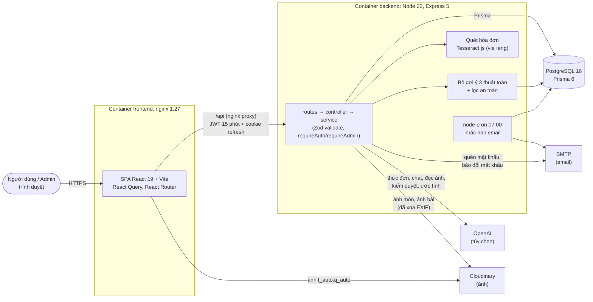
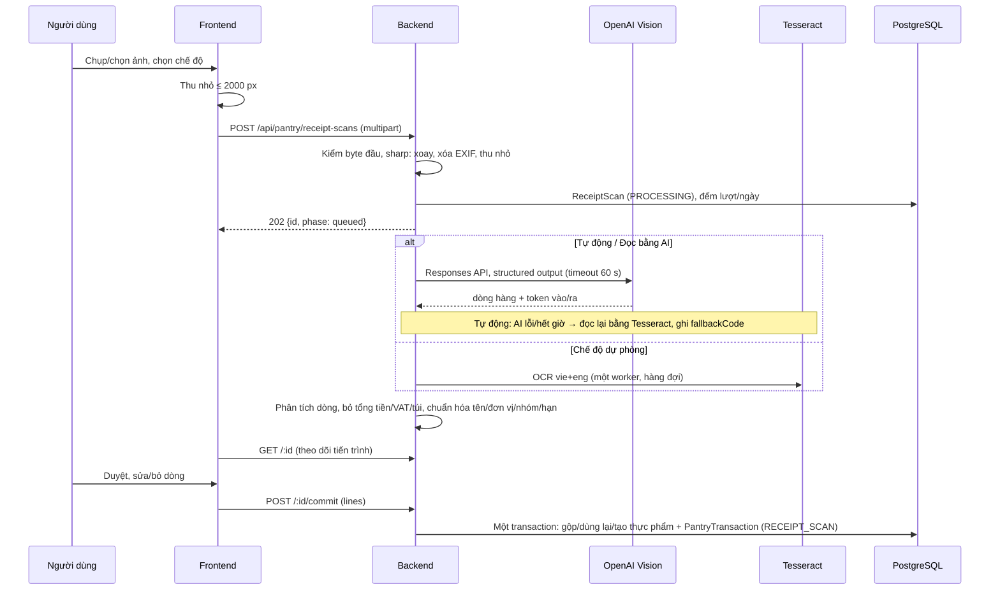
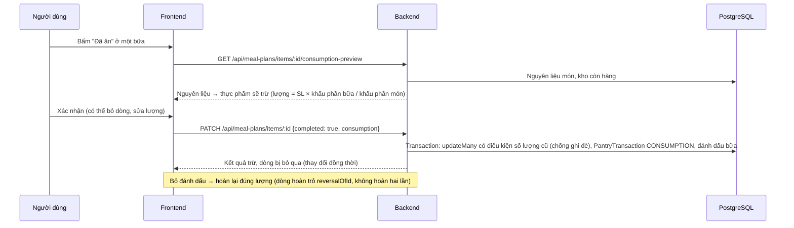
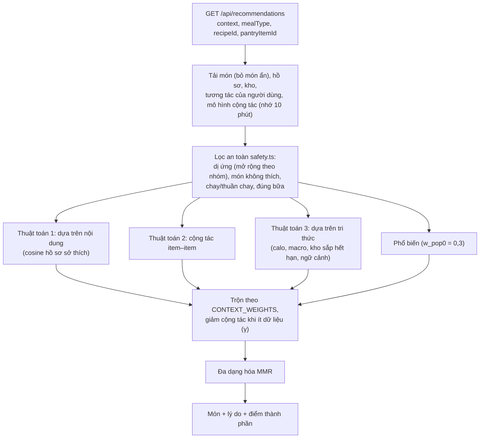

# Kiến trúc hệ thống

Mô tả theo mã trên `main` (13/11/2026). Phiên bản lấy từ `frontend/package.json`, `backend/package.json`, `docker-compose.yml`,
các `Dockerfile`. Danh sách API: `docs/bao-cao/api.md`; dữ liệu: `docs/bao-cao/erd.md`.

## 1. Sơ đồ tổng thể

- Ba container (`docker-compose.yml`): `postgres` (postgres:16-alpine), `backend` (node:22-alpine, chạy migration khi khởi động,
  cổng chỉ nghe `127.0.0.1:4000`), `frontend` (build Vite rồi phục vụ bằng nginx:1.27-alpine, gzip, chuyển `/api` sang backend).
- Dịch vụ ngoài đều **tùy chọn**: thiếu `OPENAI_API_KEY` → thực đơn dùng thuật toán chấm điểm, chat báo chưa bật, quét hóa đơn dùng
  Tesseract, kiểm duyệt bỏ qua; thiếu Cloudinary → API tải ảnh trả 503; thiếu SMTP → email chỉ ghi ra log.

## 2. Tổ chức mã

| Lớp | Thư mục | Quy ước |
|---|---|---|
| Trang | `frontend/src/pages/*Page.tsx`, `pages/admin/` | Chỉ ghép component, giữ state, gọi query/mutation |
| Thành phần | `frontend/src/components/<module>/`, dùng chung `components/ui/` | Hiển thị; token CSS ở `styles/ui/` (test chặn mã màu cứng) |
| Gọi API, logic thuần | `frontend/src/features/<module>/*.api.ts`, `*.logic.ts` (có test) | React Query, `queryKeys` tập trung |
| Route → controller → service | `backend/src/modules/<module>/` | Zod ở route; `userId` lấy từ JWT; thao tác Admin ghi `AdminAuditLog` cùng transaction |
| Thuật toán, dịch vụ dùng chung | `backend/src/services/`, `modules/recommendation/`, `services/receipt/` | Tách khỏi CRUD, có test riêng |
| Dữ liệu | `backend/prisma/schema.prisma`, `migrations/` | Mỗi thay đổi schema một migration mới; seed 33 món, `demo:reset` |

## 3. Luồng dữ liệu chính

### 3.1. Quét hóa đơn → kho

Ảnh chỉ nằm trong bộ nhớ khi đọc, không ghi đĩa, không lên Cloudinary. Dòng nháp giữ trong bộ nhớ 30 phút. Mã:
`backend/src/modules/receipt-scan/`, `backend/src/services/receipt/`, `backend/src/modules/pantry/pantry-intake.ts`.

### 3.2. "Đã ăn" → trừ kho

Khớp tên bằng `normalizeFoodText`, quy đổi g↔kg, ml↔l; đồ đã hết hạn mặc định không trừ; thực phẩm về 0 được giữ lại. Mã:
`backend/src/modules/meal-plans/meal-consumption.service.ts`, `backend/src/services/pantry-consumption.ts`, `services/pantry-match.ts`.

### 3.3. Gợi ý món

Trọng số và lý do chọn: `docs/thuat-toan-goi-y.md`; mã: `backend/src/modules/recommendation/hybrid.ts`; kiểm an toàn trên 105 hồ sơ ×
mọi nguồn gợi ý: `backend/src/test/dietary-matrix.test.ts`.

## 4. Công nghệ và lý do chọn

| Thành phần | Công nghệ (phiên bản) | Lý do |
|---|---|---|
| Giao diện | React 19, Vite, TypeScript | Hệ sinh thái lớn, build nhanh, kiểu tĩnh chung với backend |
| Dữ liệu phía client | TanStack React Query 5, Axios | Cache, làm mới sau mutation, thử lại; một chỗ xử lý 401 → làm mới token |
| Định tuyến | React Router 7 | Route bảo vệ, khu Admin riêng, tải lazy trang nặng (Admin, Báo cáo) |
| Biểu đồ | Recharts 2 | Đã dùng cho thống kê Admin, dùng lại cho Báo cáo |
| API | Express 5, Zod 3 | Đơn giản, middleware rõ ràng; Zod kiểm dữ liệu vào và sinh kiểu |
| ORM, CSDL | Prisma 6, PostgreSQL 16 | Kiểu an toàn, migration có lịch sử; mảng (`String[]`), JSON, transaction |
| Xác thực | jsonwebtoken, bcryptjs, cookie httpOnly | Access token ngắn (15 phút) + refresh token lưu băm SHA-256, xoay vòng, thu hồi được |
| Bảo mật HTTP | helmet, cors, rate limit tự viết | Header an toàn; giới hạn đăng nhập/đăng ký/quên mật khẩu |
| Ảnh | multer, sharp 0.34, Cloudinary | Kiểm byte đầu, xóa EXIF/GPS, thu nhỏ; CDN với `f_auto,q_auto` |
| OCR | tesseract.js 7 (dữ liệu vie + eng đóng gói) | Chạy trên máy chủ, không cần mạng, miễn phí — chế độ dự phòng |
| AI | openai 5 (Responses API, structured output) | Thực đơn, chat, đọc hóa đơn, kiểm duyệt, ước tính dinh dưỡng; luôn có đường dự phòng |
| Email | nodemailer 10.3.1, node-cron 4.6 | SMTP chuẩn (Gmail App Password); lịch nhắc hạn trong tiến trình backend, khóa chống gửi trùng ở DB |
| Kiểm thử | Vitest (backend + frontend), Playwright (đo giao diện, nghiệm thu) | Test chạy không cần DB/mạng (mock Prisma, transport giả, đồng hồ giả) |
| Triển khai | Docker Compose (node:22-alpine, nginx:1.27-alpine, postgres:16-alpine) | Một lệnh dựng đủ 3 dịch vụ cho demo |
