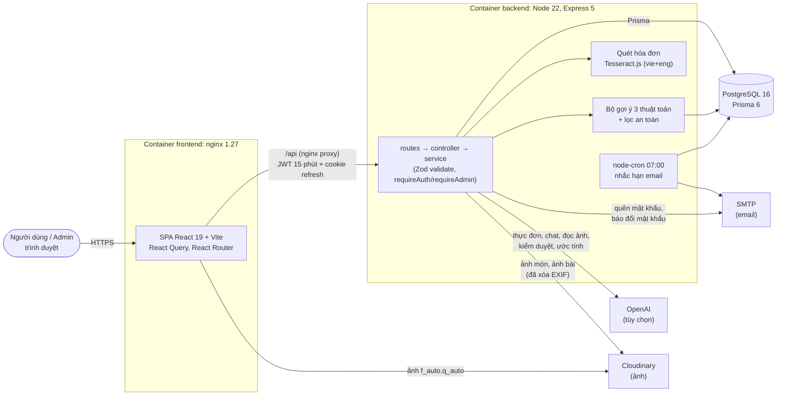
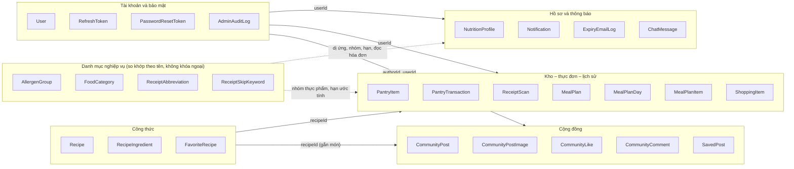
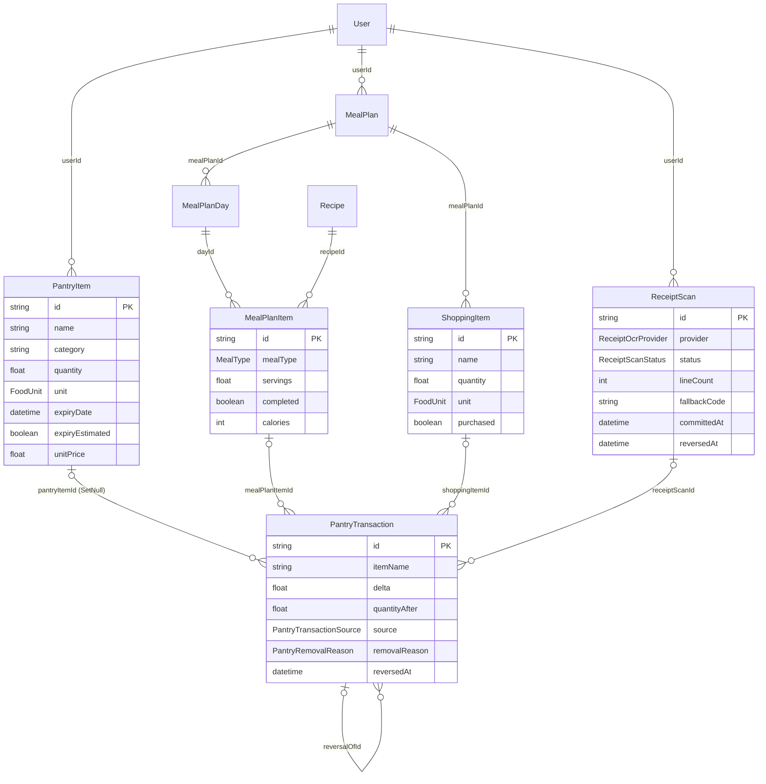
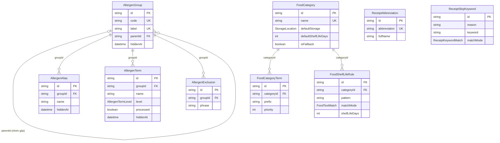
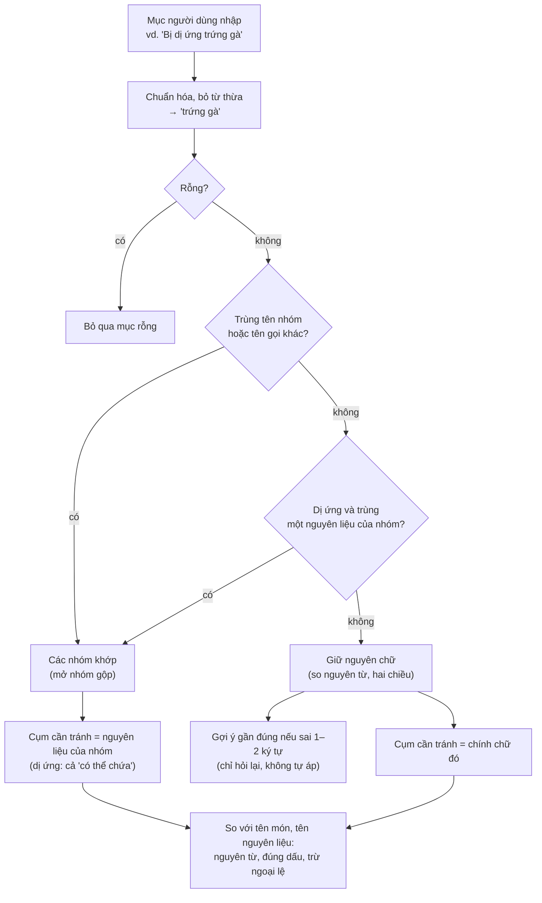

# CHƯƠNG 3. PHÂN TÍCH VÀ THIẾT KẾ HỆ THỐNG

> Bản nháp lượt 1 (mục 3.1–3.4), viết ngày 16/11/2026, đối chiếu mã nguồn ở commit `c0ea1cf` trên nhánh `main`. Số dòng mã ghi theo
> commit này. Nguồn trong ngoặc vuông chỉ dùng để kiểm tra và sẽ xóa ở bản cuối. Phần kết chương viết ở lượt sau.

Chương này trình bày kết quả phân tích yêu cầu và thiết kế của Nouri. Mục 3.1 xác định tác nhân, yêu cầu chức năng, đặc tả các use case
trọng tâm và yêu cầu phi chức năng. Mục 3.2 và 3.3 mô tả kiến trúc tổng thể và mô hình dữ liệu. Mục 3.4 trình bày chi tiết thiết kế lọc
an toàn dị ứng theo nhóm, một trong bốn nội dung trọng tâm của đề tài. Các mục 3.5 đến 3.8 (bộ gợi ý, vòng khép kín kho, quét hóa đơn và
các chức năng còn lại) được trình bày ở phần tiếp theo của chương.

## 3.1. Phân tích yêu cầu

### 3.1.1. Tác nhân

Hệ thống có ba tác nhân là con người và bốn tác nhân là hệ thống ngoài hoặc tiến trình tự động (Bảng 3.1). Khách chỉ truy cập được các
trang công khai và các chức năng tài khoản. Người dùng là tác nhân chính của hầu hết use case; mọi thao tác của Người dùng chỉ đọc và ghi
dữ liệu của chính họ, vì định danh người dùng (`userId`) được lấy từ mã truy cập (JWT), không lấy từ dữ liệu gửi lên
[use-case.md, đầu mục 2]. Admin là tài khoản có vai trò `ADMIN`, được tạo bằng seed từ biến môi trường, không đăng ký qua giao diện
[use-case.md, đầu file; audit-hardcode.md, mục "Đã kiểm"].

Ba dịch vụ ngoài (OpenAI, Cloudinary, SMTP) đều là tùy chọn: khi thiếu cấu hình, hệ thống vẫn chạy bằng đường dự phòng tương ứng (mục
3.2.3). Bộ lập lịch là tiến trình `node-cron` chạy trong backend, dùng cho email nhắc đồ sắp hết hạn [kien-truc.md, mục 1].

**Bảng 3.1: Tác nhân của hệ thống**

| Tác nhân | Loại | Vai trò | Use case tiêu biểu |
|---|---|---|---|
| Khách | Con người, chưa đăng nhập | Xem trang chủ, đăng ký, đăng nhập, quên mật khẩu | UC01, UC02, UC32 |
| Người dùng | Con người, vai trò `USER` | Quản lý hồ sơ, kho, thực đơn, công thức; nhận gợi ý; quét hóa đơn; hỏi trợ lý AI; tham gia cộng đồng; xem báo cáo | UC04–UC31, UC33, UC34, UC39 |
| Admin | Con người, vai trò `ADMIN` | Quản lý công thức, người dùng, kiểm duyệt cộng đồng, danh mục dữ liệu; xem thống kê và nhật ký | UC36–UC38, UC40 |
| OpenAI | Dịch vụ ngoài, tùy chọn | Tạo thực đơn (lựa chọn phụ), trả lời trợ lý, đọc ảnh hóa đơn, kiểm duyệt bài, ước tính dinh dưỡng | UC09, UC17, UC29, UC35, UC37 |
| Cloudinary | Dịch vụ ngoài, tùy chọn | Lưu và phân phối ảnh món, ảnh bài viết | UC20, UC36 |
| SMTP | Dịch vụ ngoài, tùy chọn | Gửi email đặt lại mật khẩu, báo đổi mật khẩu, nhắc hạn | UC31, UC32, UC33 |
| Bộ lập lịch | Tiến trình trong backend | Chạy hằng ngày lúc 07:00 giờ Việt Nam để gửi email nhắc hạn | UC31 |

[Nguồn: use-case.md, đầu file và mục 2; kien-truc.md, mục 1]

### 3.1.2. Yêu cầu chức năng

Yêu cầu chức năng được xác lập từ hai nguồn. Nguồn thứ nhất là 26 use case (UC01–UC26) rút ra khi khảo sát mã nguồn ban đầu của đề tài;
khi đối chiếu với hệ thống hiện tại, 15 use case được thực hiện đúng như mô tả, 11 use case được thực hiện khác hoặc mở rộng, và phần
"theo dõi thành viên" của UC25 không thực hiện vì nằm ngoài trọng tâm quản lý thực phẩm và dinh dưỡng [so-lieu.md, mục 6; use-case.md,
mục 1; han-che.md, mục 2.7]. Nguồn thứ hai là 14 use case mới (UC27–UC40) phát sinh từ mục tiêu trong phiếu giao đề tài và các yêu cầu
giảng viên giao thêm trong quá trình thực hiện: tự cập nhật kho khi tiêu thụ, nhập thực phẩm bằng quét hóa đơn, ba thuật toán gợi ý ở
backend, và chuyển dữ liệu nghiệp vụ vào cơ sở dữ liệu [so-lieu.md, mục 6; phieu-giao-de-tai.md]. Bảng 3.2 nhóm các use case theo chín
nhóm chức năng.

**Bảng 3.2: Yêu cầu chức năng theo nhóm**

| Nhóm chức năng | Nội dung chính | Use case | Tác nhân |
|---|---|---|---|
| Tài khoản và bảo mật | Đăng ký, đăng nhập (access token 15 phút + refresh token xoay vòng), đăng xuất thu hồi phiên, quên và đặt lại mật khẩu, đổi mật khẩu | UC01–UC03, UC32, UC33 | Khách, Người dùng, SMTP |
| Hồ sơ dinh dưỡng | Chỉ số cơ thể, mục tiêu, chế độ ăn, dị ứng, món không thích, ẩm thực ưa thích; tính lại chỉ tiêu calo và đa lượng | UC04, UC05 | Người dùng |
| Kho thực phẩm | Thêm, sửa, xóa có lý do; hạn dùng, nơi bảo quản, đơn giá; lịch sử thay đổi | UC06 | Người dùng |
| Tự cập nhật kho | "Đã ăn" trừ kho, "Đã mua" nhập kho, hoàn tác | UC12, UC13, UC28 | Người dùng |
| Quét hóa đơn | Ba chế độ đọc, màn duyệt bắt buộc, lưu một lô, hoàn tác cả lô | UC29 | Người dùng, OpenAI |
| Công thức và gợi ý | Tra cứu không dấu, chi tiết món, yêu thích; gợi ý món bằng ba thuật toán kèm lý do | UC07, UC08, UC24, UC27 | Người dùng |
| Thực đơn và đi chợ | Tạo thực đơn 7 ngày (thuật toán mặc định, AI tùy chọn), kích hoạt, xem, xóa; thêm món, đổi món vi phạm; danh sách đi chợ | UC09–UC11, UC14, UC15, UC39 | Người dùng, OpenAI |
| Trợ lý AI, báo cáo, thông báo | Hỏi trợ lý dinh dưỡng, lịch sử chat; báo cáo lãng phí và dinh dưỡng tuần; thông báo trong ứng dụng; email nhắc hạn | UC16, UC17, UC18, UC23, UC30, UC31 | Người dùng, OpenAI, SMTP, Bộ lập lịch |
| Cộng đồng | Bảng tin, đăng bài có ảnh và công thức, thích, bình luận, lưu bài, chia sẻ; AI kiểm duyệt | UC19–UC22, UC25, UC26, UC34, UC35 | Người dùng, OpenAI, Cloudinary |
| Quản trị | Công thức, người dùng, kiểm duyệt và chuyển bài thành công thức, thống kê, nhật ký, danh mục dữ liệu | UC36–UC38, UC40 | Admin, OpenAI, Cloudinary |

[Nguồn: use-case.md, mục 1–2]

[HÌNH 3.1: Sơ đồ use case tổng quát — vẽ bằng công cụ UML (draw.io/StarUML): bảy tác nhân của Bảng 3.1 bên ngoài khung hệ thống "Nouri";
bên trong là mười gói use case theo cột "Nhóm chức năng" của Bảng 3.2; nối mỗi tác nhân với các gói theo cột "Tác nhân".]

[HÌNH 3.2: Sơ đồ use case nhóm kho – thực đơn – gợi ý của Người dùng — vẽ UML: UC06, UC09–UC15, UC27, UC28, UC29, UC39; quan hệ
«include»: UC12 "Đánh dấu đã ăn" include "Xem trước lượng trừ kho"; UC13 "Đánh dấu đã mua" include "Nhập kho"; UC29 include "Duyệt dòng
hóa đơn"; tác nhân phụ OpenAI nối UC09 và UC29.]

[HÌNH 3.3: Sơ đồ use case khu Admin — vẽ UML: Admin nối UC36, UC37, UC38, UC40; UC37 «extend» "Ước tính dinh dưỡng bằng AI" (tác nhân
phụ OpenAI); mọi use case «include» "Ghi nhật ký thao tác".]

### 3.1.3. Đặc tả use case trọng tâm

Mục này đặc tả năm use case gắn với bốn nội dung trọng tâm của đề tài: nhận gợi ý món (UC27), tự cập nhật kho (UC28), quét hóa đơn (UC29),
cập nhật hồ sơ có dị ứng (UC05) và quản lý danh mục dữ liệu (UC40). Các use case còn lại được liệt kê trong Phụ lục A. Đặc tả bám theo
bảng đối chiếu use case với mã nguồn [use-case.md] và danh sách API sinh tự động từ mã [api.md].

**Bảng 3.3: Đặc tả UC27 — Nhận gợi ý món**

| Mục | Nội dung |
|---|---|
| Tên | UC27 — Nhận gợi ý món |
| Tác nhân | Chính: Người dùng |
| Mô tả | Hệ thống đề xuất danh sách món phù hợp với ngữ cảnh đang xem (Tổng quan, Công thức, Kho, chi tiết món), chỉ gồm món an toàn với hồ sơ, mỗi món kèm lý do gợi ý |
| Tiền điều kiện | Người dùng đã đăng nhập; thư viện có món đang hiện |
| Luồng chính | 1. Người dùng mở Tổng quan, Công thức, Kho hoặc trang chi tiết món.<br>2. Giao diện gọi `GET /api/recommendations` với ngữ cảnh `today`, `for-you`, `pantry`, `similar` hoặc `also-cooked`.<br>3. Backend lọc an toàn trước: loại món đã ẩn, món chứa thành phần dị ứng (theo nhóm), món chứa thành phần người dùng không thích, món trái chế độ chay/thuần chay, món sai bữa.<br>4. Backend chấm điểm lai bằng thuật toán dựa trên nội dung, cộng tác theo món, dựa trên tri thức và thành phần phổ biến.<br>5. Backend đa dạng hóa danh sách bằng MMR.<br>6. Giao diện hiển thị món kèm lý do |
| Luồng phụ / ngoại lệ | 3a. Người dùng chưa có tương tác (khởi đầu lạnh): trọng số cộng tác bằng 0, trọng số chuyển sang tri thức và phổ biến.<br>3b. Ngữ cảnh "Người khác cũng nấu" chỉ hiện cặp món có ít nhất 3 người khác cùng tương tác.<br>3c. Không còn món an toàn: trả danh sách rỗng, không bao giờ trả món vi phạm |
| Hậu điều kiện | Không thay đổi dữ liệu; mọi món trả về đã qua lọc an toàn |

[Nguồn: use-case.md, UC27; api.md, dòng 63; thuat-toan-goi-y.md, mục 4, 6]

**Bảng 3.4: Đặc tả UC28 — Tự cập nhật kho khi ăn và khi mua**

| Mục | Nội dung |
|---|---|
| Tên | UC28 — Tự cập nhật kho khi ăn và khi mua |
| Tác nhân | Chính: Người dùng |
| Mô tả | Khi người dùng đánh dấu một bữa "Đã ăn", hệ thống trừ nguyên liệu khỏi kho; khi đánh dấu một dòng đi chợ "Đã mua", hệ thống nhập thực phẩm vào kho. Mọi thay đổi được ghi lịch sử và hoàn tác được |
| Tiền điều kiện | Người dùng đã đăng nhập, có thực đơn; kho có thực phẩm trùng tên nguyên liệu (so khớp bỏ hoa thường và khoảng trắng thừa) |
| Luồng chính (đã ăn) | 1. Người dùng bấm "Đã ăn" ở một bữa.<br>2. Giao diện gọi `GET /api/meal-plans/items/:id/consumption-preview`; hộp xem trước liệt kê từng nguyên liệu và thực phẩm sẽ bị trừ.<br>3. Người dùng xác nhận (có thể bỏ dòng, sửa lượng).<br>4. Giao diện gọi `PATCH /api/meal-plans/items/:id`; backend trừ kho trong một transaction, ghi lịch sử nguồn `CONSUMPTION`, dùng điều kiện số lượng cũ để chống ghi đè đồng thời |
| Luồng chính (đã mua) | 1. Người dùng đánh dấu một dòng đi chợ.<br>2. Giao diện gọi `PATCH /api/meal-plans/shopping/:id`; backend gộp vào thực phẩm cùng tên có đơn vị quy đổi được, dùng lại thực phẩm "Đã dùng hết", hoặc tạo mới với hạn ước tính theo nhóm |
| Luồng phụ / ngoại lệ | a. Bỏ đánh dấu: hoàn lại đúng lượng đã trừ hoặc đã nhập, không hoàn hai lần.<br>b. Thực phẩm đã hết hạn mặc định không bị trừ.<br>c. Thực phẩm về 0 được giữ lại với trạng thái "Đã dùng hết".<br>d. Thiết bị khác đã đổi số lượng trước: dòng đó bị bỏ qua và được báo lại |
| Hậu điều kiện | Số lượng kho đã cập nhật; có dòng `PantryTransaction` gắn với bữa ăn hoặc dòng đi chợ; trạng thái bữa (`completed`) hoặc dòng đi chợ (`purchased`) đã đổi |

[Nguồn: use-case.md, UC12, UC13, UC28; api.md, dòng 53, 56, 57; kien-truc.md, mục 3.2]

**Bảng 3.5: Đặc tả UC29 — Quét hóa đơn để nhập kho**

| Mục | Nội dung |
|---|---|
| Tên | UC29 — Quét hóa đơn để nhập kho |
| Tác nhân | Chính: Người dùng. Phụ: OpenAI (đọc ảnh); Tesseract chạy trên máy chủ không phải tác nhân ngoài |
| Mô tả | Người dùng chụp hóa đơn, hệ thống đọc các dòng hàng, chuẩn hóa tên, đơn vị, nhóm và hạn ước tính, cho người dùng duyệt rồi nhập cả lô vào kho |
| Tiền điều kiện | Người dùng đã đăng nhập; còn lượt quét trong ngày (`RECEIPT_SCAN_DAILY_LIMIT`, mặc định 10); ảnh định dạng jpg, png hoặc webp, không quá 5 MB |
| Luồng chính | 1. Người dùng mở Kho, chọn "Quét hóa đơn", chụp hoặc chọn ảnh; trình duyệt thu nhỏ ảnh về cạnh dài không quá 2000 px.<br>2. Người dùng chọn chế độ Tự động, Đọc bằng AI hoặc Chế độ dự phòng.<br>3. Giao diện gửi `POST /api/pantry/receipt-scans`; backend xóa EXIF, nhận ảnh và đọc nền, trả ngay mã lượt quét.<br>4. Giao diện theo dõi tiến trình qua `GET /api/pantry/receipt-scans/:id`.<br>5. Bộ phân tích bỏ các dòng không phải hàng (tổng tiền, VAT, túi…), chuẩn hóa tên theo kho và bộ món, đơn vị, nhóm, hạn ước tính.<br>6. Màn duyệt bắt buộc: người dùng sửa hoặc bỏ từng dòng.<br>7. Giao diện gửi `POST /api/pantry/receipt-scans/:id/commit`; backend lưu cả lô trong một transaction, lịch sử ghi nguồn `RECEIPT_SCAN` |
| Luồng phụ / ngoại lệ | a. Chế độ Tự động mà OpenAI lỗi hoặc hết giờ: đọc lại bằng Tesseract, màn duyệt báo lý do.<br>b. Người dùng hủy khi đang đọc: `POST /:id/cancel`.<br>c. "Hoàn tác hóa đơn": `POST /:id/undo` trừ lại cả lô.<br>d. Hết lượt trong ngày: từ chối kèm thông báo |
| Hậu điều kiện | Kho có thêm hoặc được cộng các thực phẩm đã duyệt; có bản ghi `ReceiptScan`; ảnh không được lưu lại |

[Nguồn: use-case.md, UC29; api.md, dòng 28–33; kien-truc.md, mục 3.1]

**Bảng 3.6: Đặc tả UC05 — Cập nhật hồ sơ dinh dưỡng, dị ứng và món không thích**

| Mục | Nội dung |
|---|---|
| Tên | UC05 — Cập nhật hồ sơ, tính lại chỉ tiêu |
| Tác nhân | Chính: Người dùng |
| Mô tả | Người dùng cập nhật chỉ số cơ thể, mục tiêu, chế độ ăn, dị ứng, món không thích; hệ thống tính lại chỉ tiêu năng lượng và đa lượng, và mọi chức năng lọc món dùng hồ sơ mới |
| Tiền điều kiện | Người dùng đã đăng nhập và mở trang Hồ sơ |
| Luồng chính | 1. Người dùng sửa thông tin; ở ô dị ứng và món không thích, mỗi ký tự gõ vào làm hiện gợi ý theo danh mục nhóm dị ứng (tên nhóm, tên gọi khác, nguyên liệu).<br>2. Dưới ô nhập luôn hiện dòng "Sẽ tránh: …" liệt kê những gì sẽ bị lọc.<br>3. Người dùng lưu; giao diện gọi `PUT /api/profile`.<br>4. Backend kiểm dữ liệu bằng Zod, tính lại chỉ tiêu và ghi hồ sơ trong một transaction |
| Luồng phụ / ngoại lệ | a. Mục không thuộc nhóm nào: vẫn được thêm, ô nhập báo hệ thống sẽ lọc theo đúng chữ đó.<br>b. Mục sai 1–2 ký tự so với một nhóm: hiện "Có phải bạn muốn: …?", không tự thay.<br>c. Không thêm trùng nhóm đã có.<br>d. Dữ liệu ngoài giới hạn (vd. quá 30 mục dị ứng, tuổi ngoài 13–120): API từ chối, lỗi hiện trong form |
| Hậu điều kiện | Hồ sơ lưu danh sách dị ứng và món không thích đúng như người dùng nhập; các lượt gợi ý, thực đơn, danh sách công thức sau đó lọc theo hồ sơ mới |

[Nguồn: use-case.md, UC05; REPORT_NOURI.md, UC05; api.md, dòng 27; `backend/src/modules/profile/profile.service.ts:14–29`;
`backend/src/shared/limits.ts:12–21`]

**Bảng 3.7: Đặc tả UC40 — Admin quản lý danh mục dữ liệu**

| Mục | Nội dung |
|---|---|
| Tên | UC40 — Admin quản lý danh mục dữ liệu |
| Tác nhân | Chính: Admin |
| Mô tả | Admin xem và sửa các danh mục nghiệp vụ lưu trong cơ sở dữ liệu: nhóm dị ứng, nhóm thực phẩm và hạn dùng, viết tắt và từ khóa bỏ dòng hóa đơn. Thay đổi có hiệu lực ngay cho bộ lọc dị ứng, Kho và bộ đọc hóa đơn |
| Tiền điều kiện | Đăng nhập bằng tài khoản Admin chưa bị khóa |
| Luồng chính | 1. Admin mở khu `/admin`, chọn "Danh mục dữ liệu", chọn loại: Nhóm dị ứng, Nhóm thực phẩm hoặc Hóa đơn.<br>2. Với nhóm dị ứng: thêm nhóm (có thể thuộc nhóm cha), đổi tên, thêm tên gọi khác, thêm nguyên liệu thuộc nhóm với mức "Chứa" hoặc "Có thể chứa" và cờ chế biến/gia vị.<br>3. Với nhóm thực phẩm: đổi tên, nơi bảo quản và hạn dùng mặc định, từ đầu tên thuộc nhóm, hạn riêng theo loại.<br>4. Với hóa đơn: thêm viết tắt, từ khóa bỏ dòng.<br>5. Backend kiểm dữ liệu bằng Zod, ghi thay đổi và nhật ký `AdminAuditLog` (`CATALOG_CREATE` hoặc `CATALOG_UPDATE`) trong cùng một transaction, rồi nạp lại danh mục vào bộ nhớ |
| Luồng phụ / ngoại lệ | a. Mục không dùng nữa chỉ được ẩn hoặc hiện lại, không xóa.<br>b. Ẩn một nhóm hoặc một nguyên liệu dị ứng phải xác nhận, vì bộ lọc sẽ thôi nhận mục đó.<br>c. Đổi tên nhóm dị ứng: tên cũ được giữ làm tên gọi khác để hồ sơ cũ vẫn nhận ra.<br>d. Đổi tên nhóm thực phẩm: tên trong Kho và danh sách đi chợ đổi theo.<br>e. Trùng tên: trả lỗi 409. Không ẩn được nhóm thực phẩm mặc định "Khác" |
| Hậu điều kiện | Danh mục trong cơ sở dữ liệu và trong bộ nhớ backend là bản mới; có một dòng nhật ký cho mỗi thay đổi |

[Nguồn: use-case.md, UC40; api.md, dòng 84–86; `backend/src/modules/admin/admin-catalog.service.ts:224–257`]

### 3.1.4. Yêu cầu phi chức năng

Bảng 3.8 liệt kê các yêu cầu phi chức năng. Trong số đó, yêu cầu về an toàn thực phẩm được đặt cao nhất: đây là ràng buộc cứng, mọi
nguồn đề xuất món (gợi ý, thực đơn kể cả kết quả từ AI, danh sách công thức) đều phải tuân theo. Yêu cầu thứ hai là hệ thống phải dùng
được khi không có dịch vụ ngoài, vì các dịch vụ này có thể không được cấu hình, chậm hoặc lỗi. Mức đạt được của từng yêu cầu được đo ở
Chương 5.

**Bảng 3.8: Yêu cầu phi chức năng**

| Nhóm | Yêu cầu | Cách kiểm chứng |
|---|---|---|
| An toàn thực phẩm | Không đề xuất món chứa thành phần dị ứng (theo nhóm, kể cả thành phần ẩn), món trái chế độ chay/thuần chay, món đã bị ẩn, ở mọi nguồn đề xuất | Ma trận kiểm thử 105 hồ sơ × mọi nguồn gợi ý và thực đơn [so-lieu.md, mục 1] |
| Khả dụng khi thiếu dịch vụ ngoài | Mỗi chức năng dùng OpenAI, Cloudinary, SMTP có đường dự phòng hoặc thông báo rõ | Bảng 3.10; test với dịch vụ giả lập [so-lieu.md, mục 1] |
| Hiệu năng | Một lần gợi ý dưới 150 ms, kể cả với 500 món và 1.000 người dùng trong bộ nhớ | `npm run test:perf -w backend` [so-lieu.md, mục 1] |
| Toàn vẹn dữ liệu | Mọi thay đổi kho ghi lịch sử trong cùng transaction; thao tác đồng thời không ghi đè nhau; hoàn tác không thực hiện hai lần | Test luồng kho (Chương 5) [kien-truc.md, mục 3.2] |
| Bảo mật | Access token 15 phút, refresh token chỉ lưu dạng băm SHA-256 và xoay vòng, mật khẩu băm bcrypt, giới hạn số lần đăng nhập, quên mật khẩu | Test bảo mật phiên [so-lieu.md, mục 1; kien-truc.md, mục 4] |
| Quyền riêng tư | Ảnh hóa đơn không được lưu; ảnh tải lên được xóa EXIF/GPS; người dùng chỉ truy cập dữ liệu của chính mình | Test API và quy tắc lấy `userId` từ JWT [kien-truc.md, mục 3.1; use-case.md, mục 2] |
| Truy vết | Mọi thao tác của Admin ghi nhật ký trong cùng transaction với thao tác | Test nhật ký Admin [kien-truc.md, mục 2] |
| Khả năng kiểm thử | Bộ test tự động chạy không cần cơ sở dữ liệu hay mạng | 1.917 test tự động [so-lieu.md, mục 1] |
| Giao diện | Dùng được trên điện thoại (rộng 390 px) và máy tính | Ảnh màn hình 390 px và 1440 px [so-lieu.md, mục 6] |

## 3.2. Kiến trúc hệ thống

### 3.2.1. Kiến trúc tổng thể và triển khai

Nouri được tổ chức theo mô hình ba lớp gồm ứng dụng trang đơn (SPA) ở trình duyệt, máy chủ API và cơ sở dữ liệu quan hệ, đóng gói thành
ba container chạy bằng Docker Compose (Hình 3.4) [kien-truc.md, mục 1]:

- Container `frontend`: mã React 19 được build bằng Vite và phục vụ bằng nginx 1.27. nginx nén gzip các tệp tĩnh và chuyển mọi yêu cầu
  `/api` sang backend, nhờ đó trình duyệt chỉ làm việc với một địa chỉ.
- Container `backend`: Node.js 22, Express 5. Khi khởi động, container tự chạy các migration của cơ sở dữ liệu; cổng chỉ nghe trên địa
  chỉ nội bộ `127.0.0.1:4000`. Backend chứa toàn bộ phần tự xây dựng của đề tài: bộ gợi ý ba thuật toán và lọc an toàn, bộ phân tích hóa
  đơn, luồng trừ và cộng kho, lịch nhắc hạn email.
- Container `postgres`: PostgreSQL 16, truy cập qua Prisma 6.

Ba dịch vụ ngoài (OpenAI, Cloudinary, SMTP) được gọi từ backend, không gọi trực tiếp từ trình duyệt; riêng ảnh đã tải lên Cloudinary được
trình duyệt tải thẳng từ CDN với tham số tự chọn định dạng và chất lượng. Hệ thống hiện có 87 điểm cuối API: 11 công khai, 54 cần đăng
nhập và 22 dành cho Admin [so-lieu.md, mục 6].

[HÌNH 3.4: Kiến trúc tổng thể và triển khai — chép từ kien-truc.md, mục 1; xuất mermaid thành ảnh]



### 3.2.2. Tổ chức mã theo lớp

Mã nguồn được chia lớp ở cả hai phía để mỗi lớp chỉ làm một việc (Bảng 3.9). Ở frontend, trang chỉ ghép thành phần, giữ trạng thái và gọi
truy vấn; logic thuần (tính toán, định dạng) nằm trong các tệp `*.logic.ts` có test riêng. Ở backend, mỗi module đi theo chuỗi route →
controller → service → Prisma: route kiểm dữ liệu vào bằng Zod và kiểm quyền, controller chỉ chuyển đổi giữa HTTP và lời gọi service,
service chứa nghiệp vụ và truy vấn cơ sở dữ liệu. Các thuật toán dùng chung (lọc an toàn, gợi ý, phân tích hóa đơn, trừ và cộng kho) được
tách khỏi phần CRUD để kiểm thử độc lập [kien-truc.md, mục 2].

**Bảng 3.9: Tổ chức mã theo lớp**

| Lớp | Thư mục | Quy ước |
|---|---|---|
| Trang | `frontend/src/pages/*Page.tsx`, `pages/admin/` | Chỉ ghép component, giữ state, gọi query/mutation |
| Thành phần | `frontend/src/components/<module>/`, dùng chung `components/ui/` | Hiển thị; màu và khoảng cách chỉ dùng token CSS ở `styles/ui/` (có test chặn mã màu cứng) |
| Gọi API, logic thuần | `frontend/src/features/<module>/*.api.ts`, `*.logic.ts` | React Query; khóa truy vấn tập trung; logic có test |
| Route → controller → service | `backend/src/modules/<module>/` | Zod ở route; `userId` lấy từ JWT; thao tác Admin ghi `AdminAuditLog` cùng transaction |
| Thuật toán, dịch vụ dùng chung | `backend/src/services/`, `modules/recommendation/`, `services/receipt/`, `services/catalog/` | Tách khỏi CRUD, có test riêng |
| Dữ liệu | `backend/prisma/schema.prisma`, `migrations/` | Mỗi thay đổi schema một migration mới; seed 33 món |

[Nguồn: kien-truc.md, mục 2; so-lieu.md, mục 6 (33 món)]

### 3.2.3. Nguyên tắc dự phòng khi thiếu dịch vụ ngoài

Các dịch vụ ngoài được thiết kế là tùy chọn. Lý do là chúng nằm ngoài quyền kiểm soát của hệ thống: có thể chưa được cấu hình khóa, có
thể chậm (tạo thực đơn bằng OpenAI từng mất khoảng 83 giây trong lần kiểm thử thực tế) hoặc lỗi [so-lieu.md, mục 1]. Mỗi chức năng dùng
dịch vụ ngoài vì vậy có một đường dự phòng do hệ thống tự thực hiện, hoặc một thông báo rõ ràng khi không thể dự phòng (Bảng 3.10). Thêm
vào đó, kết quả từ mô hình ngôn ngữ lớn không bao giờ được dùng trực tiếp ở chỗ ảnh hưởng tới an toàn: thực đơn do OpenAI tạo luôn đi qua
hàm kiểm lại `reconcileAIPlan` dùng cùng bộ lọc an toàn với thuật toán [use-case.md, UC09; thuat-toan-goi-y.md, mục 9].

**Bảng 3.10: Chức năng dùng dịch vụ ngoài và đường dự phòng**

| Chức năng | Dịch vụ | Khi thiếu hoặc lỗi |
|---|---|---|
| Tạo thực đơn tuần | OpenAI (lựa chọn phụ "Tạo bằng AI") | Mặc định đã dùng bộ tạo thuật toán `scoredPlan`; AI lỗi, quá 120 giây hoặc trả kết quả không hợp lệ thì dùng `scoredPlan` và báo lý do |
| Trợ lý "Hỏi Nouri" | OpenAI | Trả lỗi 503, không lưu câu trả lời mẫu, gợi ý dùng "Gợi ý cho bạn" hoặc "Nấu gì từ kho?" |
| Quét hóa đơn | OpenAI (đọc ảnh) | Đọc bằng Tesseract chạy trên máy chủ; chế độ Tự động tự chuyển khi OpenAI lỗi hoặc hết giờ |
| Kiểm duyệt bài cộng đồng | OpenAI (Moderation API) | Bài được đăng như thường; Admin vẫn kiểm duyệt thủ công |
| Ước tính dinh dưỡng khi chuyển bài thành công thức | OpenAI | Form vẫn điền sẵn, Admin tự nhập dinh dưỡng |
| Ảnh món, ảnh bài viết | Cloudinary | API tải ảnh trả 503; phần còn lại vẫn chạy |
| Email (đặt lại mật khẩu, nhắc hạn) | SMTP | Nội dung email chỉ ghi ra log trên máy phát triển; bản chạy thật bắt buộc cấu hình SMTP |

[Nguồn: kien-truc.md, mục 1; cau-hoi-bao-ve.md, câu 24; use-case.md, UC09, UC17, UC29, UC35, UC37; han-che.md, mục 1.4]

## 3.3. Thiết kế cơ sở dữ liệu

### 3.3.1. Mô hình dữ liệu tổng quát

Cơ sở dữ liệu PostgreSQL gồm 32 bảng, 19 kiểu liệt kê (enum) và 39 quan hệ khóa ngoại; lịch sử thay đổi schema gồm 26 migration
[so-lieu.md, mục 6]. Schema được khai báo trong `backend/prisma/schema.prisma`; tài liệu ERD được sinh tự động từ tệp này để không lệch
với mã [erd.md, đầu file]. Theo chức năng, các bảng chia thành sáu cụm (Bảng 3.11, Hình 3.5).

**Bảng 3.11: Các cụm bảng dữ liệu**

| Cụm | Bảng | Vai trò |
|---|---|---|
| Tài khoản và bảo mật | `User`, `RefreshToken`, `PasswordResetToken`, `AdminAuditLog` | Tài khoản, vai trò, khóa tài khoản; phiên đăng nhập (chỉ lưu băm SHA-256 của token); nhật ký thao tác Admin |
| Hồ sơ và thông báo | `NutritionProfile`, `Notification`, `ExpiryEmailLog`, `ChatMessage` | Hồ sơ dinh dưỡng 1–1 với người dùng; thông báo trong ứng dụng; khóa chống gửi trùng email nhắc hạn; lịch sử trợ lý AI |
| Công thức | `Recipe`, `RecipeIngredient`, `FavoriteRecipe` | Thư viện món (dinh dưỡng một khẩu phần, nhãn chế độ ăn, bữa phù hợp), nguyên liệu, món yêu thích |
| Kho – thực đơn – lịch sử | `PantryItem`, `PantryTransaction`, `ReceiptScan`, `MealPlan`, `MealPlanDay`, `MealPlanItem`, `ShoppingItem` | Kho thực phẩm, lịch sử xuất nhập, lượt quét hóa đơn, thực đơn 7 ngày, danh sách đi chợ |
| Cộng đồng | `CommunityPost`, `CommunityPostImage`, `CommunityLike`, `CommunityComment`, `SavedPost` | Bài viết, ảnh, lượt thích, bình luận, bài đã lưu |
| Danh mục nghiệp vụ | `AllergenGroup`, `AllergenAlias`, `AllergenTerm`, `AllergenExclusion`, `FoodCategory`, `FoodCategoryTerm`, `FoodShelfLifeRule`, `ReceiptAbbreviation`, `ReceiptSkipKeyword` | Nhóm dị ứng, nhóm thực phẩm và hạn dùng, viết tắt và từ khóa hóa đơn |

[Nguồn: erd.md, "Tóm tắt các bảng"; so-lieu.md, mục 6]

[HÌNH 3.5: Mô hình dữ liệu tổng quát theo sáu cụm — vẽ từ Bảng 3.11; mermaid dưới đây chỉ thể hiện các liên kết chính giữa cụm, sơ đồ
đầy đủ ở Phụ lục C (erd.md)]



Điểm thiết kế cần lưu ý là cụm danh mục nghiệp vụ không có khóa ngoại tới hồ sơ, công thức hay kho. Hồ sơ lưu dị ứng và món không thích
dưới dạng mảng chữ (`NutritionProfile.allergies`, `dislikedFoods` kiểu `String[]`), kho lưu tên nhóm thực phẩm dạng chữ
(`PantryItem.category`); việc quy một chữ về một nhóm được thực hiện lúc lọc, dựa trên danh mục đang nạp
[`backend/prisma/schema.prisma`, model `NutritionProfile`, `PantryItem`]. Nhờ vậy, khi Admin thêm một tên gọi khác cho nhóm dị ứng, mọi
hồ sơ đã lưu từ trước cũng được nhận ra theo tên mới mà không cần sửa dữ liệu hồ sơ (mục 3.4.5).

### 3.3.2. Cụm kho – thực đơn – lịch sử

Cụm này là nền dữ liệu của vòng khép kín kho (mục 3.6). Bảng `PantryItem` lưu từng thực phẩm của người dùng: tên, nhóm, số lượng, đơn vị,
nơi bảo quản, hạn dùng, cờ `expiryEstimated` (hạn do hệ thống ước tính hay người dùng nhập), mức tối thiểu và đơn giá tùy chọn. Bảng
`PantryTransaction` lưu mọi lần xuất hoặc nhập kho với lượng thay đổi (`delta`), lượng sau khi đổi (`quantityAfter`) và nguồn (`source`)
thuộc một trong sáu giá trị: `CONSUMPTION` (đã ăn), `PURCHASE` (đã mua), `MANUAL_ADD`, `MANUAL_EDIT`, `MANUAL_DELETE` và `RECEIPT_SCAN`
[`backend/prisma/schema.prisma`, enum `PantryTransactionSource`]. Mỗi dòng lịch sử có thể trỏ tới bữa ăn (`mealPlanItemId`), dòng đi chợ
(`shoppingItemId`) hoặc lượt quét hóa đơn (`receiptScanId`) đã gây ra nó.

Ba thiết kế phục vụ trực tiếp yêu cầu toàn vẹn và hoàn tác:

1. Dòng lịch sử chụp lại tên, đơn vị, nhóm và hạn của thực phẩm tại thời điểm ghi (`itemName`, `unit`, `category`, `expiryDate`), nên
   lịch sử vẫn đọc được khi thực phẩm đã bị xóa hoặc đổi tên; khóa ngoại tới `PantryItem` được đặt `SetNull` khi thực phẩm bị xóa
   [erd.md, `PantryTransaction`].
2. Hoàn tác không xóa dòng cũ mà ghi thêm một dòng đảo trỏ về dòng gốc qua `reversalOfId`, đồng thời đánh dấu `reversedAt` ở dòng gốc;
   một dòng đã có `reversedAt` thì không được hoàn lần hai [kien-truc.md, mục 3.2].
3. Khi người dùng xóa thực phẩm, lý do xóa (`removalReason`: `USED_UP` đã dùng hết, `DISCARDED` bỏ đi, `MISTAKE` nhập nhầm) được lưu vào
   dòng lịch sử; báo cáo lãng phí đọc từ đây và bỏ qua "Nhập nhầm" [`backend/prisma/schema.prisma`, enum `PantryRemovalReason`;
   use-case.md, UC30].

Bảng `ReceiptScan` lưu mỗi lượt quét: chế độ đọc, trạng thái, số dòng, thời gian xử lý, mã lỗi, mã chuyển dự phòng (`fallbackCode`) và số
token vào/ra khi dùng OpenAI. Bảng này không lưu ảnh và không lưu văn bản đọc được; dòng nháp chỉ nằm trong bộ nhớ máy chủ [erd.md,
`ReceiptScan`].

[HÌNH 3.6: ERD cụm kho – thực đơn – lịch sử — rút từ `schema.prisma`, chỉ giữ khóa và cột chính; xuất mermaid thành ảnh]



### 3.3.3. Cụm danh mục nghiệp vụ trong cơ sở dữ liệu

Ở các phiên bản trước 14/11/2026, dữ liệu nghiệp vụ như nhóm dị ứng, nhóm thực phẩm, hạn dùng ước tính và tên viết tắt trên hóa đơn được
viết thành hằng số trong mã nguồn (`allergy-groups.ts`, `food-category.ts`, `pantry-purchase.ts`, `receipt-aliases.ts`). Theo nhận xét
của giảng viên hướng dẫn, các dữ liệu này đã được chuyển vào PostgreSQL: chín bảng mới được tạo bởi migration
`20261114100000_catalog_tables`, và migration `20261115090000_catalog_hide_rules` bổ sung cột ẩn cho ba loại mục để Admin quản lý được
[audit-hardcode.md, mục C; `backend/prisma/migrations/`]. Bảng 3.12 mô tả các bảng của cụm này.

**Bảng 3.12: Các bảng danh mục nghiệp vụ**

| Bảng | Nội dung | Cột và ràng buộc chính |
|---|---|---|
| `AllergenGroup` | Nhóm dị ứng; nhóm có con là nhóm gộp (Hải sản → Cá, Giáp xác, Nhuyễn thể) | `code`, `label` duy nhất; `parentId` tự tham chiếu; `hiddenAt` |
| `AllergenAlias` | Tên gọi khác của nhóm (hai miền, tiếng Anh) | Duy nhất theo (`groupId`, `name`); `hiddenAt` |
| `AllergenTerm` | Nguyên liệu thuộc nhóm | `level` = `CONTAINS` (chứa) hoặc `MAY_CONTAIN` (có thể chứa); `processed` = nguyên liệu chế biến, gia vị, thành phần ẩn; duy nhất theo (`groupId`, `name`, `level`) |
| `AllergenExclusion` | Ngoại lệ: tên chứa cụm này thì không thuộc nhóm | Duy nhất theo (`groupId`, `phrase`) |
| `FoodCategory` | Nhóm thực phẩm của Kho và danh sách đi chợ | `name` duy nhất; `defaultStorage`, `defaultShelfLifeDays` (rỗng = không đặt hạn); `isFallback` cho nhóm "Khác" |
| `FoodCategoryTerm` | Từ đầu tên → nhóm, xét theo `priority` tăng dần | Duy nhất theo (`categoryId`, `prefix`) |
| `FoodShelfLifeRule` | Hạn riêng theo loại trong nhóm (vd. đậu khô, đồ khô, bánh mì) | `matchMode` (`PREFIX`, `PREFIX_WORD`, `CONTAINS_WORD`), `shelfLifeDays`, `storage` |
| `ReceiptAbbreviation` | Tên viết tắt trên hóa đơn → tên thực phẩm có dấu | `abbreviation` duy nhất (lưu dạng bỏ dấu, chữ thường) |
| `ReceiptSkipKeyword` | Từ khóa nhận dòng không phải hàng (thuế, giảm giá, tổng tiền, túi…) | `reason`, `matchMode` (`WORD`, `PREFIX`, `LINE`, `LINE_SUFFIX`) |

[Nguồn: erd.md, "Tóm tắt các bảng"; `backend/prisma/schema.prisma`, các model và enum tương ứng]

Thiết kế vận hành của danh mục gồm bốn quy tắc:

1. **Dữ liệu ban đầu.** Nội dung cũ được chép nguyên văn sang `backend/prisma/catalog-data.ts`. Khi khởi động, backend gọi
   `ensureCatalog`: bảng nào còn trống thì tạo dữ liệu ban đầu, bảng đã có dữ liệu thì giữ nguyên để không ghi đè chỉnh sửa của Admin
   [`backend/src/services/catalog/catalog.service.ts:46–90`].
2. **Đọc một lần, giữ trong bộ nhớ.** Các hàm lọc được gọi hàng nghìn lần trong một lượt gợi ý, nên danh mục được đọc từ cơ sở dữ liệu một
   lần (`loadCatalog`) và giữ trong bộ nhớ tiến trình backend; frontend lấy cùng danh mục qua `GET /api/catalog`
   [`catalog.service.ts:7–11, 96–105`; api.md, dòng 65].
3. **Không bao giờ chạy với danh mục rỗng.** Nếu bảng nhóm dị ứng hoặc nhóm thực phẩm trống, `loadCatalog` báo lỗi thay vì nạp danh mục
   rỗng; các hàm lọc dị ứng cũng báo lỗi nếu chưa nạp danh mục. Lý do: lọc với danh mục rỗng sẽ bỏ sót dị ứng mà không ai biết
   [`catalog.service.ts:32–41`; `backend/src/services/allergy-groups.ts:35–58`].
4. **Sửa là có hiệu lực ngay.** Sau mỗi lần Admin thêm hoặc sửa, backend ghi thay đổi và nhật ký trong cùng một transaction rồi nạp lại
   toàn bộ danh mục [`backend/src/modules/admin/admin-catalog.service.ts:232–257`].

Danh mục trong bộ nhớ chỉ được nạp lại ở tiến trình nhận yêu cầu sửa. Điều này đúng với cách triển khai một tiến trình backend của đồ án;
khi chạy nhiều tiến trình cần cơ chế báo làm mới giữa các tiến trình (mục 3.4.9) [han-che.md, mục 1.4].

[HÌNH 3.7: ERD cụm danh mục nghiệp vụ — rút từ `schema.prisma`; xuất mermaid thành ảnh]



## 3.4. Thiết kế lọc an toàn dị ứng theo nhóm

Mục này trình bày nội dung trọng tâm thứ tư của đề tài theo trình tự: bài toán và lỗi thực tế (3.4.1), các phương án đã cân nhắc (3.4.2),
thiết kế chi tiết gồm danh mục nhóm và quy tắc nhận nhóm (3.4.3), thành phần ẩn và mức "có thể chứa" (3.4.4), phân biệt dị ứng với món
không thích (3.4.5), trường hợp biên (3.4.6), ánh xạ sang mã nguồn (3.4.7), kiểm chứng (3.4.8), hạn chế và hướng phát triển (3.4.9).

### 3.4.1. Bài toán và các lỗi thực tế

Bài toán đặt ra là: với mỗi người dùng, loại khỏi mọi đề xuất những món chứa thành phần người đó dị ứng. Khó khăn không nằm ở phép lọc mà
ở chỗ **người dùng và công thức không dùng cùng một cách gọi tên**. Người dùng có thể ghi "trứng gà", "trung ga" (không dấu), "egg" hay
"dị ứng trứng", trong khi công thức ghi nguyên liệu là "Trứng". Một thành phần gây dị ứng có thể nằm ẩn trong nguyên liệu chế biến: nước
tương được làm từ đậu nành và thường có lúa mì, nước mắm làm từ cá. Ngược lại, có những tên trùng chữ nhưng không thuộc nhóm: "Sữa đậu
nành" không phải sữa bò, "mì chính" (bột ngọt) không phải mì làm từ lúa mì, "Quả bơ" không phải bơ sữa. Tiếng Việt còn có cặp từ chỉ khác
dấu, như "chao" (đậu phụ lên men, thuộc nhóm Đậu nành) và "cháo" (món nấu từ gạo) [thuat-toan-goi-y.md, mục 2;
`backend/prisma/catalog-data.ts:26–102`]. Bỏ sót thì gây nguy hiểm cho người dùng; lọc dư thì làm mất món an toàn, và với hồ sơ hẹp có thể
không còn món nào để gợi ý.

Hai lỗi thực tế đã được phát hiện và sửa trong quá trình làm đề tài, cùng ngày 13/11/2026:

**Lỗi 1 — "trứng gà" không lọc "Bánh mì ốp la"** (sửa ở commit `c3ced89`). Món "Bánh mì ốp la" trong bộ seed có các nguyên liệu Bánh mì,
Trứng, Dầu ăn, Dưa leo, Nước tương, Tiêu [`backend/prisma/seed-data.ts:69–80`]. Hồ sơ ghi dị ứng "trứng gà" vẫn nhận được món này. Nguyên
nhân nằm ở hàm mở rộng dị ứng của phiên bản cũ: danh mục chỉ có năm nhóm viết cứng trong mã (hải sản, sữa, trứng, đậu phộng, gluten), và
một mục chỉ được nhận là nhóm khi trùng đúng tên nhóm.

```ts
// backend/src/services/dietary.service.ts:34–43 (phiên bản trước commit c3ced89)
export function expandRestrictedTerms(items: string[]) {
  const terms = new Set<string>();
  for (const raw of items) {
    const item = normalizeFoodText(raw);
    if (!item) continue;
    const group = allergyGroups.find((entry) => entry.names.includes(item));
    if (group) group.ingredients.forEach((term) => terms.add(term));
    else terms.add(item);
  }
  return [...terms];
```

Nhóm Trứng khi đó chỉ có tên `["trứng"]`, nên "trứng gà" không khớp và được giữ nguyên làm cụm cần tránh. Bước so với món lại kiểm theo
một chiều: tên nguyên liệu phải chứa cụm "trứng gà". Nguyên liệu "Trứng" không chứa cụm đó, nên món không bị loại. Cũng vì danh mục cũ
không có nhóm Đậu nành, mục "đậu nành" chỉ được lọc theo đúng chữ và không chặn được món có "Nước tương".

**Lỗi 2 — thành phần ẩn trong nước tương** (sửa ở commit `b8bc55a`). Sau lần sửa thứ nhất, danh mục có 11 nhóm và nhóm Đậu nành đã gồm
"nước tương", nhưng nhóm Gluten chưa gồm nước tương và các loại tương chế biến; khái niệm "có thể chứa" cũng chưa có. Người dị ứng gluten vì
vậy vẫn được gợi ý "Bánh mì ốp la" qua nguyên liệu Nước tương nếu chỉ xét riêng nguyên liệu này, và các món có tương đen, tương ớt Hàn Quốc
hoặc yến mạch (dễ lẫn lúa mì) không được đánh dấu. Commit sửa thêm nước tương, xì dầu vào nhóm Gluten và bổ sung mức "có thể chứa" cho các
nguyên liệu tùy nhãn hàng [`git show b8bc55a -- backend/src/services/allergy-groups.ts`]. Lần sửa này làm dữ liệu đánh giá mô phỏng thay
đổi, vì người dùng mô phỏng có dị ứng bị loại thêm món; ảnh hưởng tới số liệu được trình bày ở Chương 5 [thuat-toan-goi-y.md, mục 10].

> [CẦN KIỂM TRA: `thuat-toan-goi-y.md` mục 2 và thông điệp commit `b8bc55a` viết lỗi 2 là "cho người dị ứng đậu nành/gluten". Diff của
> commit cho thấy nhóm Đậu nành đã có "nước tương" từ `c3ced89`; phần thiếu ở `b8bc55a` là nhóm Gluten và mức "có thể chứa". Quyển viết
> theo diff như trên.]

Hai trường hợp còn lại, "cháo" khác "chao" và "Sữa đậu nành" không thuộc nhóm Sữa, **không phải lỗi đã xảy ra** mà là các ngoại lệ thiết kế
phải giữ đúng khi mở rộng danh mục. Phiên bản cũ đã tránh được "Sữa đậu nành" bằng cách chỉ liệt kê từng sản phẩm sữa cụ thể ("sữa tươi",
"sữa chua"…) thay vì từ "sữa" [`git show c3ced89^:backend/src/services/dietary.service.ts`, dòng 14–15]. Khi thêm "chao" vào nhóm Đậu nành,
commit `b8bc55a` kiểm thêm rằng món "Cháo gà hành gừng" không bị coi là chứa đậu nành [thông điệp commit `b8bc55a`].

### 3.4.2. Các phương án đã cân nhắc

Bảng 3.13 so sánh bốn phương án theo trình tự đề tài đã trải qua.

**Bảng 3.13: So sánh phương án lọc dị ứng**

| Phương án | Mô tả | Ưu điểm | Nhược điểm | Kết luận |
|---|---|---|---|---|
| P1. So chuỗi với danh sách nhóm nhỏ trong mã | Năm nhóm, nhận nhóm khi trùng đúng tên, so một chiều | Đơn giản | Bỏ sót khi người dùng gõ khác tên nhóm (lỗi 1); thiếu nhóm Đậu nành, Mè, Hạt cây; không có thành phần ẩn | Đã thay (trước 13/11/2026) |
| P2. Danh mục 11 nhóm viết trong mã, dùng chung backend và frontend | Tên gọi khác, nguyên liệu, ngoại lệ, "có thể chứa"; frontend chép y nguyên tệp, test so hai tệp | Nhận đủ cách gõ; kiểm soát chặt bằng test; danh mục cố định nên ma trận kiểm thử ổn định | Mỗi lần thêm nguyên liệu chế biến mới (một loại nước sốt) phải sửa mã và triển khai lại | Dùng từ 13/11 đến 14/11/2026 |
| P3. Danh mục trong cơ sở dữ liệu, Admin quản lý (**chọn**) | Giữ nguyên logic của P2; dữ liệu chuyển vào chín bảng, có trang Admin, nhật ký, ẩn/hiện | Admin bổ sung tên gọi khác, nguyên liệu mới mà không sửa mã; hồ sơ cũ nhận ra ngay; có truy vết | Sửa sai một dòng là có thể lọt dị ứng; phải thêm trang quản trị, nhật ký, cơ chế không chạy với danh mục rỗng; mất test so hai bản dữ liệu | Dùng từ 14/11/2026 |
| P4. Tra thành phần theo mã vạch hoặc cơ sở dữ liệu nhãn hàng | Biết thành phần thật của từng sản phẩm | Chính xác theo nhãn hàng, giảm lọc dư | Cần nguồn dữ liệu nhãn hàng Việt Nam; công thức trong thư viện ghi nguyên liệu chung chung, không gắn sản phẩm | Hướng phát triển |

[Nguồn: thuat-toan-goi-y.md, mục 2; audit-hardcode.md, mục C; han-che.md, mục 2.2 và 3; lịch sử commit `c3ced89`, `b8bc55a`, `5ab636b`]

Khi lập bảng kiểm kê dữ liệu viết cứng, P3 ban đầu được đánh giá rủi ro ở mức vừa và đề xuất giữ danh mục trong mã tới khi bảo vệ, với lập
luận "an toàn quan trọng hơn tiện lợi" [audit-hardcode.md, mục C, dòng `allergy-groups.ts`]. Đề tài vẫn chọn P3 theo nhận xét của giảng viên
rằng dữ liệu nghiệp vụ phải nằm trong cơ sở dữ liệu, đồng thời xử lý từng nhược điểm đã nêu:

- **Giữ nguyên logic.** Chỉ dữ liệu được chuyển; mã so khớp vẫn nằm ở `allergy-groups.ts` và `dietary.service.ts`. Dữ liệu ban đầu được
  chép nguyên văn từ mã cũ để kết quả lọc giống hệt trước [`backend/prisma/catalog-data.ts:1–9`].
- **Kiểm thử trên cùng đường dựng danh mục.** Test và script đánh giá nạp danh mục từ dữ liệu ban đầu qua cùng hàm dựng như khi chạy thật
  (`useSeedCatalog`), nên ma trận an toàn vẫn kiểm đúng danh mục được dùng; hai script đánh giá cho ra đúng từng con số như trước khi
  chuyển [audit-hardcode.md, mục C; `backend/src/test/setup.ts`].
- **Không chạy với danh mục rỗng**, như quy tắc 3 ở mục 3.3.3.
- **Hạn chế sửa nhầm.** Admin chỉ ẩn được, không xóa; ẩn nhóm hoặc nguyên liệu dị ứng phải xác nhận; đổi tên nhóm giữ tên cũ làm tên gọi
  khác; mọi thay đổi có nhật ký [use-case.md, UC40].

### 3.4.3. Danh mục nhóm dị ứng và quy tắc nhận nhóm

Danh mục ban đầu gồm 11 nhóm: Trứng, Sữa, Hải sản, Cá, Giáp xác, Nhuyễn thể, Đậu phộng, Hạt cây, Gluten, Đậu nành, Mè. Trong đó Hải sản là
nhóm gộp: chọn Hải sản tương đương chọn cả ba nhóm con Cá, Giáp xác và Nhuyễn thể [`backend/prisma/catalog-data.ts:26–102`]. Mỗi nhóm có
bốn loại dữ liệu: tên gọi khác (hai miền, tiếng Anh, cách gõ thường gặp), nguyên liệu chắc chắn thuộc nhóm, nguyên liệu "có thể chứa", và
ngoại lệ. Ví dụ nhóm Trứng có tên gọi khác "trứng gà", "trứng vịt", "trứng cút", "lòng đỏ", "egg"; nhóm Sữa có ngoại lệ "sữa đậu nành",
"quả bơ", "bơ đậu phộng" [`catalog-data.ts:27–40`].

Quy trình xử lý một mục người dùng nhập gồm năm bước (Bảng 3.14, Hình 3.8). Cách so sánh phụ thuộc vào việc người dùng có gõ dấu hay không:
gõ có dấu thì so có dấu, gõ không dấu thì so không dấu, để "trung ga" vẫn ra nhóm Trứng mà người gõ có dấu không bị khớp nhầm.

**Bảng 3.14: Quy tắc nhận nhóm dị ứng**

| Bước | Quy tắc | Ví dụ |
|---|---|---|
| 1. Chuẩn hóa | Chữ thường, gọn khoảng trắng, bỏ dấu câu; bỏ các từ thừa ("dị ứng", "bị", "với", "món", "tôi") | "Bị dị ứng với Trứng Gà!" → "trứng gà" |
| 2. Nhận theo tên | Trùng tên nhóm hoặc một tên gọi khác → cả nhóm (mở nhóm gộp thành nhóm con) | "egg" → Trứng; "hải sản" → Cá, Giáp xác, Nhuyễn thể |
| 3. Nhận theo nguyên liệu (chỉ với dị ứng) | Chưa trùng tên nào mà trùng một nguyên liệu của nhóm → cả nhóm | "cá hồi" → Cá; "tôm sú" → Giáp xác; "sữa đậu nành" → Đậu nành |
| 4. Không nhận ra | Giữ nguyên chữ làm cụm cần tránh, so nguyên từ, hai chiều; không bao giờ bỏ qua | "thịt bò xay" ↔ nguyên liệu "Thịt bò" |
| 5. Gợi ý gần đúng | Sai 1 ký tự (từ không quá 6 chữ) hoặc 2 ký tự (từ dài hơn) so với tên trong danh mục → chỉ hỏi lại "Có phải bạn muốn: …?", không tự áp | Từ dưới 3 chữ cái ("cá", "mè") không dùng để gợi ý |

[Nguồn: thuat-toan-goi-y.md, mục 2; `backend/src/services/allergy-groups.ts:63–122, 171–186`; `backend/src/test/dietary-matrix.test.ts:187–193`]

Bước 2 và 3 được cài đặt trong hàm `resolveUncached`:

```ts
// backend/src/services/allergy-groups.ts:115–122
function resolveUncached(raw: string, strict: boolean): ResolvedRestriction {
  const typed = stripFillerWords(raw) || normalizeAllergyText(raw);
  if (!typed) return { input: raw, groups: [], text: null };
  const byName = allergyGroups().filter((group) => [group.label, ...group.aliases].some((name) => sameTerm(typed, name)));
  const byTerm = strict && !byName.length ? allergyGroups().filter((group) => group.terms.some((term) => sameTerm(typed, term))) : [];
  const groups = expandGroups(byName.length ? byName : byTerm);
  return { input: raw, groups, text: groups.length ? null : typed };
}
```

Kết quả của bước nhận nhóm là một tập cụm cần tránh: mọi nguyên liệu của các nhóm đã nhận, cộng với các chữ không nhận ra. Ở bước so với
món, mỗi cụm được so với tên món và tên từng nguyên liệu theo **nguyên từ**: hai chuỗi được đệm khoảng trắng ở hai đầu trước khi so, nên
"ốc" không khớp "Quốc" và "cá" không khớp "cà chua". Cụm lấy từ danh mục luôn được so đúng dấu, vì vậy "chao" không khớp "cháo"
[`allergy-groups.ts:124–135`]. Cụm của danh mục chỉ so một chiều (tên nguyên liệu chứa cụm) và trừ ngoại lệ của nhóm chứa cụm đó; chữ người
dùng tự gõ thì so hai chiều, để "thịt bò xay" vẫn khớp nguyên liệu "Thịt bò" [`backend/src/services/dietary.service.ts:93–101`]:

```ts
// backend/src/services/dietary.service.ts:97–101
function needleMatches(needle: Needle, text: FoodText) {
  const haystack = needle.folded ? text.folded : text.plain;
  if (needle.catalog) return haystack.includes(needle.text) && !needle.excludes.some((phrase) => text.plain.includes(` ${phrase} `));
  return haystack.includes(needle.text) || needle.text.includes(haystack);
}
```

[HÌNH 3.8: Lưu đồ nhận nhóm dị ứng từ mục người dùng nhập — vẽ theo `allergy-groups.ts:99–122` và Bảng 3.14; bản nháp mermaid]



### 3.4.4. Thành phần ẩn và mức "chứa" / "có thể chứa"

Nguyên liệu chế biến, gia vị và thành phần ẩn được gán vào nhóm như mọi nguyên liệu khác và được đánh dấu bằng cột
`AllergenTerm.processed`. Một nguyên liệu có thể thuộc nhiều nhóm: nước tương thuộc cả Đậu nành và Gluten. Với những nguyên liệu mà thành
phần phụ thuộc nhãn hàng, đề tài chọn hướng an toàn: gán chúng vào mức "có thể chứa" (`AllergenTerm.level = MAY_CONTAIN`). Mức này vẫn bị
lọc khi người dùng dị ứng; khác biệt duy nhất là thẻ món ghi "Có thể chứa: Gluten (Tương đen)" thay vì "Chứa: …", để người dùng biết đây là
khả năng chứ không chắc chắn [thuat-toan-goi-y.md, mục 2; `allergy-groups.ts:137–151`]. Bảng 3.15 trích các nguyên liệu chế biến chính.

**Bảng 3.15: Nguyên liệu chế biến và nhóm dị ứng (rút gọn)**

| Nguyên liệu chế biến | Nhóm (chắc chắn) | Có thể chứa | Có trong 33 món seed |
|---|---|---|---|
| Nước tương, xì dầu | Đậu nành, Gluten | — | Có (Nước tương) |
| Tương đen | Đậu nành | Gluten, Mè | Có |
| Tương ớt Hàn Quốc (gochujang) | Đậu nành | Gluten | Có |
| Đậu hũ, sữa đậu nành | Đậu nành | — | Có |
| Dầu hào | Nhuyễn thể (Hải sản) | Gluten, Đậu nành | — |
| Nước mắm, mắm nêm, mắm cá | Cá (Hải sản) | — | Có (Nước mắm) |
| Mắm tôm, mắm ruốc, ruốc, bánh phồng tôm | Giáp xác (Hải sản) | — | — |
| Bánh mì, mì, mì Ý, bột mì, bột chiên giòn/xù, bánh bao, mì căn | Gluten | — | Có (Bánh mì, Mì Ý) |
| Yến mạch, bún tàu | — | Gluten (dễ lẫn lúa mì) | Có (Yến mạch) |
| Mayonnaise, sốt trứng | Trứng | — | — |
| Bơ, phô mai, kem, sữa tươi/chua/đặc | Sữa | — | Có (Phô mai feta, Sữa tươi, Sữa chua, Sữa đặc) |
| Dầu mè, muối mè, mè rang, tahini | Mè | — | Có (Dầu mè, Mè rang) |
| Sa tế, tương đậu phộng | — | Đậu phộng | — |

[Nguồn: thuat-toan-goi-y.md, mục 2 (bảng nguyên liệu chế biến); `backend/prisma/catalog-data.ts:26–102`]

Ngoại lệ được lưu trong bảng `AllergenExclusion` và áp dụng ở bước so với món: với nhóm Gluten, "mì chính" (bột ngọt) và "mì Quảng"
(bột gạo) không tính là "mì"; với nhóm Sữa, "Sữa đậu nành" và các loại sữa hạt, "Quả bơ", "Sinh tố bơ", "Bơ đậu phộng" không thuộc
nhóm. Một số tên khác không cần ngoại lệ vì không chứa nguyên từ nào của nhóm, ví dụ bánh phở, bún gạo, bánh tráng không thuộc Gluten
[thuat-toan-goi-y.md, mục 2; `catalog-data.ts:39–40, 85`].

### 3.4.5. Phân biệt dị ứng với món không thích; một hàm lọc dùng ở mọi nơi

Hồ sơ có hai danh sách hạn chế với bản chất khác nhau, nên được xử lý theo hai chế độ của cùng một hàm `expandRestrictedTerms(items, {
strict })` (Bảng 3.16). Dị ứng là vấn đề an toàn nên lọc rộng: nhận nhóm cả theo tên nguyên liệu, tránh mọi nguyên liệu của nhóm kể cả gia
vị, thành phần ẩn và "có thể chứa". Món không thích là khẩu vị nên lọc hẹp: chỉ tên nhóm hoặc tên gọi khác mới mở thành cả nhóm, và chỉ
tránh nguyên liệu chính (bỏ các nguyên liệu có cờ `processed`). Ví dụ, người không thích "cá" vẫn được gợi ý Bún chả, Bún bò (chỉ có nước
mắm) nhưng không được gợi ý Canh chua cá lóc; muốn tránh cả nước mắm thì ghi đích danh "nước mắm" [thuat-toan-goi-y.md, mục 2;
`dietary.service.ts:25–43`; commit `1016df9`].

**Bảng 3.16: Dị ứng và món không thích**

| Tiêu chí | Dị ứng (`strict = true`) | Món không thích (`strict = false`) |
|---|---|---|
| Bản chất | An toàn | Khẩu vị |
| Mục nào mở thành cả nhóm | Tên nhóm, tên gọi khác, hoặc một nguyên liệu của nhóm | Chỉ tên nhóm hoặc tên gọi khác; tên nguyên liệu ("cá hồi") giữ đúng chữ |
| Nguyên liệu bị tránh | Mọi nguyên liệu của nhóm, kể cả chế biến, gia vị, thành phần ẩn và "có thể chứa" | Chỉ nguyên liệu chính (`mainTermsOf`) |
| Nhãn trên thẻ món | "Chứa: Cá (Nước mắm)", "Có thể chứa: Gluten (Tương đen)" | "Có thành phần bạn không thích: Cá lóc" |
| Tác động | Món bị loại khỏi gợi ý và thực đơn; ở danh sách công thức bị ẩn mặc định | Món bị loại khỏi gợi ý và thực đơn; ở danh sách công thức chỉ gắn nhãn |

[Nguồn: thuat-toan-goi-y.md, mục 2; cau-hoi-bao-ve.md, câu 41; use-case.md, UC07; `allergy-groups.ts:61–62`;
`backend/src/services/recipe-fit.service.ts:76–90`]

Toàn bộ quy tắc trên chỉ được cài đặt một lần. Hai hàm `expandRestrictedTerms` và `findRestrictedTerms` của `dietary.service.ts` được dùng
chung ở tám nơi: bộ gợi ý, bộ tạo thực đơn (cả kết quả AI qua `reconcileAIPlan`), danh sách và tìm kiếm công thức, chi tiết món, trợ lý AI,
quét hóa đơn, công thức thành viên trong bài cộng đồng và email nhắc hạn [thuat-toan-goi-y.md, mục 2]. Vì vậy khi lỗi 1 được sửa ở hàm
chung, tất cả các nơi này cùng được sửa trong một commit [thông điệp commit `c3ced89`]. Ở bộ gợi ý, các hàm này được ghép thành bước lọc
cứng chạy trước mọi thuật toán:

```ts
// backend/src/modules/recommendation/safety.ts:33–36
export function isRecipeSafe(recipe: SafetyRecipe, profile: SafetyProfile, context: SafetyContext = {}) {
  if (recipe.hiddenAt !== undefined && isRecipeHidden({ hiddenAt: recipe.hiddenAt, deletedAt: (recipe as { deletedAt?: Date | null }).deletedAt })) return false;
  return fitsMealType(recipe, context.mealType) && recipeFit(recipe, profile).safe;
}
```

Vì hồ sơ chỉ lưu chữ người dùng nhập, còn việc quy về nhóm làm lúc lọc (mục 3.3.1), mọi thay đổi danh mục của Admin có hiệu lực cả với hồ
sơ cũ. Test tích hợp kiểm đúng điều này: sau khi Admin thêm tên gọi khác "hột gà ta" cho nhóm Trứng, bộ lọc nhận ra ngay và có dòng nhật ký
`CATALOG_CREATE`; khi ẩn tên đó đi, bộ lọc thôi nhận [`backend/src/modules/admin/admin-catalog.test.ts:61–74`].

### 3.4.6. Trường hợp biên

- **Hồ sơ không còn món đúng bữa.** Với bộ 33 món, hồ sơ thuần chay kèm dị ứng gluten không còn món trưa hoặc tối an toàn, vì các món mặn
  chay đều có nước tương. Thiết kế đặt thứ tự "an toàn trước, đúng bữa sau": bộ tạo thực đơn lấy món an toàn của bữa khác thay vì món có
  gluten. Trong đánh giá mô phỏng, 0,3% số bữa thuộc trường hợp này và 0,0% số bữa vi phạm dị ứng hoặc chế độ ăn [so-lieu.md, mục 3;
  thuat-toan-goi-y.md, mục 2, 9].
- **Danh mục chưa nạp hoặc rỗng.** Các hàm lọc báo lỗi thay vì trả kết quả không lọc (mục 3.3.3, quy tắc 3).
- **Từ ngắn và từ chỉ khác dấu.** Cụm của danh mục so đúng dấu ("chao" ≠ "cháo", "cá" ≠ "cà"); gợi ý gần đúng bỏ qua tên dưới 3 chữ cái
  vì sai một ký tự đã thành từ khác [`allergy-groups.ts:128–135, 180`].
- **Món chưa khai báo bữa.** Món có danh sách bữa rỗng được coi là dùng được cho mọi bữa [`safety.ts:19–21`].
- **Cảnh báo dưới câu trả lời của trợ lý AI.** Bộ so khớp quét toàn bộ nội dung trả lời, nên khi AI nhắc tới thành phần dị ứng để khuyên
  tránh, cảnh báo vẫn hiện; đây là chủ đích ưu tiên không bỏ sót hơn không báo nhầm [han-che.md, mục 1.3].

### 3.4.7. Ánh xạ thiết kế sang mã nguồn

| Thành phần thiết kế | Tệp, hàm | Ghi chú |
|---|---|---|
| Dữ liệu ban đầu của danh mục | `backend/prisma/catalog-data.ts` (`ALLERGEN_GROUP_SEED`) | Chỉ dùng khi bảng trống và cho test, script đánh giá |
| Đọc, nạp, tạo danh mục | `backend/src/services/catalog/catalog.service.ts` (`readCatalogRows`, `loadCatalog`, `seedCatalog`, `ensureCatalog`, `getPublicCatalog`); `catalog-build.ts` (`buildAllergyGroups`, `applyCatalog`, `useSeedCatalog`) | Chuyển dòng cơ sở dữ liệu thành cấu trúc nhóm trong bộ nhớ |
| Logic nhóm dị ứng | `backend/src/services/allergy-groups.ts` (`setAllergyCatalog`, `resolveRestriction`, `containsTerm`, `allergyMatchesOfFoodName`, `suggestAllergyGroup`, `mainTermsOf`) | Không chứa dữ liệu; frontend chép y nguyên tệp này ở `frontend/src/features/profile/allergy-groups.ts`, test so hai tệp |
| Mở rộng và so với món | `backend/src/services/dietary.service.ts` (`expandRestrictedTerms`, `findRestrictedTerms`, `restrictedFoodNames`, `allergenLabels`) | Có bộ nhớ đệm, dựng lại khi danh mục được nạp lại |
| Cảnh báo và độ phù hợp của món | `backend/src/services/recipe-fit.service.ts` (`recipeWarnings`); `backend/src/modules/recommendation/safety.ts` (`recipeFit`, `isRecipeSafe`, `safeRecipes`) | Lọc cứng trước mọi thuật toán gợi ý |
| Quản trị danh mục | `backend/src/modules/admin/admin-catalog.*`; `frontend/src/pages/admin/AdminCatalogPage.tsx`; API `GET /api/admin/catalog`, `POST /api/admin/catalog/:kind`, `PATCH /api/admin/catalog/:kind/:id` | Zod, nhật ký cùng transaction, nạp lại sau khi lưu |

[Nguồn: mã nguồn ở commit `c0ea1cf`; api.md, dòng 65, 84–86]

Chi tiết cài đặt và giao diện tương ứng được trình bày ở mục 4.3.

### 3.4.8. Kiểm chứng thiết kế

Thiết kế được kiểm chứng bằng một bộ test riêng, gọi là ma trận an toàn, đặt ở `backend/src/test/dietary-matrix.test.ts`. Bộ test này
không gọi lại các hàm lọc để tính đáp án, mà đối chiếu với một **đáp án viết tay** theo tên của các nguyên liệu trong bộ món seed; nhờ vậy,
một lỗi trong dữ liệu danh mục (ví dụ thiếu một nguyên liệu trong nhóm) cũng bị phát hiện [`dietary-matrix.test.ts:13–16, 25–32`]. Ma
trận gồm 105 hồ sơ, là tổ hợp của 5 chế độ ăn, 7 bộ dị ứng và 3 bộ món không thích, chạy qua mọi nguồn đề xuất: lọc an toàn, các bộ tạo
thực đơn (dự phòng, chấm điểm, kết quả OpenAI đã kiểm lại), đổi món, và các ngữ cảnh của API gợi ý [`dietary-matrix.test.ts:57–60,
90–128`]. Kết quả: không nguồn nào trả về món vi phạm hoặc món đã ẩn [so-lieu.md, mục 1].

Bộ test bổ sung kiểm 14 cách gõ cho cùng một nhóm (ví dụ "trứng gà", "Trứng Gà", "trung ga", "dị ứng trứng", "egg", "lòng đỏ" đều phải cho
cùng tập món như nhóm Trứng) và ba trường hợp thành phần ẩn, cùng các ca cụ thể: "Bánh mì ốp la" bị loại với dị ứng Đậu nành và nhãn ghi
"Đậu nành (Nước tương)", với dị ứng Gluten nhãn ghi "Gluten (Bánh mì, Nước tương)"; người không thích "cá" vẫn được Bún chả và Bún bò
[`dietary-matrix.test.ts:187–229`; thuat-toan-goi-y.md, mục 2]. Ở mức hệ thống, đánh giá mô phỏng cho thấy vai trò của bước lọc: mọi phương
pháp gợi ý chạy sau lọc an toàn đều có 0,0% món vi phạm, trong khi phương án cơ sở "phổ biến nhất" không lọc có 13,5% món vi phạm dị ứng,
chế độ ăn hoặc món không thích của chính người được gợi ý (dữ liệu mô phỏng) [so-lieu.md, mục 2, bảng 1]. Kết quả đầy đủ và phân tích được
trình bày ở mục 5.4.

### 3.4.9. Hạn chế và hướng phát triển

- **So khớp theo tên.** Hệ thống không biết thành phần thật của từng nhãn hàng (nước tương không gluten, tương ớt có đậu nành). Chỗ không
  chắc được gán "có thể chứa" và vẫn bị lọc, nên có thể lọc dư; nguyên liệu chế biến chưa có trong danh mục, hoặc được đặt tên lạ, có thể
  không bị phát hiện. Người dị ứng nặng vẫn cần đọc nhãn sản phẩm [han-che.md, mục 2.2].
- **Bộ món nhỏ.** Với 33 món, một số hồ sơ hẹp không còn món đúng bữa (mục 3.4.6) [so-lieu.md, mục 6].
- **Danh mục giữ trong bộ nhớ một tiến trình.** Khi chạy nhiều tiến trình backend, cần cơ chế báo làm mới như `LISTEN/NOTIFY` của
  PostgreSQL hoặc Redis pub/sub [han-che.md, mục 1.4].
- **Hướng phát triển:** nhận diện dị ứng theo thành phần thật của sản phẩm (mã vạch, cơ sở dữ liệu nhãn hàng) thay vì theo tên; bổ sung món
  thuần chay không gluten (dùng tamari thay nước tương) [han-che.md, mục 3].
